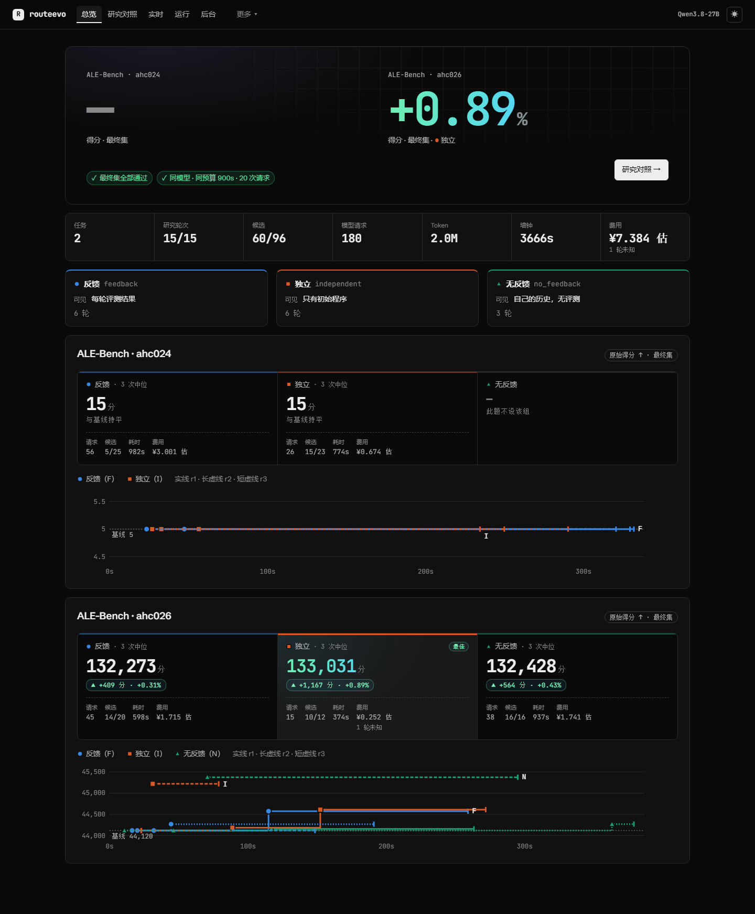
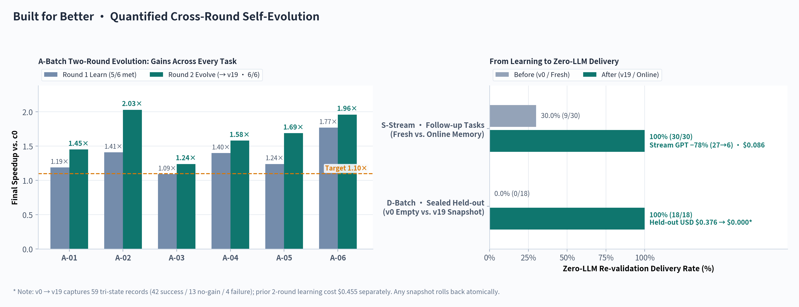
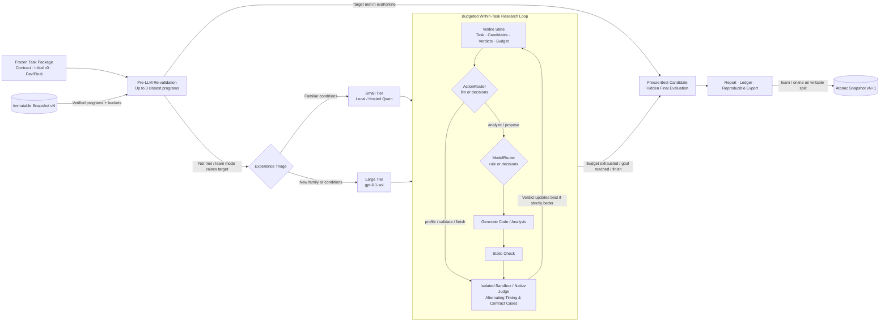
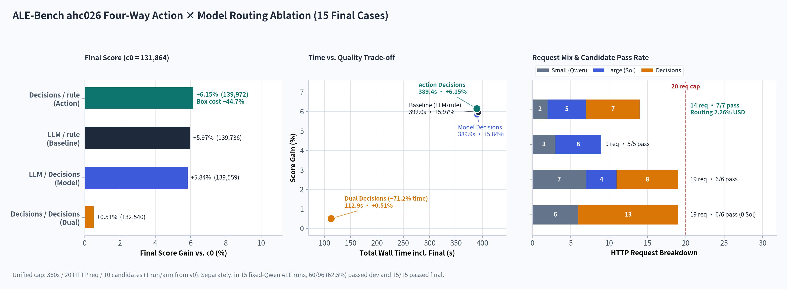
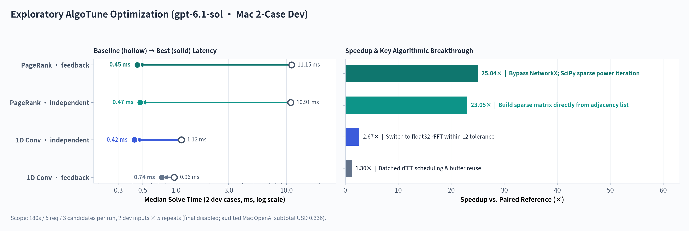
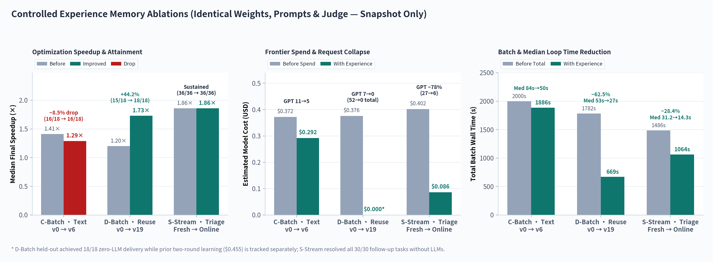
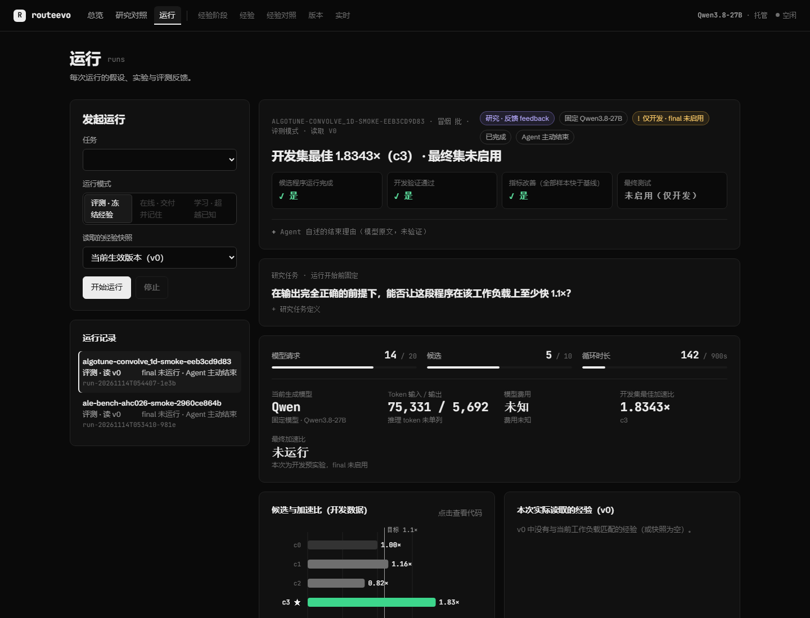
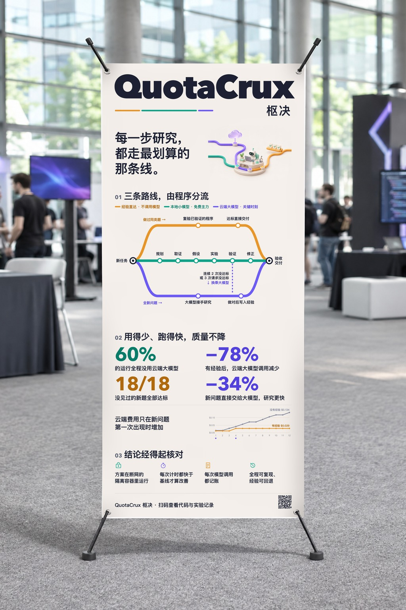

<div align="center">

# QuotaCrux

**A self-evolving, budget-aware research agent: decoupling routing decisions from generation, backing every verdict with an isolated sandbox judge, and capturing rollback-safe executable experience snapshots.**

[简体中文](README.md) · [English](README.en.md) · [Docs Index](docs/README.md) · [Research Report (PDF)](docs/research/analysis-report-20261114/output/pdf/quotacrux-research-report.pdf) · [Project Overview (PDF)](docs/presentation/project-overview.pdf) · [Poster (PDF)](docs/poster/QuotaCrux-poster.pdf) · [Slide Deck (PDF)](docs/presentation/QuotaCrux.pdf) · [Backend Guide](backend/README.md)



</div>

---

## Why QuotaCrux?

Autonomous coding and research agents typically break down in one of two ways: they either burn frontier-model quota on repetitive trial-and-error, or stall on smaller models with unstructured prose reflections that fail to generalize—and sometimes regress performance.

QuotaCrux frames algorithm and code optimization as a **budget-governed, empirically falsifiable research loop** built on three design choices:

1. **Orthogonal Action & Model Routing (`ActionRouter` × `ModelRouter`)** — Decouples *what step to take next* (analyze, propose a candidate, gather task-specific profile evidence, re-validate, or finish) from *which model tier generates the artifact* (`small` local/hosted Qwen vs. `large` `gpt-6.1-sol`). Action routing can use either the generation LLM or a dedicated decision model; model routing swaps between an escalation rule and a decision model via clean adapters. On `ALE-Bench ahc026`, `gpt-6-luna` Decisions routing accounted for just **2.26%** of recorded USD spend.
2. **Executable Program Experience, Not Prose Tips** — Early ablations established that storing prose-only advice cut API spend but *degraded* held-out speedup (`1.41× → 1.29×`). QuotaCrux persists **sandbox-verified programs paired with workload applicability conditions** in immutable snapshots (`v0, v1, …`). Incoming tasks re-validate closest past wins in Docker *before* touching any LLM, triage unseen task families directly to the large tier, and atomically publish verified improvements with instant rollback.
3. **Zero-Trust Sandbox Evaluation & Auditable Ledger** — Models never grade themselves. Candidates execute in network-disabled, read-only, non-root Docker containers (or a dedicated GPU worker for KernelBench), timed alternately against the baseline (`U = 0`), with one final pass over hidden test cases. Every model role, reasoning token, wall-clock latency, and missing billing field (`null`, never silently zeroed) lands in a reproducible ledger.

---

## Design & Inspiration: A Separate Research Decision Layer

**QuotaCrux asks a focused systems question: within a tight budget, when should an agent analyze further, test a candidate, escalate to a stronger model, or stop to maximize verified gains?** We elevate those choices into a first-class decision layer—composed independently with generation, task adaptation, and external judging—and charge decision overhead directly against the shared budget.

### A Shared Separation of Concerns with DeepSeek SuperAgent

The DeepSeek Harness team's [SuperAgent research prototype](https://github.com/deepseek-ai/dsh-superagent-prototype) separates user interaction and task dispatch (Router) from isolated execution environments and working trees (Workers), allowing orchestration and execution to manage distinct contexts and tool permissions (see its [official execution design](https://github.com/deepseek-ai/dsh-superagent-prototype/blob/main/docs/003-execution.md)).

We share that principle of **separating orchestration from execution**. While SuperAgent targets continuous team development workflows, QuotaCrux applies the boundary to single-episode budget allocation and empirical verification across three adapter seams:

- **Action adapter:** Chooses `analyze`, `propose`, `profile`, `validate`, or `finish` from visible evidence, remaining budget, and task capabilities; `profile`, `validate`, and `finish` dispatch directly to program execution without an extra generation call.
- **Model adapter:** Selects the model tier when generation is required. Both rule-based and decision-model routers enforce the same irreversible `small → large` escalation constraint, isolating *when* escalation happens as the controlled variable.
- **Task & evaluation adapter:** Translates each benchmark's objective, profiling hooks, and verifier protocol into the research loop; an independent judge determines candidate validity and true metric gain.

Because these seams isolate routing cleanly, we hold the task suite, generator weights, and budget cap fixed and vary one router at a time—directly measuring whether extra routing calls pay for themselves. Implementation details live in [Action & Model Routing](docs/design/action-model-routing.md).

### Inspiration from Jev and the Decision API Ecosystem

The decision layer also draws from **TypeSafe's Jev**: mapping `"state + typed question"` to structured choices and probabilities that application code can consume cleanly ([Jev introduction](https://docs.typesafe.ai/introduction)). QuotaCrux applies that pattern to research control flow—a dedicated decision model selects the next action or tier, a generator writes analysis or code, and the Runner validates everything inside Docker.

| Decision API example | Relevant capability | Status in this repository |
| --- | --- | --- |
| **OpenAI Decisions (`gpt-6-luna`)** | Select among supplied actions or model tiers and return structured choices + probabilities | **Integrated and exercised in the 4-way routing study**; see [client](backend/src/quotacrux/llm/openai_decisions.py) & [experiment log](docs/research/native-routing/20261114/short-results/README.md) |
| **[TypeSafe Jev](https://docs.typesafe.ai/introduction)** | Typed choices, scoring rubrics, and truth judgments composable into control flow | **Design inspiration & candidate adapter**; not integrated |
| **[Gemini Decisions (`gemini-decision-1`)](https://blog.google/innovation-and-ai/technology/developers-tools/gemini-decisions-api/)** | Evaluates closed choices, boolean predicates, and scoring criteria over shared context | **Parallel Decision API reference & candidate adapter**; not integrated |

Adding a new decision provider only requires an adapter mapping its request/response schema, validating allowed choices, and logging tokens/cost into the shared budget ledger. Current routing ablations charge both decisions and generations to one unified cap, exposing genuine quality/cost/time trade-offs (1 run per combination in the short study).

---

## Built for Better: Inspectable, Rollback-Safe Self-Evolution

Aligned with the **"Built for Better — Building Self-Evolving Intelligence"** principle, QuotaCrux turns every sandbox outcome into inspectable, diffable, rollback-safe evolutionary state—so the next run is measurably faster, cheaper, and more reliable than the last:



- **Cross-round progression to 100% attainment (`A-Batch` `v0 → v19`):** Across `A-01..A-06`, Round 1 met `5/6` speedup targets; by Round 2 (`v19`), every task improved further to **`6/6` attainment** (per-task final speedups rising from `1.09×–1.77×` to `1.24×–2.03×`; `$0.455` cumulative learning cost).
- **Verified generalization on sealed suites & live streams:** On the never-seen `D-Batch` held-out suite, switching to `v19` raised target attainment from `15/18` to **`18/18`**, median speedup from `1.20×` to **`1.73×`**, and delivered **`18/18` runs with zero LLM calls (`$0.000`)**. On `S-Stream` (seeded with `groupagg`-only `v19` plus unseen `logstats`/`intervals` tasks), QuotaCrux escalated on first encounters and solved **all `30/30` follow-up tasks with zero LLM calls** (vs. `9/30` without memory), cutting GPT requests by **78%** (`27 → 6`).
- **Within-run correction & failure-aware retrieval:** Within a single run, sandbox refutation drives deterministic escalation (e.g., `A-01`: `0.90×` refuted → format error → escalated to `gpt-6.1-sol` reading exact failure evidence to hit **`1.45×`**). Across runs, the extractor records **verified code, 5 workload features, and tri-state sandbox verdicts** (`v19` = `59` records: `42` success, `13` no-gain, `4` failure; LLM prose stays tagged as unverified hypotheses). Pre-LLM re-validation automatically skips any candidate whose prior `no_gain` or `failure` record matches closer than its `success` record.
- **Immutable snapshots, structural diffs & instant safe rollback:** Every learning step publishes an immutable snapshot (`v0, v1, …`) linked to its parent run; inspect diffs or switch the active pointer safely in the Snapshots UI or CLI with a full audit trail:
  ```bash
  uv run quotacrux snapshots list                              # List snapshot lineage, record counts, and active pointer (*)
  uv run quotacrux snapshots diff v0 v19                       # Compare added, removed, and shared experience IDs between snapshots
  uv run quotacrux snapshots activate v0 --reason "baseline"   # Safely roll back active snapshot with full audit history
  ```

---

## Architecture & Research Loop



---

## Key Results

All figures below are audited directly against run ledgers and frozen evaluation splits; each study preserves its exact evaluation scope rather than averaging across incomparable benchmarks.

### 1. Decoupled Action/Model Routing (`ALE-Bench ahc026`, Single-Run Routing Study)

Evaluated on 15 hidden final cases under a unified per-run budget (`360s` wall-clock cap, `20` total HTTP requests including routing calls, up to `10` candidates; `small` = hosted `Qwen3.8-27B`, `large` = `gpt-6.1-sol`, `Decisions` = `gpt-6-luna`; 1 run per combination from `v0`):



- **Highest final quality (`Decisions / rule`):** Reached **`139,972`** (**`+6.15%`** over `c0 = 131,864`, beating the default `LLM / rule` baseline by `+236` pts) while cutting task box-movement energy across the 15 final cases from `18,136` to `10,028` (**-44.7%**). `gpt-6.1-sol` used **46.6%** of total tokens (`68,207 / 146,253`), and `gpt-6-luna` routing cost just `$0.0068` (**2.26%** of the run's `$0.3006` recorded USD subtotal, plus 2 Qwen requests).
- **Early stopping vs. depth (`Decisions / Decisions`):** Finished **71.2% faster** (`112.9s` vs. `392.0s`) by staying on `small` and calling `finish` early (`+0.51%` score gain), making the cost/speed vs. quality trade-off explicit.
- **Fixed-Qwen ALE formal ablation (15 runs):** Across `ahc024` and `ahc026`, hosted `Qwen3.8-27B` proposed 96 candidates, with **60/96 (62.5%)** passing dev checks and **15/15** delivered candidates passing hidden final tests.
- **Two-host supplement (2026-11-14):** Four strategies (fixed `small`, fixed `large`, rule adaptation, and action Decisions) were run once each on laptop and desktop. Both fixed-small runs yielded `0%` gain, whereas the six runs using the large model gained `5.43%–6.37%`. Action Decisions split 1–1 against rule adaptation (whose laptop run ended on an API timeout), and all eight frozen deliveries passed final validation; see the [supplement report](docs/research/onehour-20261114/README.md) and [time–quality curves](docs/research/onehour-20261114/quality-time.png).

> **Boundary clarified by the two-host supplement:** Across 14 Decisions action calls, median latency was `1.34s` with an estimated total routing cost of about `$0.015`, supporting low-overhead integration. Because every call in this batch continued proposing candidates and complete searches still consumed most of the loop budget—without repeating the earlier dual-Decisions early finish—these runs do not establish end-to-end speedup or settled speed/quality modes yet.

<details>
<summary>Show raw ahc026 routing ablation table</summary>

| Action / Model Router | Final Score (`c0 = 131,864`) | vs. `c0` | Total Time (incl. final) | Requests (`small / large / Dec`) | Candidates Passed / Proposed |
| --- | ---: | ---: | ---: | ---: | ---: |
| `LLM / rule` (Baseline) | 139,736 | +5.97% | 392.0s | 3 / 6 / 0 | 5 / 5 |
| **`Decisions / rule` (Action Decisions)** | **139,972** | **+6.15%** | 389.4s | 2 / 5 / 7 | 7 / 7 |
| `LLM / Decisions` (Model Decisions) | 139,559 | +5.84% | 389.9s | 7 / 4 / 8 | 6 / 6 |
| `Decisions / Decisions` (Dual Decisions) | 132,540 | +0.51% | **112.9s** | 6 / 0 / 13 | 6 / 6 |

</details>

### 2. Exploratory AlgoTune Optimization (`gpt-6.1-sol`, Mac Dev Suite)

Conducted with fixed `gpt-6.1-sol` (`180s` / `5` requests / `3` candidates per episode, `2` dev inputs × `5` paired timing repeats, final testing disabled; audited batch OpenAI spend `USD 0.336`):



- **Graph representation breakthrough (PageRank):** Both modes eliminated NetworkX graph construction in favor of SciPy sparse power iteration, slashing solve latency from `11.15 ms` / `10.91 ms` down to **`0.45 ms` (`25.04×`)** and **`0.47 ms` (`23.05×`)**.
- **Precision-aware FFT scheduling (1D Convolution):** Switched to `float32` real FFT within the L2 tolerance and batched buffer reuse, accelerating solve latency to **`0.42 ms` (`2.67×`)** and **`0.74 ms` (`1.30×`)**.

<details>
<summary>Show raw AlgoTune Mac exploratory table</summary>

| Task | Strategy | Baseline → Best Time | Best Speedup | Key Algorithmic Change |
| --- | --- | ---: | ---: | --- |
| **PageRank** | `feedback` | `11.15 ms → 0.45 ms` | **25.04×** | Bypass NetworkX graph construction; direct SciPy sparse power iteration |
| **PageRank** | `independent` | `10.91 ms → 0.47 ms` | **23.05×** | Build sparse representation directly from adjacency input for iterative multiplication |
| **1D Convolution** | `independent` | `1.12 ms → 0.42 ms` | **2.67×** | Switch to `float32` real FFT within the specified L2 error tolerance |
| **1D Convolution** | `feedback` | `0.96 ms → 0.74 ms` | **1.30×** | Batched real FFT scheduling and buffer reuse |

</details>

### 3. Cross-Task Experience Reuse & Online Triage

Evaluated on sealed Python optimization benchmarks (3 built-in families: `groupagg`, `logstats`, `intervals`; identical model weights, prompts, and evaluators — varying *only* the experience snapshot):



- **`C-Batch` proved text-only memory can backfire:** `v6` prose advice trimmed GPT escalations slightly yet pushed median held-out speedup down **-8.5%** (`1.41× → 1.29×`), motivating executable snapshots (`v2`) and coverage triage (`v3`).
- **`D-Batch` achieved zero-LLM held-out delivery:** With `v19` (from two A-batch learning rounds), sealed held-out attainment climbed from `15/18` to **`18/18`**, median speedup jumped **+44.2%** (`1.20× → 1.73×`), total batch runtime dropped **62.5%** (`1782s → 669s`), and all 18 runs finished with **zero LLM requests (`$0.000` held-out cost; prior learning rounds cost `$0.455` separately)**.
- **`S-Stream` scaled seamlessly across unseen families:** Starting from `groupagg`-only `v19`, online evolution maintained `36/36` attainment and `1.86×` median speedup while cutting GPT calls by **78%** (`27 → 6`), USD spend from `$0.402` to **`$0.086`**, and solving **every follow-up run (`30/30`) without an LLM call**.

<details>
<summary>Show raw experience-memory controlled comparison table</summary>

| Benchmark | Comparison | Target Met | Median Final Speedup | Requests / GPT Escalations | Est. Model Cost | Zero-Model Runs | Median Loop / Total Time |
| --- | --- | ---: | ---: | ---: | ---: | ---: | ---: |
| **S-Stream** (Sealed, 12 tasks × 3 repeats, from `v19`) | Fresh `v19` → Online Memory | 36/36 → **36/36** | 1.86× → **1.86×** | 27 → **6** GPT (−78%) | `$0.402` → **`$0.086`** | 9/36 → **30/36** | 31.2s / 1486s → **14.3s / 1064s** |
| **D-Batch** (Sealed `groupagg`, 6 tasks × 3 repeats) | `v0` → `v19` (Program Reuse) | 15/18 → **18/18** | 1.20× → **1.73×** | 52 → **0** total (7 → **0** GPT) | `$0.376` → **`$0.000`**\* | 0/18 → **18/18** | 53s / 1782s → **27s / 669s** |
| **C-Batch** (Held-out `groupagg`, 6 tasks × 3 repeats) | `v0` → `v6` (Text-Only v1) | 16/18 → 16/18 | 1.41× → 1.29× | 11 → 5 GPT escalations | `$0.372` → `$0.292` | — | 84s / 2000s → 50s / 1886s |

<sub>*In `D-Batch`, two prior A-batch learning rounds from `v0` to `v19` cost `$0.455` separately. In `S-Stream`, every task after a family's first appearance (`30/30` runs) succeeded with zero LLM calls.</sub>

</details>

---

## Supported Benchmarks & Task Families

| Suite | Adapter / Module | Supported Scope | Evaluation Protocol |
| --- | --- | --- | --- |
| **Generated Families** | `families/{groupagg,logstats,intervals}.py` | CSV group-by aggregation, access-log stats, closed-interval merging (`43` hash-locked tasks in `tasks/lock.json`) | Docker sandbox, 7 public contract cases, alternating 5-round timing (`U = 0`, target ≥ `1.10×`) |
| **EffiBench-X** | `benchmarks/effibench.py` | 623 Python tasks (`io` & `functional`) from pinned HuggingFace Parquet shards | Isolated reference & evaluation containers following upstream normalization |
| **ALE-Bench** | `benchmarks/ale.py` | AtCoder Heuristic tasks `ahc024`, `ahc026` | Upstream Rust `vis` judge in separate container; raw feasibility + score |
| **AlgoTune** | `benchmarks/algotune.py` | `convolve_1d`, `pagerank` (NumPy / SciPy / NetworkX, single-threaded) | Upstream `is_solution` check + paired alternating solve timing |
| **KernelBench** | `benchmarks/kernelbench.py` | Level 1 `1_Square_matrix_multiplication_` (PyTorch / CUDA C++ `load_inline`) | Remote GPU Docker worker (`cu126`, CUDA events) + CPU tensor verifier |

---

## Quick Start

### Prerequisites

- **Python 3.12** (`3.12.11` recommended via `uv` when importing external benchmarks or rebuilding `tasks/lock.json` manifests) & [`uv`](https://docs.astral.sh/uv/)
- **Docker** (or OrbStack) running locally for isolated sandbox execution
- **Node.js + `pnpm`** (only required to build/serve the React dashboard)
- **Model endpoints:** an `OPENAI_API_KEY` (for `gpt-6.1-sol` / `gpt-6-luna`) and an OpenAI-compatible small-model endpoint (local Ollama `qwen3.8:27b-mlx` or hosted `Qwen3.8-27B`)

### 1. Install & Launch the Dashboard

```bash
cd backend
uv sync
cp .env.example .env             # Fill in OPENAI_API_KEY and QWEN_* settings
uv run quotacrux tasks build     # Rebuild frozen task packages & verify tasks/lock.json hashes

(cd ../frontend && pnpm install && pnpm build)
uv run quotacrux serve           # Open http://127.0.0.1:8000 (API docs at /docs)
```

<details>
<summary>Web Dashboard & Exhibition Poster Preview</summary>

| Run Inspector & Verdict Ledger | Exhibition Poster Mockup |
| :---: | :---: |
|  |  |

</details>

### 2. Common CLI Workflows

```bash
cd backend

# Run a single task with decoupled Decisions action routing
uv run quotacrux run B-01 --snapshot v0 --action-router decisions --model-router rule

# Deliver online while evolving snapshots, or learn serially across tasks
uv run quotacrux run B-01 --mode online --snapshot v19
uv run quotacrux learn A-01 A-02

# Run a 4-way routing ablation (llm|decisions × rule|decisions) on a frozen snapshot
uv run quotacrux ablate-routing B-01 B-02 --snapshot v0 --repeats 3

# Import & compare native benchmarks under feedback vs. independent modes
uv sync --extra benchmark --python 3.12.11
uv run quotacrux tasks import-ale-bench ahc026 --split smoke --dev-cases 2 --final-cases 3
uv run quotacrux tasks import-algotune convolve_1d --split smoke --dev-cases 2 --final-cases 3 --size 1000
uv run quotacrux research-compare <ALE_TASK_ID> <ALGOTUNE_TASK_ID> \
  --repeats 1 --wall-clock 900 --max-requests 20 --max-candidates 10 --fixed-model small --dev-only

# Export a self-contained reproducible bundle (report, best.py, raw calls, reproduce.sh)
uv run quotacrux export-run <RUN_ID> --bundle ../artifacts/<RUN_ID>

# Replay the full generated-task experiment pipeline
scripts/experiment.sh [learn|compare-b|compare-d|stream|ablation|all]

# Run the backend test suite (Docker required for sandbox tests)
uv run --extra benchmark pytest
```

---

## Repository Layout

```text
.
├── backend/
│   ├── src/quotacrux/
│   │   ├── agent/          # Research runner, prompts, ActionRouter / ModelRouter, Decisions client
│   │   ├── benchmarks/     # EffiBench-X, ALE-Bench, AlgoTune, KernelBench & native adapters
│   │   ├── families/       # Generated CSV/log/interval families, contracts, workload features
│   │   ├── llm/            # OpenAI Responses, chat-completions compat & frozen price tables
│   │   ├── sandbox/        # Isolated Docker runner & evaluator orchestration
│   │   ├── memory.py       # Immutable snapshots, deterministic retrieval, pre-LLM re-validation & triage
│   │   ├── compare.py      # Held-out & online stream controlled comparisons
│   │   ├── routing_ablation.py / research_compare.py
│   │   ├── api.py / cli.py / report.py
│   ├── scripts/            # Experiment runner, result generator, poster & deck build tools
│   ├── tasks/              # Frozen task specs and SHA256 lock.json
│   └── tests/              # Unit & Docker end-to-end tests
├── frontend/               # React + Vite + TypeScript dashboard (Overview, Research, Live, Runs, Console, Snapshots)
├── docs/                   # Docs index, design specs, requirements, presentations, posters & audited logs
├── THIRD_PARTY_NOTICES.md  # Dataset & benchmark licenses (EffiBench-X, ALE-Bench, AlgoTune, KernelBench)
├── README.md
└── README.en.md
```

---

## Documentation & Artifacts Index

| Category | Document / Artifact | Description |
| --- | --- | --- |
| **Docs Index** | [docs/README.md](docs/README.md) | Master map from competition brief → requirements → design → evaluation → acceptance |
| **Presentations & Overview** | [Project Overview (PDF)](docs/presentation/project-overview.pdf) · [Roadshow Deck (PDF)](docs/presentation/QuotaCrux.pdf) · [Technical Deck (PDF)](docs/presentation/QuotaCrux-technical.pdf) · [Demo Script](docs/presentation/demo-script.md) | System overview ([Markdown](docs/presentation/project-overview.md)), slides, and walkthrough script |
| **Posters** | [Poster (PDF)](docs/poster/QuotaCrux-poster.pdf) · [High-Res Preview](docs/poster/倍漾量化-瀚海Vastsea-枢决QuotaCrux.jpg) · [X-Banner Mockup](docs/poster/QuotaCrux-xbanner-mockup.jpg) | `80 × 180 cm` print-ready vector poster and previews |
| **Architecture & Adapters** | [Backend Guide](backend/README.md) · [Action & Model Routing](docs/design/action-model-routing.md) · [EffiBench-X Integration](docs/design/effibench-integration.md) · [Native Benchmarks](docs/design/native-benchmarks.md) | CLI / HTTP API, routing ablation protocol, EffiBench-X / ALE / AlgoTune / KernelBench setup |
| **Requirements & Acceptance** | [Product Requirements](docs/requirements/product-requirements.md) · [Core Requirements](docs/requirements/core-requirements.md) · [Acceptance Record](docs/requirements/acceptance-record.md) | Research loop specs, snapshot versioning, and RA-AC-01–08 traceability |
| **Reports & Experiments** | [Research Report (19p PDF)](docs/research/analysis-report-20261114/output/pdf/quotacrux-research-report.pdf) ([Notes](docs/research/analysis-report-20261114/README.md)) · [Mac Exploratory Archive](docs/research/mac-exploratory-20261114/README.md) · [2026-11-14 Summary](docs/research/20261114-summary.md) · [Batch Index](docs/research/README.md) · [Routing Results](docs/research/native-routing/20261114/RESULTS.md) · [ALE Results](docs/research/native-formal-20261114/ale/results/README.md) · [Memory Results](docs/archive/memory-learning-results.md) | Audited empirical reports, chart scripts, runtime rules ([legacy-runtime-rules.md](docs/archive/legacy-runtime-rules.md)), and integration logs |
| **Licensing** | [THIRD_PARTY_NOTICES.md](THIRD_PARTY_NOTICES.md) | Upstream dataset attributions and license texts in `docs/licenses/` |
