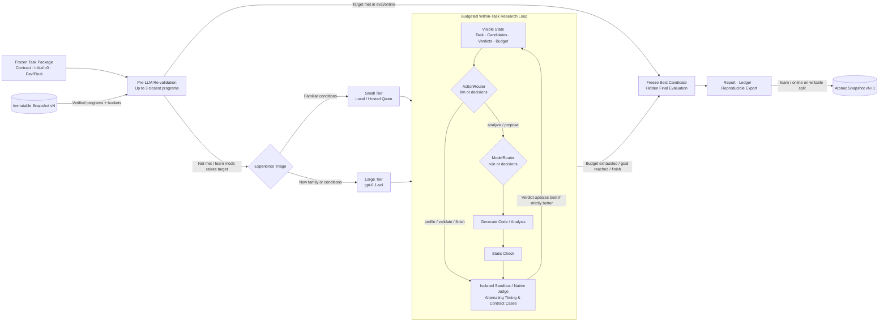

<div align="center">

# QuotaCrux

**Self-evolving, budget-aware autonomous research agent: decoupled action/model routing, zero-trust verification, and rollback-safe executable experience memory.**

[简体中文](README.md) · [English](README.en.md) · [Docs Index](docs/README.md) · [Project Overview (PDF)](docs/presentation/project-overview.pdf) · [Poster (PDF)](docs/poster/QuotaCrux-poster.pdf) · [Slide Deck (PDF)](docs/presentation/QuotaCrux.pdf) · [Backend Guide](backend/README.md)


</div>

---

## Why QuotaCrux?

Autonomous coding and research agents typically fail in two opposite ways: they either burn expensive frontier-model quota on repetitive trial-and-error, or stall on weak local models with unstructured prose reflections that fail to improve real benchmarks.

QuotaCrux treats code and algorithm optimization as a **closed-loop, budget-governed empirical research process** built around three design choices:

1. **Decoupled Routing (`ActionRouter` × `ModelRouter`)** — Separates *what step to take next* (analysis, candidate generation, task-supported evidence gathering, validation, or finish) from *which model tier generates the artifact* (`small` local/hosted Qwen vs. `large` `gpt-6.1-sol`). Action routing uses either the generation model or a dedicated decision model; model routing uses either an escalation rule or a dedicated decision model. Independent adaptors compose these choices to focus strong-model quota on difficult steps—in the `ahc026` action-decisions study, `gpt-6-luna` Decisions routing accounted for **2.26%** of recorded USD spend.
2. **Executable Experience, Not Just Text Tips** — In earlier ablations, storing text-only advice reduced API cost but *hurt* optimization quality (`1.41× → 1.29×`). QuotaCrux stores **verified programs paired with their applicability conditions** inside immutable snapshots (`v0, v1, …`). New tasks re-validate matching past programs in Docker *before* calling any LLM, escalate straight to the large model on unseen task families or conditions, and atomically publish new wins with instant rollback.
3. **Zero-Trust Sandbox Evaluation & Full Resource Ledger** — Models cannot self-grade. Every candidate is checked in an isolated, network-disabled, read-only Docker container (or a dedicated GPU worker for KernelBench), timed alternately against the baseline with strict statistical gating (`U = 0`), and verified once more on a hidden final suite. Every token, reasoning token, latency, and unknown-cost response (`null`, never silently zeroed) is preserved in a reproducible ledger.

---

## Design & Inspiration: A Separate Research Decision Layer

**QuotaCrux asks when to analyze, experiment, escalate, or stop to achieve better verified results within a fixed budget.** These choices form a separate decision layer, composed with generation, task adaptation, and external evaluation. The cost of deciding is part of the comparison.

### A Shared Separation of Concerns with DeepSeek SuperAgent

The DeepSeek Harness team's [SuperAgent research prototype](https://github.com/deepseek-ai/dsh-superagent-prototype) assigns interaction and dispatch to a Router, while Workers execute tasks in their own sessions and working directories. This division gives orchestration and execution distinct contexts and tool capabilities. See its [official execution design](https://github.com/deepseek-ai/dsh-superagent-prototype/blob/main/docs/003-execution.md).

We see a shared principle in **separating orchestration from execution**. SuperAgent focuses on ongoing collaboration around team development tasks. QuotaCrux focuses on budget allocation and evidence within a research episode, with three distinct boundaries:

- **Action adaptor:** Select analysis, candidate generation, evidence gathering, validation, or finish from options allowed by the visible evidence, remaining budget, and task capabilities. Evidence gathering, validation, and finish can go directly to program execution.
- **Model adaptor:** Select the model tier for steps requiring generation. Both rule-based and decision-model routing currently share the same irreversible `small → large` escalation constraint, allowing a comparison of escalation timing.
- **Task and evaluation adapter:** Supply each benchmark's objective, tool capabilities, and judging protocol to the loop. An independent evaluator measures candidate validity and improvement.

These boundaries let us replace action or model routing independently while holding tasks, generation models, and total budgets constant. The four-way ablation asks whether an extra decision is worth its cost. See [Action & Model Routing](docs/design/action-model-routing.md) for the implementation and protocol.

### Inspiration from Jev and the Decision API Ecosystem

The decision layer draws part of its inspiration from **TypeSafe's Jev**: map a state and typed questions to choices and probabilities that software can consume, then compose small judgments in code. QuotaCrux applies this idea to research scheduling: a dedicated decision model selects the next step, a generation model produces analysis or candidate code, and the Runner executes and verifies the result. See [Jev's official introduction](https://docs.typesafe.ai/introduction).

| Decision API example | Relevant capability | Status in this repository |
| --- | --- | --- |
| **OpenAI Decisions (`gpt-6-luna`)** | Select from supplied actions or model tiers and return choices with probabilities | **Integrated and exercised in the four-way routing study**; see the [client](backend/src/quotacrux/llm/openai_decisions.py) and [experiment record](docs/research/native-routing/20261114/short-results/README.md) |
| **[TypeSafe Jev](https://docs.typesafe.ai/introduction)** | Typed choices, scores, and truth judgments that compose into program control flow | **Design inspiration and a candidate for adaptation**; not integrated |
| **[Gemini Decisions (`gemini-decision-1`)](https://blog.google/innovation-and-ai/technology/developers-tools/gemini-decisions-api/)** | Evaluate closed choices, yes/no questions, and scoring rubrics against shared input, returning probabilistic decisions | **Another Decision API example and a candidate for adaptation**; not integrated |

A new provider requires an adaptor that maps its requests and responses, validates allowed choices, and records usage in the same ledger. Existing experiments count both routing and generation requests against one budget and expose quality, cost, and latency trade-offs; the current short routing batch contains one run per combination.

---

## Built for Better: Inspectable, Rollback-Safe Self-Evolution

Aligned with the **"Built for Better — Building Self-Evolving Intelligence"** theme principle, QuotaCrux goes beyond one-shot task completion: every verified sandbox outcome feeds back into inspectable, diffable, rollback-safe experience snapshots so subsequent runs perform faster, cheaper, and more reliably:

- **Quantitative proof that the next run beats the last**
  - **Cross-round offline evolution (`v0 → v19`):** On the sealed `D-Batch` held-out suite, two learning rounds raised target attainment from `15/18` to **`18/18`**, median final speedup from `1.20×` to **`1.73×`**, and total runtime from `1782s` down to **`669s`**, achieving **`18/18` zero-LLM / `$0.000` USD** re-validation delivery on held-out tasks (prior learning rounds cost `$0.455` separately).
  - **Live online stream evolution (`S-Stream`):** Starting from `v19` (containing only `groupagg` experience) across mixed seen and unseen task families, QuotaCrux escalated unseen families to the large tier once, captured verified code, and resolved **all `30/30` subsequent same-family tasks with zero LLM calls** (vs. `9/30` without memory), cutting overall GPT requests by **78%** (`27 → 6`) and cost from `$0.402` to `$0.086`.
  - **Within-run correction & architectural self-evolution:** Within an episode, sandbox refutation drives targeted hypothesis revision and deterministic escalation (e.g., `A-01`: `0.90×` refuted → format error → escalated to `gpt-6.1-sol` reading exact failure feedback to reach **`1.45×`**). At the system level, our `C-Batch` ablation exposed that text-only memory (`v6`) actually *reduced* speedup (`1.41× → 1.29×`), driving the evolution to `v2` executable program reuse and `v3` coverage triage.
- **Inspectable knowledge capture & failure-aware mistake avoidance**
  No opaque "it got smarter" claims. The runner deterministically records **complete verified programs, 5 workload classification features, and tri-state sandbox verdicts** (`success` / `no_gain` / `failure` — e.g., `59` records in `v19`: `42` success, `13` no-gain, `4` failure; LLM prose stays tagged as unverified hypotheses). If a candidate program has a prior `no_gain` or `failure` record closer to the current workload than any `success` record, pre-LLM re-validation skips it automatically to prevent repeated mistakes, and the ledger logs every experience ID read and published.
- **Immutable snapshots, diffs & instant safe rollback**
  Every evolution step publishes an immutable snapshot (`v0, v1, …`) linked to its parent and source run. Operators can diff snapshots and safely roll back the active pointer via the Snapshots UI or CLI at any time while keeping the full pointer audit log intact:
  ```bash
  uv run quotacrux snapshots list                              # List snapshot lineage, record counts, and active pointer (*)
  uv run quotacrux snapshots diff v0 v19                       # Compare added, removed, and shared experience IDs between snapshots
  uv run quotacrux snapshots activate v0 --reason "baseline"   # Safely roll back active snapshot with full audit history
  ```

---

## Architecture & Research Loop



---

## Key Results

All figures below are audited against run ledgers and frozen evaluation splits; each block keeps its exact evaluation scope rather than averaging across incomparable benchmarks.

### 1. Decoupled Action/Model Routing (`ALE-Bench ahc026`, Single-Run Routing Study)

Evaluated on 15 hidden final cases under a unified per-run budget (`360s` wall-clock cap, `20` total HTTP requests including routing calls, up to `10` candidates; `small` = hosted `Qwen3.8-27B`, `large` = `gpt-6.1-sol`, `Decisions` = `gpt-6-luna`; 1 run per combination from `v0`):

| Action / Model Router | Final Score (`c0 = 131,864`) | vs. `c0` | Total Time (incl. final) | Requests (`small / large / Dec`) | Candidates Passed / Proposed |
| --- | ---: | ---: | ---: | ---: | ---: |
| `LLM / rule` (Baseline) | 139,736 | +5.97% | 392.0s | 3 / 6 / 0 | 5 / 5 |
| **`Decisions / rule` (Action Decisions)** | **139,972** | **+6.15%** | 389.4s | 2 / 5 / 7 | 7 / 7 |
| `LLM / Decisions` (Model Decisions) | 139,559 | +5.84% | 389.9s | 7 / 4 / 8 | 6 / 6 |
| `Decisions / Decisions` (Dual Decisions) | 132,540 | +0.51% | **112.9s** | 6 / 0 / 13 | 6 / 6 |

- **Highest final quality (`Decisions / rule`):** Outperformed the default `LLM / rule` baseline by **+236 pts (+0.17%)** and cut task-defined box-movement cost across the 15 final cases from `18,136` to `10,028` (**-44.7%**). `gpt-6.1-sol` accounted for **46.6%** of total tokens (`68,207 / 146,253`), while Decisions routing cost `$0.0068` (**2.26%** of that run's `$0.3006` recorded USD subtotal, plus 2 Qwen requests).
- **Speed vs. quality trade-off (`Decisions / Decisions`):** Finished **71.2% faster** (`112.9s` vs. `392.0s`) by staying on the small model and calling `finish` early, yielding a smaller `+0.51%` gain — illustrating explicit budget vs. quality trade-offs.
- **Fixed-Qwen ALE formal ablation (15 runs):** Across `ahc024` and `ahc026`, hosted `Qwen3.8-27B` proposed 96 candidates, with **60/96 (62.5%)** passing dev checks and **15/15** delivered candidates passing final tests.

**Two-host supplement (2026-11-14):** Four strategies were then run once each on laptop and desktop: fixed small, fixed large, rule-based adaptation, and action Decisions. Both fixed-small runs delivered 0% gain; the six runs using the large model gained 5.43%–6.37%. Action Decisions won once and lost once against rule-based adaptation, whose laptop run ended on an API timeout. All eight frozen deliveries passed final validation. See the [supplement report](docs/research/onehour-20261114/README.md) for results and failures, and the [time–quality curves](docs/research/onehour-20261114/quality-time.png).

The added evidence refines the **time, cost, and quality trade-off**. Across 14 Decisions action calls, median latency was 1.34s and estimated routing cost totaled about $0.015, supporting adoption with limited overhead. Every call selected another candidate proposal, and the complete searches still largely used the loop budget; these results do not establish end-to-end acceleration. This batch did not repeat the earlier dual-Decisions early finish, so stable speed/quality modes remain unproven.

### 2. Exploratory AlgoTune Optimization (`gpt-6.1-sol`, Mac Dev Suite)

Conducted with fixed `gpt-6.1-sol` (`180s` / `5` requests / `3` candidates per episode, `2` dev inputs × `5` timing repeats, final test disabled; speedup measured over paired reference timings):

| Task | Strategy | Best Speedup | Key Algorithmic Change |
| --- | --- | ---: | --- |
| **PageRank** | `feedback` | **25.04×** | Bypass NetworkX graph construction; direct SciPy sparse matrix power iteration (`11.15 ms → 0.45 ms`) |
| **PageRank** | `independent` | **23.05×** | Build sparse representation directly from adjacency input for iterative multiplication |
| **1D Convolution** | `independent` | **2.67×** | Switch to `float32` real FFT within the specified L2 error tolerance (`1.12 ms → 0.42 ms`) |
| **1D Convolution** | `feedback` | **1.30×** | Batched real FFT scheduling and buffer reuse |

### 3. Cross-Task Experience Reuse & Online Triage

Evaluated on sealed Python optimization benchmarks (3 built-in task families: `groupagg`, `logstats`, `intervals`; identical model weights, prompts, and evaluators — varying *only* the experience snapshot):

| Benchmark | Comparison | Target Met | Median Final Speedup | Requests / GPT Escalations | Est. Model Cost | Zero-Model Runs | Median Loop / Total Time |
| --- | --- | ---: | ---: | ---: | ---: | ---: | ---: |
| **S-Stream** (Sealed, 12 tasks × 3 repeats, from `v19`) | Fresh `v19` → Online Memory | 36/36 → **36/36** | 1.86× → **1.86×** | 27 → **6** GPT (−78%) | $0.402 → **$0.086** | 9/36 → **30/36** | 31.2s / 1486s → **14.3s / 1064s** |
| **D-Batch** (Sealed `groupagg`, 6 tasks × 3 repeats) | `v0` → `v19` (Program Reuse) | 15/18 → **18/18** | 1.20× → **1.73×** | 52 → **0** total (7 → **0** GPT) | $0.376 → **$0.000*** | 0/18 → **18/18** | 53s / 1782s → **27s / 669s** |
| **C-Batch** (Held-out `groupagg`, 6 tasks × 3 repeats) | `v0` → `v6` (Text-Only v1) | 16/18 → 16/18 | 1.41× → 1.29× | 11 → 5 GPT escalations | $0.372 → $0.292 | — | 84s / 2000s → 50s / 1886s |

<sub>*In `D-Batch`, two prior A-batch learning rounds from `v0` to `v19` cost `$0.455` separately. In `S-Stream`, every task after a family's first appearance (`30/30` runs) succeeded with zero LLM calls.</sub>

---

## Supported Benchmarks & Task Families

| Suite | Adapter / Module | Supported Scope | Evaluation Protocol |
| --- | --- | --- | --- |
| **Generated Families** | `families/{groupagg,logstats,intervals}.py` | CSV group-by aggregation, access-log stats, closed-interval merging (`43` hash-locked tasks in `tasks/lock.json`) | Docker sandbox, 7 public contract cases, alternating 5-round timing (`U = 0`, target ≥ `1.10×`) |
| **EffiBench-X** | `benchmarks/effibench.py` | 623 Python tasks (`io` & `functional`) from pinned HuggingFace Parquet shards | Isolated reference & evaluation containers following upstream normalization |
| **ALE-Bench** | `benchmarks/ale.py` | AtCoder Heuristic tasks `ahc024`, `ahc026` | Upstream Rust `vis` judge in separate container; raw feasibility + score |
| **AlgoTune** | `benchmarks/algotune.py` | `convolve_1d`, `pagerank` (NumPy / SciPy / NetworkX, single-threaded) | Upstream `is_solution` check + paired alternating solve timing |
| **KernelBench** | `benchmarks/kernelbench.py` | Level 1 `1_Square_matrix_multiplication_` (PyTorch / CUDA C++ `load_inline`) | Remote GPU Docker worker (`cu126`, CUDA events) + CPU tensor verifier |

---

## Quick Start

### Prerequisites

- **Python 3.12** (`3.12.11` recommended via `uv` when importing external benchmarks or rebuilding `tasks/lock.json` manifests) & [`uv`](https://docs.astral.sh/uv/)
- **Docker** (or OrbStack) running locally for isolated sandbox execution
- **Node.js + `pnpm`** (only required to build/serve the React dashboard)
- **Model endpoints:** an `OPENAI_API_KEY` (for `gpt-6.1-sol` / `gpt-6-luna`) and an OpenAI-compatible small-model endpoint (local Ollama `qwen3.8:27b-mlx` or hosted `Qwen3.8-27B`)

### 1. Install & Launch the Dashboard

```bash
cd backend
uv sync
cp .env.example .env             # Fill in OPENAI_API_KEY and QWEN_* settings
uv run quotacrux tasks build     # Rebuild frozen task packages & verify tasks/lock.json hashes

(cd ../frontend && pnpm install && pnpm build)
uv run quotacrux serve           # Open http://127.0.0.1:8000 (API docs at /docs)
```

<details>
<summary>Web Dashboard & Exhibition Poster Preview</summary>

| Run Inspector & Verdict Ledger | Exhibition Poster Mockup |
| :---: | :---: |
|  |  |

</details>

### 2. Common CLI Workflows

```bash
cd backend

# Run a single task with decoupled Decisions action routing
uv run quotacrux run B-01 --snapshot v0 --action-router decisions --model-router rule

# Deliver online while evolving snapshots, or learn serially across tasks
uv run quotacrux run B-01 --mode online --snapshot v19
uv run quotacrux learn A-01 A-02

# Run a 4-way routing ablation (llm|decisions × rule|decisions) on a frozen snapshot
uv run quotacrux ablate-routing B-01 B-02 --snapshot v0 --repeats 3

# Import & compare native benchmarks under feedback vs. independent modes
uv sync --extra benchmark --python 3.12.11
uv run quotacrux tasks import-ale-bench ahc026 --split smoke --dev-cases 2 --final-cases 3
uv run quotacrux tasks import-algotune convolve_1d --split smoke --dev-cases 2 --final-cases 3 --size 1000
uv run quotacrux research-compare <ALE_TASK_ID> <ALGOTUNE_TASK_ID> \
  --repeats 1 --wall-clock 900 --max-requests 20 --max-candidates 10 --fixed-model small --dev-only

# Export a self-contained reproducible bundle (report, best.py, raw calls, reproduce.sh)
uv run quotacrux export-run <RUN_ID> --bundle ../artifacts/<RUN_ID>

# Replay the full generated-task experiment pipeline
scripts/experiment.sh [learn|compare-b|compare-d|stream|ablation|all]

# Run the backend test suite (Docker required for sandbox tests)
uv run --extra benchmark pytest
```

---

## Repository Layout

```text
.
├── backend/
│   ├── src/quotacrux/
│   │   ├── agent/          # Research runner, prompts, ActionRouter / ModelRouter, Decisions client
│   │   ├── benchmarks/     # EffiBench-X, ALE-Bench, AlgoTune, KernelBench & native adapters
│   │   ├── families/       # Generated CSV/log/interval families, contracts, workload features
│   │   ├── llm/            # OpenAI Responses, chat-completions compat & frozen price tables
│   │   ├── sandbox/        # Isolated Docker runner & evaluator orchestration
│   │   ├── memory.py       # Immutable snapshots, deterministic retrieval, pre-LLM re-validation & triage
│   │   ├── compare.py      # Held-out & online stream controlled comparisons
│   │   ├── routing_ablation.py / research_compare.py
│   │   ├── api.py / cli.py / report.py
│   ├── scripts/            # Experiment runner, result generator, poster & deck build tools
│   ├── tasks/              # Frozen task specs and SHA256 lock.json
│   └── tests/              # Unit & Docker end-to-end tests
├── frontend/               # React + Vite + TypeScript dashboard (Overview, Research, Live, Runs, Console, Snapshots)
├── docs/                   # Docs index, design specs, requirements, presentations, posters & audited logs
├── THIRD_PARTY_NOTICES.md  # Dataset & benchmark licenses (EffiBench-X, ALE-Bench, AlgoTune, KernelBench)
├── README.md
└── README.en.md
```

---

## Documentation & Artifacts Index

| Category | Document / Artifact | Description |
| --- | --- | --- |
| **Docs Index** | [docs/README.md](docs/README.md) | Master map from competition brief → requirements → design → evaluation → acceptance |
| **Presentations & Overview** | [Project Overview (PDF)](docs/presentation/project-overview.pdf) · [Technical Deck (PDF)](docs/presentation/QuotaCrux.pdf) · [PPTX](docs/presentation/QuotaCrux.pptx) · [Showcase Video](docs/video/QuotaCrux-showcase.mp4) · [Demo Script](docs/presentation/demo-script.md) | System overview ([Markdown](docs/presentation/project-overview.md)), slides, and walkthrough script |
| **Posters** | [Poster (PDF)](docs/poster/QuotaCrux-poster.pdf) · [High-Res Preview](docs/poster/倍漾量化-瀚海Vastsea-枢决QuotaCrux.jpg) · [X-Banner Mockup](docs/poster/QuotaCrux-xbanner-mockup.jpg) | `80 × 180 cm` print-ready vector poster and previews |
| **Architecture & Adapters** | [Backend Guide](backend/README.md) · [Action & Model Routing](docs/design/action-model-routing.md) · [EffiBench-X Integration](docs/design/effibench-integration.md) · [Native Benchmarks](docs/design/native-benchmarks.md) | CLI / HTTP API, routing ablation protocol, EffiBench-X / ALE / AlgoTune / KernelBench setup |
| **Requirements & Acceptance** | [Product Requirements](docs/requirements/product-requirements.md) · [Core Requirements](docs/requirements/core-requirements.md) · [Acceptance Record](docs/requirements/acceptance-record.md) | Research loop specs, snapshot versioning, and RA-AC-01–08 traceability |
| **Experiment Records** | [2026-11-14 Summary](docs/research/20261114-summary.md) · [Batch Index](docs/research/README.md) · [Routing Results](docs/research/native-routing/20261114/RESULTS.md) · [ALE Results](docs/research/native-formal-20261114/ale/results/README.md) · [Memory Results](docs/archive/memory-learning-results.md) | Audited benchmark runs, runtime rules ([legacy-runtime-rules.md](docs/archive/legacy-runtime-rules.md)), and integration log |
| **Licensing** | [THIRD_PARTY_NOTICES.md](THIRD_PARTY_NOTICES.md) | Upstream dataset attributions and license texts in `docs/licenses/` |
