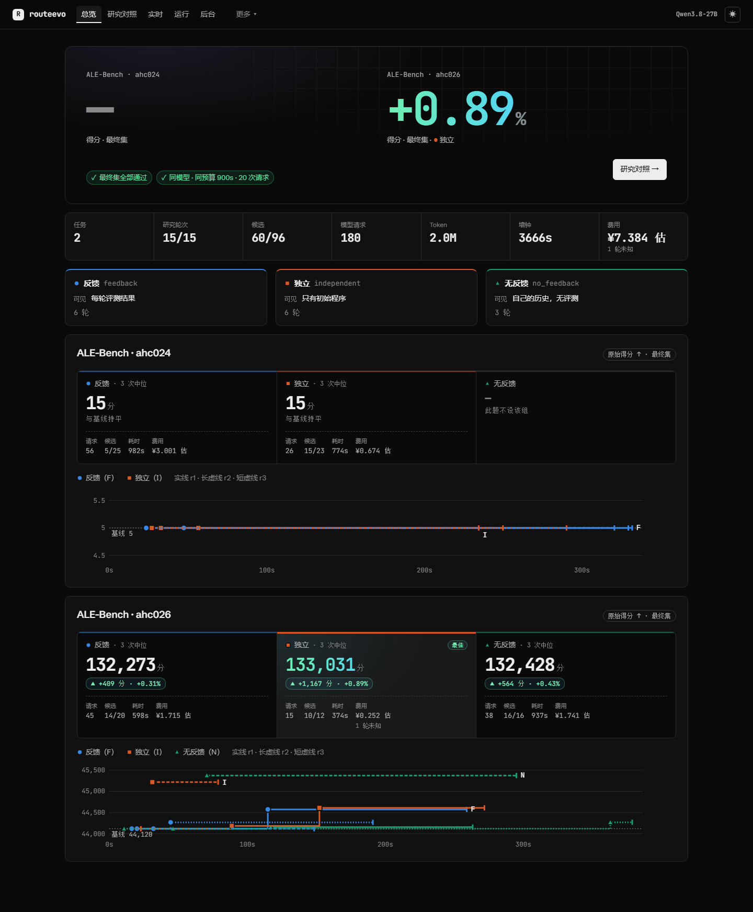
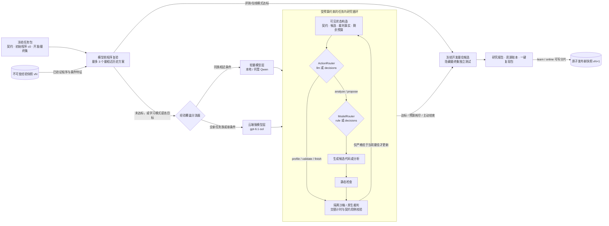
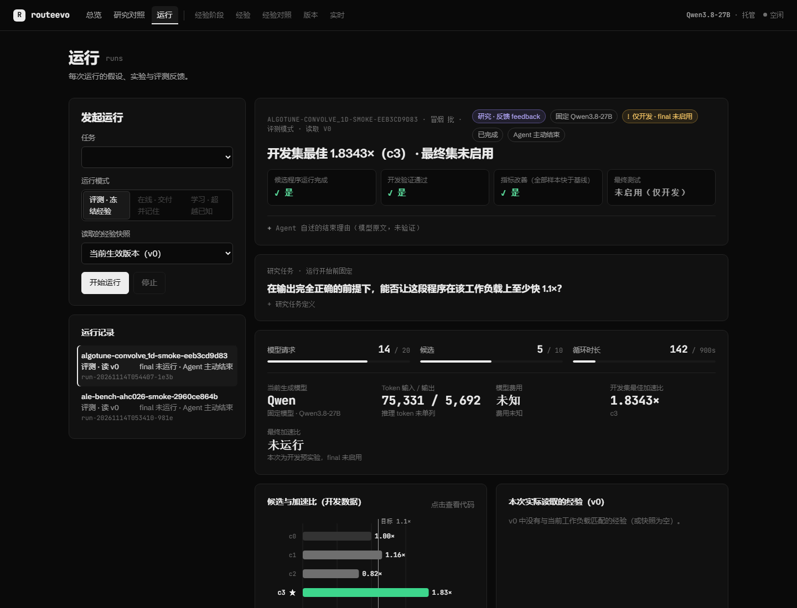
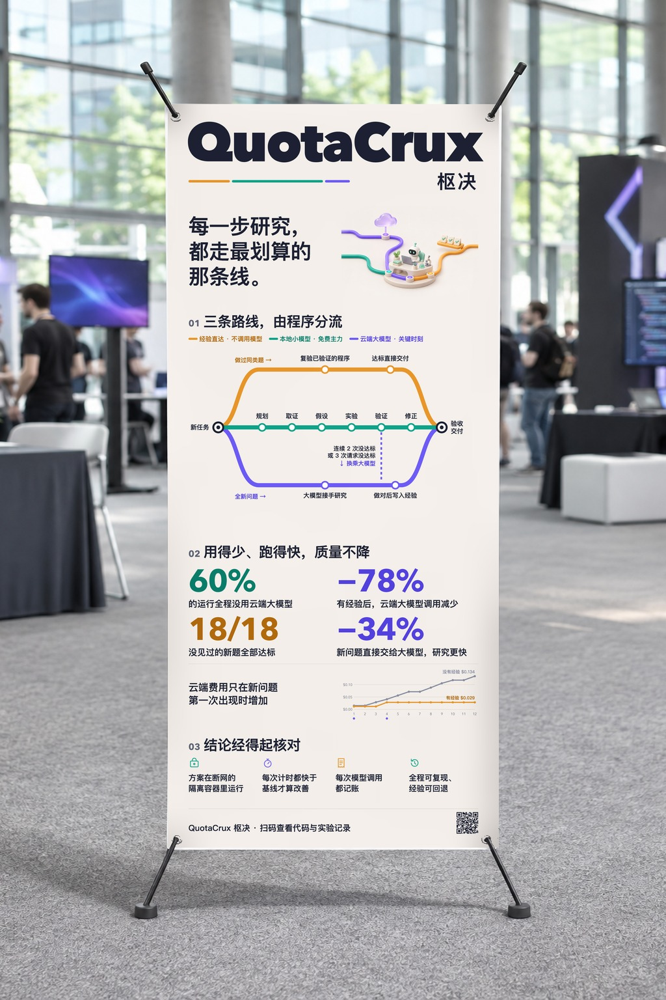

<div align="center">

# QuotaCrux（枢决）

**从反馈中自我进化的预算感知 Research Agent：动作与模型解耦路由、隔离沙箱独立裁判、可回退可执行经验快照。**

[简体中文](README.md) · [English](README.en.md) · [文档总导航](docs/README.md) · [项目介绍 (PDF)](docs/presentation/project-overview.pdf) · [展示海报 (PDF)](docs/poster/QuotaCrux-poster.pdf) · [演示文稿 (PDF)](docs/presentation/QuotaCrux.pdf) · [后端指南](backend/README.md)



</div>

---

## 为什么做 QuotaCrux？

现有的代码与研究型 Agent 在真实优化任务中常陷入两种低效困境：要么依赖昂贵的云端大模型盲目试错，把预算消耗在重复改写与无效分析上；要么受限于弱模型与纯文字经验总结，在复杂约束下原地打转甚至引入性能退步。

QuotaCrux 将算法与代码优化组织为**受预算约束、由外部裁判驱动的连续研究闭环**，核心由三大机制支撑：

1. **动作与模型解耦路由（`ActionRouter` × `ModelRouter`）** — 将“**下一步做什么**”（分析、提出候选、按任务能力取证、复验、结束）与“**这一步交给谁生成**”（本地/托管轻量模型 Qwen vs. 云端强模型 `gpt-6.1-sol`）拆分为两个正交决策点。动作层支持生成模型或专用决策模型，模型层支持升级规则或专用决策模型；两层通过 adaptor 独立组合，把强模型配额留给需要攻坚的节点——在 `ahc026` 动作决策实验中，`gpt-6-luna` Decisions 路由费用占该轮已知美元费用的 **2.26%**。
2. **可执行程序经验，而非仅存文字心得** — 早期消融证明：只存文字经验虽然更省，却让留出集最终加速比从 `1.41×` 降到 `1.29×`。QuotaCrux 在不可变经验快照（`v0, v1, …`）中保存**已验证通过的程序及其成立的工作负载条件**。遇到新任务时，程序先在调用任何模型前复验最相近的历史方案；全新任务族或新条件由分流器直接交由强模型攻坚，新成果原子发布并支持随时回退。
3. **零信任隔离裁判与完整资源账本** — 模型禁止自评。所有候选均在断网、只读文件系统、非 root 的 Docker 沙箱（或 KernelBench 独立 GPU worker）中执行；性能任务采用预热 + 5 轮交替计时与严格单侧检验（`U = 0`），研究结束后在隐藏最终集上做一次独立验收。每一次调用的模型角色、推理 Token、延迟及未知用量（显式记为 `null`，绝不伪造为 0）均完整落账并支持一键导出复现包。

---

## 设计定位与灵感：把研究决策独立出来

**QuotaCrux 探索的是：有限预算下，何时继续思考、何时动手实验、何时升级模型、何时停止，才能获得更好的可验证结果。** 我们将这些选择做成独立的决策层，与生成能力、任务适配和外部评测组合，并把决策本身的开销一起纳入比较。

### 与 DeepSeek SuperAgent 的分层思路相通

DeepSeek Harness 团队发布的 [SuperAgent 研究原型](https://github.com/deepseek-ai/dsh-superagent-prototype) 将交互与任务分派交给 Router，具体工作由拥有独立会话和工作目录的 Worker 执行。这种职责划分让调度与执行能够各自管理上下文和工具能力。[官方执行设计](https://github.com/deepseek-ai/dsh-superagent-prototype/blob/main/docs/003-execution.md)

我们将两者的相似之处归纳为**编排与执行分离**：SuperAgent 侧重团队开发任务的持续协作，QuotaCrux 侧重一次研究中的预算分配与证据反馈，将决策进一步拆成三个边界：

- **动作 adaptor：** 根据可见证据、剩余预算和合法选项，选择分析、生成候选、取证、复验或结束；取证、复验与结束可以直接交给程序执行。
- **模型 adaptor：** 为需要生成的步骤选择模型档位；当前在相同的 `small → large` 单向升级约束下，比较规则与决策模型的升级时机。
- **任务与评测 adapter：** 承接不同 benchmark 的目标、工具能力和裁判协议，将任务差异传给决策层；候选是否有效、指标是否改善，由独立裁判实测。

这些边界让我们能够保持任务、生成模型和总预算一致，单独替换动作或模型路由，通过四组消融回答“额外一次决策是否值得”。实现与协议见 [动作与模型选择设计](docs/design/action-model-routing.md)。

### Jev 的启发与 Decision API

决策层的灵感部分来自 **TypeSafe 的 Jev**：把“状态 + 类型化问题”映射为代码可直接消费的选择及概率，将小而明确的判断作为可组合的程序部件。QuotaCrux 将这一思路用于研究调度：专用决策模型选择下一步，生成模型完成分析与候选代码，Runner 执行并检验结果。[Jev 官方介绍](https://docs.typesafe.ai/introduction)

| 决策 API 示例 | 与研究决策层相关的能力 | 本仓库状态 |
| --- | --- | --- |
| **OpenAI Decisions（`gpt-6-luna`）** | 从给定动作或模型档位中选择，返回选择与概率 | **已接入并完成四组路由实验**；见 [客户端](backend/src/quotacrux/llm/openai_decisions.py) 与 [实验记录](docs/research/native-routing/20261114/short-results/README.md) |
| **[TypeSafe Jev](https://docs.typesafe.ai/introduction)** | 类型化选择、评分和真假判断，可组合进程序控制流程 | **灵感来源、可选适配方向**；尚未接入 |
| **[Gemini Decisions（`gemini-decision-1`）](https://blog.google/innovation-and-ai/technology/developers-tools/gemini-decisions-api/)** | 对共享输入评估封闭选项、真假问题与评分标准，返回概率等决策结果 | **同类 Decision API 示例、可选适配方向**；尚未接入 |

接入新的决策提供方时，需在 adaptor 内映射其请求与响应、校验合法选择，并接入同一份用量账本。现有实验已将路由与生成请求计入统一预算，展示不同决策组合的质量、成本与耗时取舍；当前路由短批为四组各一次。

---

## Built for Better：看得见、可回退的自我进化

围绕 **「Built for Better —— 打造会自我进化的智能」**，QuotaCrux 不把智能体停留在“单次完成任务”，而是让每次沙箱评测的真实反馈都沉淀为可检验、可对比、可回退的进化资产，使系统在下一次运行中表现得更快、更省、更稳：

- **前后量化对照，实证“下一次比上一次更好”**
  - **跨轮自主演进（`v0 → v19`）：** 在完全封存留出的 `D 批` 上，经过两轮自主学习演进后，达标率由 `15/18` 升至 **`18/18`**，最终加速比中位数由 `1.20×` 升至 **`1.73×`**，总耗时由 `1782s` 降至 **`669s`**，并在留出验收中实现 **`18/18` 零模型调用、`$0.000` 云端费用**直接复验交付（前置两轮学习费用另计 `$0.455`）。
  - **在线流式进化（`S 任务流`）：** 从仅含 `groupagg` 经验的 `v19` 出发，在混合未知新任务族（`logstats`、`intervals`）的连续任务流中，系统仅在首遇新族时分流强模型攻坚并沉淀方案，此后 **全部 `30/30` 后续同类任务实现零模型调用交付**（无记忆对照仅 `9/30`），整条流 GPT 请求下降 **78%**（`27 → 6`），费用由 `$0.402` 降至 `$0.086`。
  - **任务内反馈纠错与架构自我迭代：** 单次运行内沙箱反驳证据直接驱动下一步修正与规则升级（如 `A-01`：`c1` 实测 `0.90×` 被反驳 → `c2` 输出格式错误未能检验 → 触发升级由强模型读取具体反馈提出方案实现 **`1.45×`**）；系统自身亦通过 `C 批` 受控消融发现“仅存文字经验（`v6`）反使加速比从 `1.41×` 降为 `1.29×`”，从而演进为 `v2` 可执行程序复用与 `v3` 覆盖分流。
- **看得清“学到了什么”，并以失败前科规避重复犯错**
  拒绝“模型变聪明了”的黑盒叙事。每次学习由外部程序从沙箱评测中确定性提取**完整可执行代码、5 项工作负载分类特征与成功 / 无收益 / 失败三态实测事实**（如 `v19` 共沉淀 `59` 条经验：`42` 成功、`13` 无收益、`4` 失败；模型文字解释单独标记为“未验证假设”）。检索与复验同时参考成功与失败前科——若某程序存在**比其成功记录更接近当前工作负载特征的无收益或失败记录**，系统会自动跳过复验，避免重复无效试错，并在账本中写明每次读取和发布的经验编号。
- **不可变版本快照、差异审计与一键安全回退**
  每次进化以不可变快照（`v0, v1, …`）原子发布并保留父版本与来源运行记录；可在 Web 控制台「版本管理」或 CLI 中随时对比差异、零破坏安全切回任意历史版本，指针切换审计历史完整保留：
  ```bash
  uv run quotacrux snapshots list                              # 查看快照谱系、经验数与当前生效版本 (*)
  uv run quotacrux snapshots diff v0 v19                       # 对比两个快照间新增、移除与共有的经验条目
  uv run quotacrux snapshots activate v0 --reason "baseline"   # 原子切回指定快照并记录完整审计日志
  ```

---

## 系统架构与研究闭环



---

## 核心实测成果

以下数据均核对自仓库内运行账本与冻结评测记录，每组实验严格保留其测试口径与比较对象，不做跨基准平均。

### 1. 任务内决策路由消融（`ALE-Bench ahc026`）

在 15 例隐藏最终测试集上以统一预算运行四组路由组合（每轮上限 `360s`、总 HTTP 请求 `20` 次含路由决策、最多 `10` 个候选；生成 `small` 为托管 `Qwen3.8-27B`，`large` 为 `gpt-6.1-sol`，`Decisions` 为 `gpt-6-luna`；基于 `v0` 各运行 1 次）：

| 动作 / 模型路由 | 最终得分（`c0 = 131,864`） | 相对 `c0` 提升 | 单轮总耗时（含 final） | 请求数（`small / large / 决策`） | 候选通过 / 提出 |
| --- | ---: | ---: | ---: | ---: | ---: |
| `LLM / rule`（默认基线） | 139,736 | +5.97% | 392.0s | 3 / 6 / 0 | 5 / 5 |
| **`Decisions / rule`（动作决策）** | **139,972** | **+6.15%** | 389.4s | 2 / 5 / 7 | 7 / 7 |
| `LLM / Decisions`（模型决策） | 139,559 | +5.84% | 389.9s | 7 / 4 / 8 | 6 / 6 |
| `Decisions / Decisions`（双决策） | 132,540 | +0.51% | **112.9s** | 6 / 0 / 13 | 6 / 6 |

- **最高交付质量（`Decisions / rule`）：** 最终得分较默认基线高 **+236 分（+0.17%）**，并将题设 15 例箱子搬运操作代价从 `18,136` 降至 `10,028`（**-44.7%**）。该轮强模型 `gpt-6.1-sol` 占全角色总 Token 的 **46.6%**（`68,207 / 146,253`），Decisions 路由费用仅 `$0.0068`（占该轮已知美元费用 `$0.3006` 的 **2.26%**，另有 2 次 Qwen 请求）。
- **早停省时与质量取舍（`Decisions / Decisions`）：** 全程保持轻量模型并主动提前结束，单轮总耗时较基线下降 **71.2%**（`112.9s` vs. `392.0s`），同时得分提升较小（`+0.51%`），呈现出预算受限下深度搜索与主动早停之间的真实权衡。
- **固定 Qwen ALE 正式消融（15 轮）：** 托管 `Qwen3.8-27B` 在 `ahc024` / `ahc026` 上共提出 96 个候选，**60/96（62.5%）** 通过开发验证，**15/15** 最终交付候选全部通过隐藏最终集。

**双机补充对照（2026-11-14）：** 随后在 laptop / desktop 各运行固定小模型、固定大模型、规则自适应、Decisions 动作路由四组。固定小模型两格均为 0% 提升；有大模型参与的六格提升 5.43%–6.37%。Decisions 动作路由相对规则自适应一胜一负，后者 laptop 格因 API 超时结束；八份冻结交付候选均通过 final。完整数据、失败记录与[时间—质量曲线](docs/research/onehour-20261114/quality-time.png)见[双机补充报告](docs/research/onehour-20261114/README.md)。

这批证据细化了**时间、成本与质量的权衡**。14 次 Decisions 动作选择的中位耗时为 1.34 秒，路由费用估算合计约 $0.015，支持低开销的局部接入；本批全部选择继续生成候选，完整研究仍大体耗满预算，尚未证明整轮加速。旧批双 Decisions 的快速结束点没有在本批重跑，不能据此认定已有稳定的速度/质量档位。

### 2. AlgoTune 函数级优化探索（`gpt-6.1-sol` · Mac 开发测试）

固定使用 `gpt-6.1-sol`（每项上限 `180s` / `5` 次请求 / `3` 个候选，每题 `2` 个开发输入 × `5` 次计时重复，关闭最终测试；加速比为相对配对参考实现的函数执行提速）：

| 任务 | 策略 | 最佳加速比 | 关键算法变化 |
| --- | --- | ---: | --- |
| **PageRank** | `feedback` | **25.04×** | 绕过 NetworkX 图对象构建，直接转换 SciPy 稀疏矩阵执行幂迭代（`11.15 ms → 0.45 ms`） |
| **PageRank** | `independent` | **23.05×** | 从邻接表直接构建稀疏表示完成矩阵乘法迭代 |
| **一维卷积** | `independent` | **2.67×** | 在幅度/能量检查满足容限内切换 `float32` 实数 FFT（`1.12 ms → 0.42 ms`） |
| **一维卷积** | `feedback` | **1.30×** | 实数 FFT 批处理调度与缓冲区复用 |

### 3. 跨任务经验复用与在线分流（经验记忆对照）

在覆盖 3 个任务族（`groupagg`、`logstats`、`intervals`）的封存任务集上，固定模型权重、提示词与评测器，**仅更换经验快照**进行受控对照：

| 评测集 | 对照配置 | 达标率 | 最终加速比中位数 | 请求 / 升级 | 估算模型费用 | 零模型调用运行 | 循环中位数 / 总耗时 |
| --- | --- | ---: | ---: | ---: | ---: | ---: | ---: |
| **S 任务流**（封存 12 任务 × 3 次重放，起点 `v19`） | 不带记忆 → 在线记忆 | 36/36 → **36/36** | 1.86× → **1.86×** | 27 → **6** 次 GPT（−78%） | $0.402 → **$0.086** | 9/36 → **30/36** | 31.2s / 1486s → **14.3s / 1064s** |
| **D 批**（封存留出 `groupagg`，6 任务 × 3 次） | `v0` → `v19`（程序复用） | 15/18 → **18/18** | 1.20× → **1.73×** | 52 → **0** 总请求（7 → **0** GPT） | $0.376 → **$0.000*** | 0/18 → **18/18** | 53s / 1782s → **27s / 669s** |
| **C 批**（初版留出 `groupagg`，6 任务 × 3 次） | `v0` → `v6`（仅文字经验 v1） | 16/18 → 16/18 | 1.41× → 1.29× | 11 → 5 次 GPT 升级 | $0.372 → $0.292 | — | 84s / 2000s → 50s / 1886s |

<sub>*注：`D 批` 所用 `v19` 快照来自两轮 A 批学习（学习阶段另计费用 `$0.455`）。在 `S 任务流` 中，新任务族首次出现之后的所有后续任务（`30/30`）均通过程序复验实现**零模型调用直接交付**。</sub>

---

## 支持的 Benchmark 与任务族

| 基准 / 任务族 | 适配器模块 | 当前支持范围 | 评测机制 |
| --- | --- | --- | --- |
| **自建生成任务族** | `families/{groupagg,logstats,intervals}.py` | CSV 分组聚合、访问日志统计、闭区间合并（`tasks/lock.json` 锁定 43 个任务） | Docker 沙箱、7 个公开契约用例、5 轮交替计时（`U = 0`，目标 ≥ `1.10×`） |
| **EffiBench-X** | `benchmarks/effibench.py` | 固定 HuggingFace Parquet 分片中的 623 道 Python 题（`io` 与 `functional`） | 独立容器运行参考解与候选校验，遵循上游输出归一化规则 |
| **ALE-Bench** | `benchmarks/ale.py` | AtCoder Heuristic 赛题 `ahc024`、`ahc026` | 独立容器运行上游 Rust `vis` 裁判，按可行性与原始得分排序 |
| **AlgoTune** | `benchmarks/algotune.py` | `convolve_1d`、`pagerank`（单线程 NumPy / SciPy / NetworkX） | 上游 `is_solution` 数值校验 + 配对交替函数计时 |
| **KernelBench** | `benchmarks/kernelbench.py` | Level 1 `1_Square_matrix_multiplication_`（PyTorch / CUDA C++ `load_inline`） | SSH 调度远端 GPU Docker worker（`cu126`，CUDA events）+ 无 GPU 张量校验 |

---

## 快速开始

### 环境准备

- **Python 3.12**（导入外部 benchmark 或重建 `tasks/lock.json` 建议通过 `uv` 锁定 `3.12.11`）与 [`uv`](https://docs.astral.sh/uv/)
- **Docker**（或 OrbStack），运行中用于构建并拉起隔离沙箱容器
- **Node.js 与 `pnpm`**（用于构建前端可视化控制台）
- **模型配置：** `OPENAI_API_KEY`（用于 `gpt-6.1-sol` / `gpt-6-luna`）以及兼容 OpenAI 接口的轻量模型服务（本地 Ollama `qwen3.8:27b-mlx` 或托管 `Qwen3.8-27B`）

### 1. 安装依赖并启动控制台

```bash
cd backend
uv sync
cp .env.example .env             # 填写 OPENAI_API_KEY 与 QWEN_* 模型地址
uv run quotacrux tasks build     # 按 tasks/lock.json 校验并构建冻结任务包

(cd ../frontend && pnpm install && pnpm build)
uv run quotacrux serve           # 打开 http://127.0.0.1:8000（API 文档位于 /docs）
```

<details>
<summary>控制台运行界面与路演展架预览</summary>

| 研究运行与假设判定账本 | 路演展示海报（X 展架场景预览） |
| :---: | :---: |
|  |  |

</details>

### 2. 常用命令示例

```bash
cd backend

# 使用 Decisions 动作路由运行单个任务
uv run quotacrux run B-01 --snapshot v0 --action-router decisions --model-router rule

# 在线边交付边进化（自动发布新快照），或串行多任务自主学习
uv run quotacrux run B-01 --mode online --snapshot v19
uv run quotacrux learn A-01 A-02

# 在冻结快照上执行四组合路由消融（llm|decisions × rule|decisions）
uv run quotacrux ablate-routing B-01 B-02 --snapshot v0 --repeats 3

# 导入外部 Benchmark 并执行 feedback vs. independent 公平对照
uv sync --extra benchmark --python 3.12.11
uv run quotacrux tasks import-ale-bench ahc026 --split smoke --dev-cases 2 --final-cases 3
uv run quotacrux tasks import-algotune convolve_1d --split smoke --dev-cases 2 --final-cases 3 --size 1000
uv run quotacrux research-compare <ALE_TASK_ID> <ALGOTUNE_TASK_ID> \
  --repeats 1 --wall-clock 900 --max-requests 20 --max-candidates 10 --fixed-model small --dev-only

# 一键导出包含研究记录、最佳代码、原始模型请求与复核脚本的独立交付包
uv run quotacrux export-run <RUN_ID> --bundle ../artifacts/<RUN_ID>

# 重放自建任务族完整实验流水线（学习 / B 对照 / D 留出 / S 任务流 / 路由消融）
scripts/experiment.sh [learn|compare-b|compare-d|stream|ablation|all]

# 运行后端测试（含 Docker 沙箱端到端测试）
uv run --extra benchmark pytest
```

---

## 仓库结构

```text
.
├── backend/
│   ├── src/quotacrux/
│   │   ├── agent/          # 研究主循环、提示词构造、ActionRouter / ModelRouter 与 Decisions 客户端
│   │   ├── benchmarks/     # EffiBench-X、ALE-Bench、AlgoTune、KernelBench 与原生评测适配器
│   │   ├── families/       # 自建 CSV / 日志 / 区间合并任务族、契约用例与工作负载分桶
│   │   ├── llm/            # OpenAI Responses、Chat Completions 兼容层与冻结价目表
│   │   ├── sandbox/        # 隔离 Docker 沙箱与外部评测调度
│   │   ├── memory.py       # 不可变快照、确定性检索、模型前复验与经验覆盖分流
│   │   ├── compare.py      # 冻结留出对照与在线任务流评测
│   │   ├── routing_ablation.py / research_compare.py
│   │   ├── api.py / cli.py / report.py
│   ├── scripts/            # 完整实验脚本、海报与文稿生成及统计工具
│   ├── tasks/              # 任务规范与 SHA256 校验锁 tasks/lock.json
│   └── tests/              # 单元测试与 Docker 端到端测试
├── frontend/               # React + Vite + TypeScript 控制台（总览、研究对照、实时、运行、后台、版本管理）
├── docs/                   # 文档导航、设计规范、需求验收、演示文稿、海报与完整实验记录
├── THIRD_PARTY_NOTICES.md  # 第三方基准数据与代码许可声明（EffiBench-X、ALE-Bench、AlgoTune、KernelBench）
├── README.md
└── README.en.md
```

---

## 文档与交付物索引

| 类别 | 文档 / 交付物 | 说明 |
| --- | --- | --- |
| **文档总览** | [docs/README.md](docs/README.md) | 赛题 → 需求 → 设计 → 评测 → 实验 → 验收的完整导航 |
| **项目介绍与路演** | [项目介绍 (PDF)](docs/presentation/project-overview.pdf) · [技术演示文稿 (PDF)](docs/presentation/QuotaCrux.pdf) · [PPTX](docs/presentation/QuotaCrux.pptx) · [展示视频](docs/video/QuotaCrux-showcase.mp4) · [演示脚本](docs/presentation/demo-script.md) | 路演材料、技术幻灯片与现场演示流程（含 [Markdown 原文](docs/presentation/project-overview.md)） |
| **展示海报** | [展架海报 (PDF)](docs/poster/QuotaCrux-poster.pdf) · [高清预览图](docs/poster/倍漾量化-瀚海Vastsea-枢决QuotaCrux.jpg) · [X 展架场景预览](docs/poster/QuotaCrux-xbanner-mockup.jpg) | `80 × 180 cm` 印刷级矢量海报及导出预览 |
| **架构与接入设计** | [后端指南](backend/README.md) · [动作与模型路由](docs/design/action-model-routing.md) · [EffiBench-X 接入](docs/design/effibench-integration.md) · [原生 Benchmark 接入](docs/design/native-benchmarks.md) | CLI / HTTP API、四组路由消融、EffiBench-X / ALE / AlgoTune / KernelBench 协议 |
| **需求与验收** | [产品需求](docs/requirements/product-requirements.md) · [核心需求](docs/requirements/core-requirements.md) · [验收记录](docs/requirements/acceptance-record.md) | 研究闭环规则、经验与快照版本机制、RA-AC-01–08 逐条证据对照 |
| **实验数据与归档** | [2026-11-14 数据汇总](docs/research/20261114-summary.md) · [实验批次索引](docs/research/README.md) · [路由短批结果](docs/research/native-routing/20261114/RESULTS.md) · [ALE 正式结果](docs/research/native-formal-20261114/ale/results/README.md) · [经验学习结果](docs/archive/memory-learning-results.md) | 全部实验数据、运行边界（[运行时规则](docs/archive/legacy-runtime-rules.md)）与集成记录 |
| **许可与归因** | [THIRD_PARTY_NOTICES.md](THIRD_PARTY_NOTICES.md) | 上游数据集版本哈希与许可证原文（`docs/licenses/`） |
