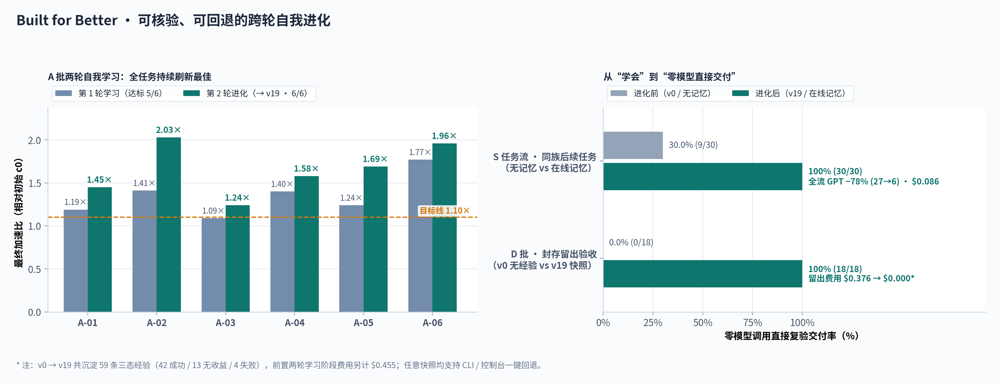
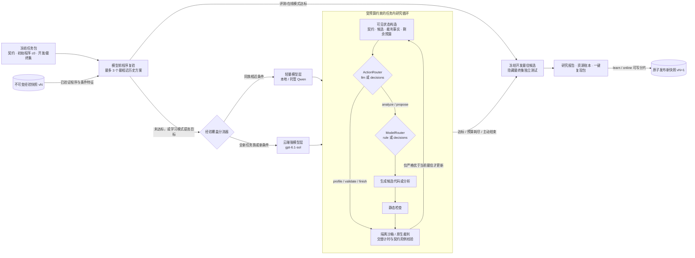
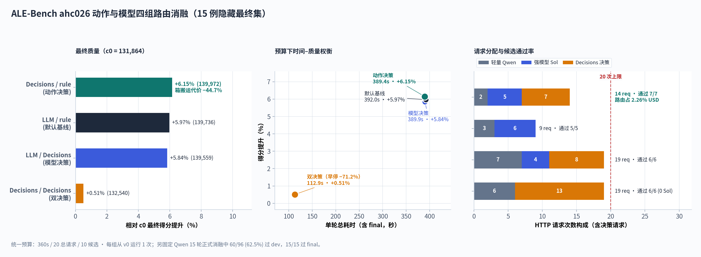
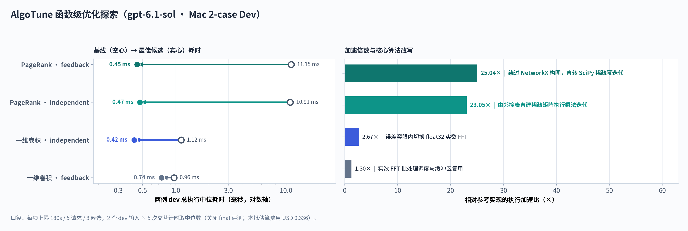
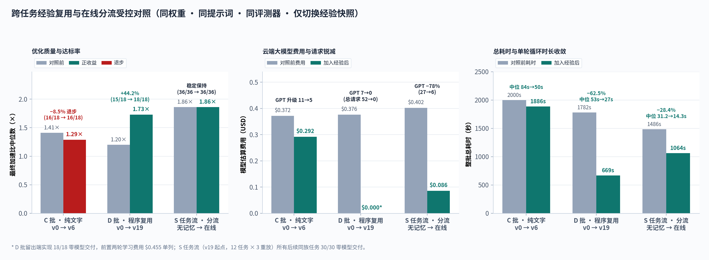

<div align="center">

# QuotaCrux（枢决）

**从反馈中自我进化的预算感知 Research Agent：将决策与生成解耦，以独立沙箱裁判、动作/模型正交路由与可回退的程序经验快照，让每次运行比上一次更快、更省、更稳。**

[简体中文](README.md) · [English](README.en.md) · [文档总导航](docs/README.md) · [研究报告 (PDF)](docs/research/analysis-report-20261114/output/pdf/quotacrux-research-report.pdf) · [项目介绍 (PDF)](docs/presentation/project-overview.pdf) · [展示海报 (PDF)](docs/poster/QuotaCrux-poster.pdf) · [演示文稿 (PDF)](docs/presentation/QuotaCrux.pdf) · [后端指南](backend/README.md)


</div>

---

## 为什么做 QuotaCrux？

现有的代码与研究型 Agent 在真实优化任务中常陷入两种低效困境：要么全程调用昂贵的云端大模型盲目试错，把配额消耗在重复改写与低价值分析上；要么依赖轻量模型配合纯文字经验总结，在复杂约束下原地打转甚至造成性能回退。

QuotaCrux 将算法与代码优化重塑为**受预算约束、由外部裁判驱动的闭环研究过程**，依托三大核心设计打破“高成本”与“低质量”的两难：

1. **动作与模型正交解耦路由（`ActionRouter` × `ModelRouter`）** — 把“**下一步做什么**”（分析、提出候选、按任务能力取证、复验、结束）与“**这一步交给谁生成**”（轻量模型 Qwen vs. 云端强模型 `gpt-6.1-sol`）拆分为两个正交决策边界。动作层可选生成模型或专用决策模型，模型层可选升级规则或专用决策模型，并通过适配器独立组合，将强模型配额精准留给关键攻坚节点——在 `ahc026` 动作决策实验中，`gpt-6-luna` Decisions 路由费用仅占该轮已知美元支出的 **2.26%**。
2. **可执行程序经验，而非只存文字心得** — 早期消融实证：只保存纯文字建议虽降低了单次调用费用，却让留出集最终加速比从 `1.41×` 滑落至 `1.29×`。QuotaCrux 在不可变经验快照（`v0, v1, …`）中沉淀**经沙箱实测通过的可执行程序及其成立的工作负载条件**。面对新任务时，程序先在调用任何模型前自动复验最相近的历史方案；全新任务族或未覆盖条件由分流器直交强模型攻坚，新成果原子发布并支持随时回退。
3. **零信任隔离裁判与全链路资源账本** — 禁止模型自评。所有候选统一在断网、只读文件系统、非 root 的 Docker 沙箱（或 KernelBench 独立 GPU worker）中运行；性能任务执行预热 + 5 轮交替计时与严格单侧检验（`U = 0`），并在研究结束时于隐藏最终集上独立验收。每一次调用的模型角色、推理 Token、耗时及未知用量（显式记为 `null`，绝不静默填 0）均完整落账，并支持一键导出可复现交付包。

---

## 设计定位与灵感：把研究决策独立出来

**QuotaCrux 聚焦一个核心工程问题：在有限预算下，何时继续分析、何时动手实验、何时升级模型、何时停止，才能换取更优的可验证结果。** 我们将这些决策从生成模型中剥离成独立的决策层，与生成、任务适配和外部评测模块正交组合，并将决策本身的开销一并纳入总预算核算。

### 与 DeepSeek SuperAgent 的分层思路相通

DeepSeek Harness 团队发布的 [SuperAgent 研究原型](https://github.com/deepseek-ai/dsh-superagent-prototype) 将交互与分派职责交给 Router，而把具体执行交给拥有独立会话和工作目录的 Worker，从而让调度与执行分别维护各自的上下文与工具权限（参见其[官方执行设计](https://github.com/deepseek-ai/dsh-superagent-prototype/blob/main/docs/003-execution.md)）。

两者共享**编排与执行分离**的架构思想：SuperAgent 面向团队开发任务的持续协同，QuotaCrux 则面向单轮研究中的预算调度与实证反馈，并将决策与适配拆为三个清晰边界：

- **动作适配器：** 依据当前可见证据、剩余预算与任务允许的工具能力，决定分析、提出候选、取证、复验或结束；其中取证、复验与结束可直接触发程序执行，无需再次请求大模型。
- **模型适配器：** 为需要生成的步骤选择模型档位；当前在统一的 `small → large` 单向升级约束下，公平对照静态规则与决策模型对升级时机的把控。
- **任务与评测适配器：** 统一封装不同 benchmark 的优化目标、工具能力与裁判协议并透传给决策层；所有候选是否合法、指标是否提升，全部交由外部独立裁判实测判定。

这一边界划分使我们得以锁定任务、生成模型与总预算，单独替换动作路由或模型路由，用四组受控消融直接回答“多花一次决策是否值得”。协议与实现细节见 [动作与模型选择设计](docs/design/action-model-routing.md)。

### Jev 的启发与 Decision API

决策层的设计同样受到 **TypeSafe 的 Jev** 启发：将“状态 + 类型化问题”映射为程序可直接消费的选项与概率分布，把小而明确的判断抽象为可组合的程序构件（参见 [Jev 官方介绍](https://docs.typesafe.ai/introduction)）。QuotaCrux 将其落地到研究调度循环中：专用决策模型选择下一步动作或模型档位，生成模型专注产出分析或候选代码，Runner 负责隔离执行与独立验真。

| 决策 API 示例 | 与研究决策层相关的能力 | 本仓库状态 |
| --- | --- | --- |
| **OpenAI Decisions（`gpt-6-luna`）** | 从给定的动作或模型档位集合中选择，返回选择结果与概率分布 | **已接入并完成四组路由消融**；见 [客户端实现](backend/src/quotacrux/llm/openai_decisions.py) 与 [实验记录](docs/research/native-routing/20261114/short-results/README.md) |
| **[TypeSafe Jev](https://docs.typesafe.ai/introduction)** | 类型化选项、评分与真假判断，可直接嵌入控制流 | **核心灵感来源与可选适配方向**；尚未接入 |
| **[Gemini Decisions（`gemini-decision-1`）](https://blog.google/innovation-and-ai/technology/developers-tools/gemini-decisions-api/)** | 基于共享上下文评估封闭选项、是非判断与评分标准，返回概率分布 | **同类 Decision API 参考与可选适配方向**；尚未接入 |

接入新的决策提供方时，只需在适配器层完成请求/响应映射、合法选项校验及用量记账即可纳入统一架构。现有实验已把决策调用与代码生成计入同一预算池，直观呈现不同组合在质量、费用与耗时上的真实取舍；当前路由短批为四组各运行 1 次。

---

## Built for Better：看得见、可回退的自我进化

围绕 **「Built for Better —— 打造会自我进化的智能」**，QuotaCrux 不把智能体停留在“单次完成任务”，而是让每次沙箱评测的真实反馈持续沉淀为可检验、可对比、可回退的进化资产，使系统在下一次运行中实打实地更快、更省、更稳：



- **两轮进化即可全数突破目标（`A 批` `v0 → v19`）：** `A-01..A-06` 在第一轮学习中 `5/6` 达标；到第二轮进化沉淀为 `v19` 后，6 个任务全数提速并实现 **`6/6` 达标**（各任务最终加速比由 `1.09×–1.77×` 跃升至 `1.24×–2.03×`，累计学习费用 `$0.455`）。
- **进化结果经得起封存留出集与在线流检验：** 在从未参与学习的封存 `D 批` 上，切换 `v19` 快照后达标率由 `15/18` 升至 **`18/18`**、中位加速比由 `1.20×` 升至 **`1.73×`**，并实现 **`18/18` 零模型调用直接交付**；在混合未知新族（`logstats`、`intervals`）的在线流 `S 任务流` 中，系统仅在首次遭遇新族时触发强模型沉淀方案，此后 **`30/30` 后续同类任务零模型调用交付**（无记忆对照仅 `9/30`），GPT 请求减少 **78%**（`27 → 6`）。
- **任务内实证纠错 + 透明三态经验库：** 在单次任务内，沙箱反驳直接驱动修正与确定性升级（如 `A-01`：`c1` 实测 `0.90×` 被否 → `c2` 格式错误 → 升级强模型定位瓶颈后达成 **`1.45×`**）。经验库则由外部程序确定性抽取**可执行程序、5 项工作负载特征与成功 / 无收益 / 失败三态裁决**（如 `v19` 含 `59` 条记录：`42` 成功、`13` 无收益、`4` 失败；模型口头分析单独标注为“未验证假设”）。当某程序存在比其成功记录更匹配当前特征的失败或无收益前科时，复验引擎自动跳过，避免在同一陷阱上反复烧钱。
- **不可变快照、差异审计与一键安全回退：** 每次进化以不可变快照（`v0, v1, …`）原子发布并记录父版本与来源运行；通过 Web 控制台「版本管理」或 CLI 随时对比差异、零破坏回退并保留完整切换审计日志：
  ```bash
  uv run quotacrux snapshots list                              # 查看快照谱系、经验条目数与当前生效版本 (*)
  uv run quotacrux snapshots diff v0 v19                       # 对比两个快照间新增、移除与共有的经验条目
  uv run quotacrux snapshots activate v0 --reason "baseline"   # 原子切回指定快照并写入完整审计日志
  ```

---

## 系统架构与研究闭环



---

## 核心实测成果

以下结果均核对自仓库运行账本与冻结评测分片，每组实验严格保持各自口径与基线对照，不做跨基准平均。

### 1. 任务内决策路由消融（`ALE-Bench ahc026`）

在 15 例隐藏最终测试集上以统一预算运行四组路由组合（每轮上限 `360s`、总 HTTP 请求 `20` 次含路由决策、最多 `10` 个候选；生成 `small` 为托管 `Qwen3.8-27B`，`large` 为 `gpt-6.1-sol`，`Decisions` 为 `gpt-6-luna`；基于 `v0` 各运行 1 次）：



- **最高交付质量（`Decisions / rule`）：** 最终得分达 **`139,972`**（较 `c0 = 131,864` 提升 **`+6.15%`**，高出 `LLM / rule` 基线 `+236` 分），并将 15 例箱子搬运操作代价从 `18,136` 压低至 `10,028`（**-44.7%**）。该轮 `gpt-6.1-sol` 占全角色总 Token 的 **46.6%**（`68,207 / 146,253`），Decisions 路由费用仅 `$0.0068`（占已知美元费用 `$0.3006` 的 **2.26%**，另有 2 次 Qwen 请求）。
- **主动早停与预算权衡（`Decisions / Decisions`）：** 全程保持轻量模型并在 `112.9s` 主动 `finish`，耗时较基线骤降 **71.2%**（vs. `392.0s`），得分温和提升 `+0.51%`，清晰反映预算受限下“深度探索”与“见好就收”的可控权衡。
- **固定 Qwen ALE 正式消融（15 轮）：** 托管 `Qwen3.8-27B` 在 `ahc024` / `ahc026` 上提出 96 个候选，**60/96（62.5%）** 通过开发验证，**15/15** 最终交付候选全数通过隐藏最终测试。
- **双机补充对照（2026-11-14）：** 随后在 laptop / desktop 各运行固定小模型、固定大模型、规则自适应与 Decisions 动作路由四组。固定小模型两格均为 `0%` 提升；有大模型参与的六格提升 `5.43%–6.37%`。Decisions 动作路由相对规则自适应一胜一负（后者 laptop 格因 API 超时结束），八份冻结交付候选均通过最终测试；完整数据、失败记录与[时间—质量曲线](docs/research/onehour-20261114/quality-time.png)见[双机补充报告](docs/research/onehour-20261114/README.md)。

> **补充证据对路由权衡的边界界定：** 在该补充批次中，14 次 Decisions 动作选择的中位延迟为 `1.34s`、估算路由费用合计约 `$0.015`，进一步验证了低开销局部接入的可行性；同时该批 Decisions 调用均倾向继续生成候选，完整搜索仍大体用满轮次预算，且未复现早先双 Decisions 的早停加速，因此尚不能认定已有稳定的“端到端加速 / 速度-质量固定档位”。

<details>
<summary>展开查看 ahc026 四组路由消融原始数据明细</summary>

| 动作 / 模型路由 | 最终得分（`c0 = 131,864`） | 相对 `c0` 提升 | 单轮总耗时（含 final） | 请求数（`small / large / 决策`） | 候选通过 / 提出 |
| --- | ---: | ---: | ---: | ---: | ---: |
| `LLM / rule`（默认基线） | 139,736 | +5.97% | 392.0s | 3 / 6 / 0 | 5 / 5 |
| **`Decisions / rule`（动作决策）** | **139,972** | **+6.15%** | 389.4s | 2 / 5 / 7 | 7 / 7 |
| `LLM / Decisions`（模型决策） | 139,559 | +5.84% | 389.9s | 7 / 4 / 8 | 6 / 6 |
| `Decisions / Decisions`（双决策） | 132,540 | +0.51% | **112.9s** | 6 / 0 / 13 | 6 / 6 |

</details>

### 2. AlgoTune 函数级优化探索（`gpt-6.1-sol` · Mac 开发测试）

固定使用 `gpt-6.1-sol`（每项上限 `180s` / `5` 次请求 / `3` 个候选，每题 `2` 个开发输入 × `5` 次配对交替计时，关闭最终测试；全批审计 OpenAI 估算费用 `USD 0.336`）：



- **图结构重构突破（PageRank）：** 在独立运行与反馈驱动两种模式下均发现了绕开 NetworkX 图对象构造的稀疏幂迭代重构，将中位总耗时从 `11.15 ms` / `10.91 ms` 压低至 **`0.45 ms`（`25.04×`）** 与 **`0.47 ms`（`23.05×`）**。
- **数值精度换吞吐（一维卷积）：** 在满足参考解 L2 误差容限的前提下，自主完成单线程实时卷积到 `float32` 实数 FFT 及批处理缓冲区复用的切换，将耗时分别降至 **`0.42 ms`（`2.67×`）** 与 **`0.74 ms`（`1.30×`）**。

<details>
<summary>展开查看 AlgoTune Mac 探索测试原始数据明细</summary>

| 任务 | 策略 | 基线 → 最佳耗时 | 最佳加速比 | 关键算法变化 |
| --- | --- | ---: | ---: | --- |
| **PageRank** | `feedback` | `11.15 ms → 0.45 ms` | **25.04×** | 绕过 NetworkX 图对象构建，直转 SciPy 稀疏矩阵执行幂迭代 |
| **PageRank** | `independent` | `10.91 ms → 0.47 ms` | **23.05×** | 从邻接表直接构建稀疏矩阵完成乘法迭代 |
| **一维卷积** | `independent` | `1.12 ms → 0.42 ms` | **2.67×** | 在误差容限内切换 `float32` 实数 FFT |
| **一维卷积** | `feedback` | `0.96 ms → 0.74 ms` | **1.30×** | 实数 FFT 批处理调度与缓冲区复用 |

</details>

### 3. 跨任务经验复用与在线分流（经验记忆对照）

在覆盖 3 个任务族（`groupagg`、`logstats`、`intervals`）的封存任务集上，锁定模型权重、提示词与沙箱裁判，**仅切换经验快照**进行三组受控消融：



- **`C 批` 反证“只存文字不可靠”：** `v6` 纯文字经验虽略微减少了强模型升级，却让中位加速比从 `1.41×` 逆向跌至 `1.29×`（`-8.5%`），直接促成可执行程序快照与工作负载分流的设计演进。
- **`D 批` 封存留出复验归零：** 基于两轮 A 批学习沉淀的 `v19` 快照，留出集达标率由 `15/18` 升至 **`18/18`**、中位加速比由 `1.20×` 跃至 **`1.73×`**（`+44.2%`），总耗时缩减 **`62.5%`**（`1782s → 669s`），全部 18 次留出运行实现**零 LLM 请求、`$0.000` 云端支出**（前置学习费用另计 `$0.455`）。
- **`S 任务流` 新老任务混合在线自进化：** 以仅含 `groupagg` 经验的 `v19` 起步，系统在高加速比（`1.86×`）与满分达标率（`36/36`）不降反稳的前提下，将 GPT 请求锐减 **78%**（`27 → 6`），云端支出从 `$0.402` 降至 **`$0.086`**，所有新族首现之后的 **`30/30` 后续任务**均零模型调用直接交付。

<details>
<summary>展开查看三组经验记忆受控对照原始数据明细</summary>

| 评测集 | 对照配置 | 达标率 | 最终加速比中位数 | 请求 / 升级 | 估算模型费用 | 零模型调用运行 | 循环中位数 / 总耗时 |
| --- | --- | ---: | ---: | ---: | ---: | ---: | ---: |
| **S 任务流**（封存 12 任务 × 3 次重放，起点 `v19`） | 不带记忆 → 在线记忆 | 36/36 → **36/36** | 1.86× → **1.86×** | 27 → **6** 次 GPT（−78%） | `$0.402` → **`$0.086`** | 9/36 → **30/36** | 31.2s / 1486s → **14.3s / 1064s** |
| **D 批**（封存留出 `groupagg`，6 任务 × 3 次） | `v0` → `v19`（程序复用） | 15/18 → **18/18** | 1.20× → **1.73×** | 52 → **0** 总请求（7 → **0** GPT） | `$0.376` → **`$0.000`**\* | 0/18 → **18/18** | 53s / 1782s → **27s / 669s** |
| **C 批**（初版留出 `groupagg`，6 任务 × 3 次） | `v0` → `v6`（仅文字经验 v1） | 16/18 → 16/18 | 1.41× → 1.29× | 11 → 5 次 GPT 升级 | `$0.372` → `$0.292` | — | 84s / 2000s → 50s / 1886s |

<sub>*注：`D 批` 所用 `v19` 快照来自两轮 A 批学习（学习阶段另计费用 `$0.455`）。在 `S 任务流` 中，新任务族首次出现之后的所有后续任务（`30/30`）均通过程序复验实现零模型调用直接交付。</sub>

</details>

---

## 支持的 Benchmark 与任务族

| 基准 / 任务族 | 适配器模块 | 当前支持范围 | 评测机制 |
| --- | --- | --- | --- |
| **自建生成任务族** | `families/{groupagg,logstats,intervals}.py` | CSV 分组聚合、访问日志统计、闭区间合并（`tasks/lock.json` 锁定 43 个任务） | Docker 沙箱、7 个公开契约用例、5 轮交替计时（`U = 0`，目标 ≥ `1.10×`） |
| **EffiBench-X** | `benchmarks/effibench.py` | 固定 HuggingFace Parquet 分片中的 623 道 Python 题（`io` 与 `functional`） | 独立容器运行参考解与候选校验，遵循上游输出归一化规则 |
| **ALE-Bench** | `benchmarks/ale.py` | AtCoder Heuristic 赛题 `ahc024`、`ahc026` | 独立容器运行上游 Rust `vis` 裁判，按可行性与原始得分排序 |
| **AlgoTune** | `benchmarks/algotune.py` | `convolve_1d`、`pagerank`（单线程 NumPy / SciPy / NetworkX） | 上游 `is_solution` 数值校验 + 配对交替函数计时 |
| **KernelBench** | `benchmarks/kernelbench.py` | Level 1 `1_Square_matrix_multiplication_`（PyTorch / CUDA C++ `load_inline`） | SSH 调度远端 GPU Docker worker（`cu126`，CUDA events）+ 无 GPU 张量校验 |

---

## 快速开始

### 环境准备

- **Python 3.12**（导入外部 benchmark 或重建 `tasks/lock.json` 建议通过 `uv` 锁定 `3.12.11`）与 [`uv`](https://docs.astral.sh/uv/)
- **Docker**（或 OrbStack），运行中用于构建并拉起隔离沙箱容器
- **Node.js 与 `pnpm`**（用于构建前端可视化控制台）
- **模型配置：** `OPENAI_API_KEY`（用于 `gpt-6.1-sol` / `gpt-6-luna`）以及兼容 OpenAI 接口的轻量模型服务（本地 Ollama `qwen3.8:27b-mlx` 或托管 `Qwen3.8-27B`）

### 1. 安装依赖并启动控制台

```bash
cd backend
uv sync
cp .env.example .env             # 填写 OPENAI_API_KEY 与 QWEN_* 模型地址
uv run quotacrux tasks build     # 按 tasks/lock.json 校验并构建冻结任务包

(cd ../frontend && pnpm install && pnpm build)
uv run quotacrux serve           # 打开 http://127.0.0.1:8000（API 文档位于 /docs）
```

<details>
<summary>控制台运行界面与路演展架预览</summary>

| 研究运行与假设判定账本 | 路演展示海报（X 展架场景预览） |
| :---: | :---: |
|  |  |

</details>

### 2. 常用命令示例

```bash
cd backend

# 使用 Decisions 动作路由运行单个任务
uv run quotacrux run B-01 --snapshot v0 --action-router decisions --model-router rule

# 在线边交付边进化（自动发布新快照），或串行多任务自主学习
uv run quotacrux run B-01 --mode online --snapshot v19
uv run quotacrux learn A-01 A-02

# 在冻结快照上执行四组合路由消融（llm|decisions × rule|decisions）
uv run quotacrux ablate-routing B-01 B-02 --snapshot v0 --repeats 3

# 导入外部 Benchmark 并执行 feedback vs. independent 公平对照
uv sync --extra benchmark --python 3.12.11
uv run quotacrux tasks import-ale-bench ahc026 --split smoke --dev-cases 2 --final-cases 3
uv run quotacrux tasks import-algotune convolve_1d --split smoke --dev-cases 2 --final-cases 3 --size 1000
uv run quotacrux research-compare <ALE_TASK_ID> <ALGOTUNE_TASK_ID> \
  --repeats 1 --wall-clock 900 --max-requests 20 --max-candidates 10 --fixed-model small --dev-only

# 一键导出包含研究记录、最佳代码、原始模型请求与复核脚本的独立交付包
uv run quotacrux export-run <RUN_ID> --bundle ../artifacts/<RUN_ID>

# 重放自建任务族完整实验流水线（学习 / B 对照 / D 留出 / S 任务流 / 路由消融）
scripts/experiment.sh [learn|compare-b|compare-d|stream|ablation|all]

# 运行后端测试（含 Docker 沙箱端到端测试）
uv run --extra benchmark pytest
```

---

## 仓库结构

```text
.
├── backend/
│   ├── src/quotacrux/
│   │   ├── agent/          # 研究主循环、提示词构造、ActionRouter / ModelRouter 与 Decisions 客户端
│   │   ├── benchmarks/     # EffiBench-X、ALE-Bench、AlgoTune、KernelBench 与原生评测适配器
│   │   ├── families/       # 自建 CSV / 日志 / 区间合并任务族、契约用例与工作负载分桶
│   │   ├── llm/            # OpenAI Responses、Chat Completions 兼容层与冻结价目表
│   │   ├── sandbox/        # 隔离 Docker 沙箱与外部评测调度
│   │   ├── memory.py       # 不可变快照、确定性检索、模型前复验与经验覆盖分流
│   │   ├── compare.py      # 冻结留出对照与在线任务流评测
│   │   ├── routing_ablation.py / research_compare.py
│   │   ├── api.py / cli.py / report.py
│   ├── scripts/            # 完整实验脚本、海报与文稿生成及统计工具
│   ├── tasks/              # 任务规范与 SHA256 校验锁 tasks/lock.json
│   └── tests/              # 单元测试与 Docker 端到端测试
├── frontend/               # React + Vite + TypeScript 控制台（总览、研究对照、实时、运行、后台、版本管理）
├── docs/                   # 文档导航、设计规范、需求验收、演示文稿、海报与完整实验记录
├── THIRD_PARTY_NOTICES.md  # 第三方基准数据与代码许可声明（EffiBench-X、ALE-Bench、AlgoTune、KernelBench）
├── README.md
└── README.en.md
```

---

## 文档与交付物索引

| 类别 | 文档 / 交付物 | 说明 |
| --- | --- | --- |
| **文档总览** | [docs/README.md](docs/README.md) | 赛题 → 需求 → 设计 → 评测 → 实验 → 验收的完整导航 |
| **项目介绍与路演** | [项目介绍 (PDF)](docs/presentation/project-overview.pdf) · [演示文稿 (PDF)](docs/presentation/QuotaCrux.pdf) · [技术汇报 (PDF)](docs/presentation/QuotaCrux-technical.pdf) · [演示脚本](docs/presentation/demo-script.md) | 路演材料、技术幻灯片与现场演示流程（含 [Markdown 原文](docs/presentation/project-overview.md)） |
| **展示海报** | [展架海报 (PDF)](docs/poster/QuotaCrux-poster.pdf) · [高清预览图](docs/poster/倍漾量化-瀚海Vastsea-枢决QuotaCrux.jpg) · [X 展架场景预览](docs/poster/QuotaCrux-xbanner-mockup.jpg) | `80 × 180 cm` 印刷级矢量海报及导出预览 |
| **架构与接入设计** | [后端指南](backend/README.md) · [动作与模型路由](docs/design/action-model-routing.md) · [EffiBench-X 接入](docs/design/effibench-integration.md) · [原生 Benchmark 接入](docs/design/native-benchmarks.md) | CLI / HTTP API、四组路由消融、EffiBench-X / ALE / AlgoTune / KernelBench 协议 |
| **需求与验收** | [产品需求](docs/requirements/product-requirements.md) · [核心需求](docs/requirements/core-requirements.md) · [验收记录](docs/requirements/acceptance-record.md) | 研究闭环规则、经验与快照版本机制、RA-AC-01–08 逐条证据对照 |
| **实验数据与报告** | [研究实验报告 (19 页 PDF)](docs/research/analysis-report-20261114/output/pdf/quotacrux-research-report.pdf)（[说明](docs/research/analysis-report-20261114/README.md)） · [Mac 探索归档](docs/research/mac-exploratory-20261114/README.md) · [2026-11-14 数据汇总](docs/research/20261114-summary.md) · [实验批次索引](docs/research/README.md) · [路由短批结果](docs/research/native-routing/20261114/RESULTS.md) · [ALE 正式结果](docs/research/native-formal-20261114/ale/results/README.md) · [经验学习结果](docs/archive/memory-learning-results.md) | 全部实证实验报告、图表复现脚本、运行边界（[运行时规则](docs/archive/legacy-runtime-rules.md)）与集成记录 |
| **许可与归因** | [THIRD_PARTY_NOTICES.md](THIRD_PARTY_NOTICES.md) | 上游数据集版本哈希与许可证原文（`docs/licenses/`） |
