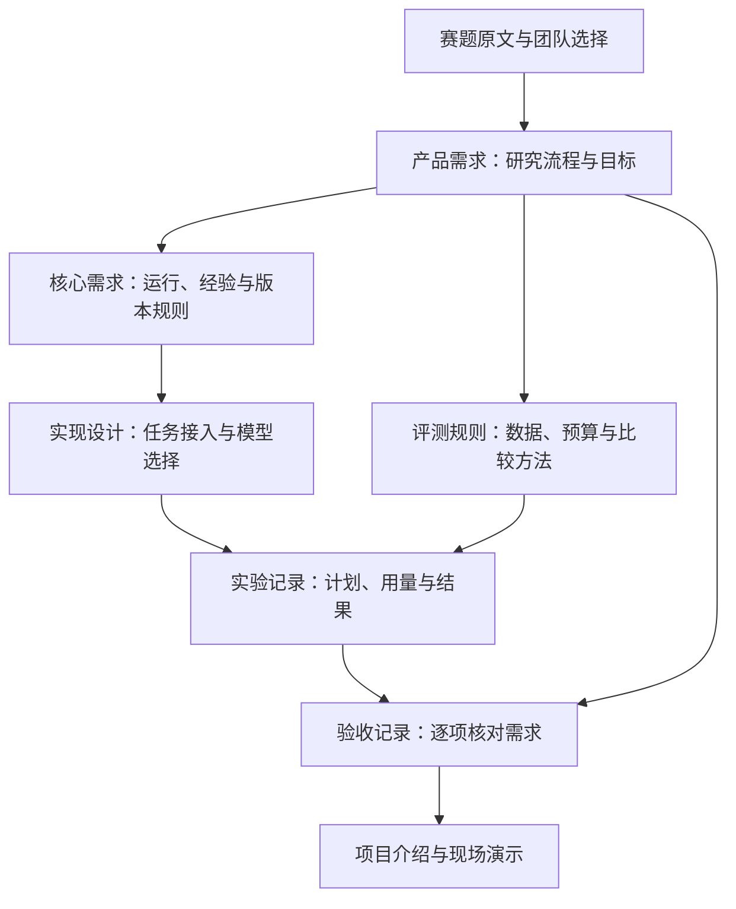

# RouteEvo 文档导航

第一次了解项目，从[项目介绍](presentation/project-overview.md)开始。开发时按“赛题 → 产品需求 → 核心需求 → 设计 → 评测 → 结果 → 验收”查阅。

## 文档之间的关系

## 每份文档负责什么

| 顺序 | 入口 | 回答的问题 |
| --- | --- | --- |
| 1 | [赛题原文与团队选择](requirements/competition-brief.md) | 比赛要求什么，团队选了什么？ |
| 2 | [产品需求](requirements/product-requirements.md) | 系统要完成什么研究流程，怎样验收？ |
| 3 | [核心需求](requirements/core-requirements.md) | 任务、运行、经验记录和版本怎样工作？ |
| 4 | [实现设计](design/README.md) | 评测任务怎样接入，动作和模型怎样选择？ |
| 5 | [评测入口](evaluation/README.md) | 数据、预算、候选选择和计时规则是什么？ |
| 6 | [实验批次与结果](research/README.md) | 实际运行了什么，结果与原始记录在哪里？ |
| 7 | [验收记录](requirements/acceptance-record.md) | 每项需求对应哪些实现和实验依据？ |
| 展示 | [项目介绍与演示材料](presentation/README.md) | 怎样向观众介绍和演示？ |
| 历史 | [旧方案与早期结果](archive/README.md) | 过去为什么这样设计，后来改了什么？ |

## 按工作查找

- 运行项目：[仓库首页](../README.md)、[后端命令与 API](../backend/README.md)。
- 正式对照：[协议 v2](research/native-formal-20261114/protocol.md)、[30项计划](research/native-formal-20261114/central-plan.json)、[Mac执行交接](research/native-formal-20261114/mac-handoff.md)。
- 查看研究过程：[案例索引](research/case-studies.md)；查看总体结果：[实验批次索引](research/README.md)。
- 提交材料：[展示材料](presentation/README.md)、[海报](poster/)、[第三方说明](../THIRD_PARTY_NOTICES.md)与[许可文本](licenses/)。

## 维护方式

需求写目标和规则，设计写实现方法，批次记录写实际设置和结果，验收表引用这些记录。展示材料从它们提炼内容，旧方案统一进入 `archive/`。

新文档按上述职责放置，文件名说明主题。实验批次按日期保存，保留原始文件和 `SHA256SUMS`。重命名时同步更新引用和生成脚本；修改 Markdown 后按需重新导出 PDF/PPTX。
