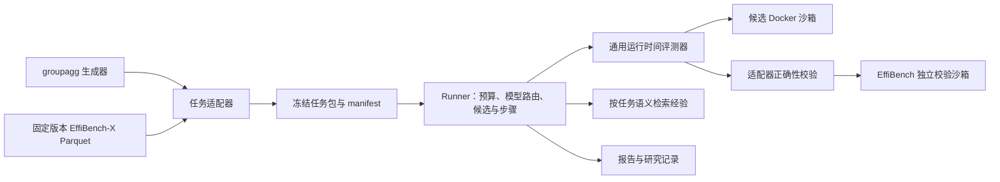

# Benchmark 解耦与 EffiBench-X 接入

实现分支：`feat/effibench-x-adapter`；基线：`f8fbb3e`。本次把任务语义从研究执行循环中拆出，并加入 EffiBench-X 的 Python 导入入口。

## 1. 当前架构与边界



| 边界 | 实现 | 负责内容 |
| --- | --- | --- |
| 任务包 | `taskpkg.py` | 文件哈希、不可变注册、加载与复现入口 |
| 题目适配器 | `benchmarks/groupagg.py`、`benchmarks/effibench.py` | 用例、正确性、公开契约、工作负载特征、经验兼容性、展示说明 |
| 通用评测 | `evaluator.py` | 每用例独立执行、预热、交替计时、结果状态与持久化 |
| 研究循环 | `agent/runner.py` | 预算、模型升级、提出/验证候选、冻结最佳产物、经验发布 |
| 任务上下文 | `agent/prompt.py` | 公共动作规则；题目特有约束来自适配器 |
| 报告和页面 | `report.py`、`research.py`、任务选择器 | 使用适配器的题名、工作负载、基线与验证说明 |

两个任务族都属于 CPU Python 程序性能优化，因此共用现有 speedup、候选选择和停止规则。此次没有引入多指标框架。机器学习分类和 GPU 算子是赛题允许的其他场景；若以后接入，需新增相应运行环境、目标指标、候选排序和停止策略，不能直接套用当前的时间比值。

原有 groupagg 生成代码与 manifest 内容保留，A/B/C/D 的任务锁不变。七个公开契约用例和五维检索特征移入其适配器。评测器、提示词、检索与经验提取版本已更新，旧版本与新版本运行的配置指纹不同。

## 2. 数据集规模与固定来源

数据集：[EffiBench/effibench-x](https://huggingface.co/datasets/EffiBench/effibench-x)。固定 revision：`49babbec95f0897d5f06276aaf274f9f1dcd036b`。

| 项目 | 核实结果 |
| --- | --- |
| 题目数 | 623，全部带 Python 参考解 |
| 接口类型 | 285 个 `io`，338 个 `functional`；全部 functional 题带 Python runner |
| 来源 | Aizu 33、AtCoder 149、CodeChef 93、Codeforces 10、LeetCode 338 |
| 上游 split | 只有 `test`；RouteEvo 的 A/B/C/D 是本地实验划分 |
| 分片 | 20 个 Parquet，合计 **2,341,977,516 bytes**，约 **2.34 GB / 2.18 GiB** |
| 用例数 | 官方说明每题 100 个；导入时记录实际条数并去除重复输入 |

题目目录、分片大小和 SHA256 在 `backend/src/routeevo/benchmarks/effibench_catalog.json`。规模与 Python 覆盖通过读取全部 20 个分片的元数据和选定列核实；没有把 2.34 GB 数据放进 Git。压缩文件大小不等于内存开销；部分题目的测试字符串很大，导入时需要解压所在分片。

上游运行逻辑参考 [EffiBench-X `21b6668a`](https://github.com/EffiBench/EffiBench-X/tree/21b6668a49a342c843e679cc5ed16081064a5768)，相关许可证及修改说明见 [第三方说明](../THIRD_PARTY_NOTICES.md)。

## 3. 接入协议

- **优化对象**：从数据集已有 Python 参考解开始。`io` 直接作为程序；`functional` 把参考解嵌入该题 Python runner，补入上游标准库导入项，成为完整 stdin/stdout 程序。候选继续提交完整程序。
- **支持范围**：Python 3.12 标准库、当前 20,000 字节代码上限和既有 Docker 资源限制。需要 `sortedcontainers` 等第三方库的题目明确拒绝，目录中有参考解不代表 623 题都已执行验证。
- **数据划分**：同一输入重复出现时去重；若期望输出冲突则拒绝。按输入 SHA256 排序，默认前 20 个为 dev，其余为 final。`--case-limit` 可指定试接入子集，子集数量和原始用例 ID 写入 manifest。该划分是固定、可复现的工程选择，未按难度分层。
- **模型可见数据**：题目、初始程序、dev 概况和最多两个小型 dev 例子。候选容器只接收单个测试输入；final 数据和 checker 不进入模型上下文。
- **正确性**：使用数据集的 `evaluate`，调用顺序和文本归一化遵循上述上游版本实际代码，即 `evaluate(actual, expected)`，不根据函数形参名称猜测。checker 在单独的无网络、只读 Docker 沙箱执行；异常、超时或非法返回明确记作 `checker_error`，不写成候选失败经验。
- **性能**：每个 case 使用全新容器；一轮计时为该 suite 各用例运行时间之和，校验器执行时间不计入候选耗时。单轮累计 stdout 也受现有输出预算限制，避免多用例放大输出内存占用。基线和候选各预热一轮，交替运行 5 轮，用两组总时间的中位数之比作为 speedup；每个计时轮仍检查输出。全部候选轮快于全部基线轮且 speedup ≥ 1.10 才达标。
- **证据工具**：cProfile 使用第一个 dev case，反馈注明 case ID 和 dev 总数。
- **经验隔离**：EffiBench 的 problem、数据 revision、checker、runner、适配版本和 dev 输入划分共同组成兼容键。只检索/复验同一兼容键的经验，避免跨题误用完整解法，也避免改变 dev 划分后将已见输入带入新的 final。groupagg 保留原有跨工作负载复用。

这是 **RouteEvo 的参考程序优化实验**。它没有复刻官方的代码生成、内存/时间综合评分和排名协议，结果不能作为 EffiBench-X 官方分数。当前的严格经验隔离也意味着：跨新题的迁移收益尚未被证明，不能把同题代码复用解释为跨题学习。

## 4. 使用方式

在仓库 `backend/` 下运行。保留 groupagg 任务锁时使用 Python **3.12.11**。

```bash
uv sync --extra benchmark --python 3.12.11

# 每题只下载所在分片，缓存到当前 ROUTEEVO_VAR_DIR/benchmarks/。
# 下列两题在同一个 7,321,349-byte 分片中，第二次导入可复用缓存。
uv run --extra benchmark routeevo tasks import-effibench codeforces/2104A \
  --split smoke --dev-cases 3 --case-limit 6
uv run --extra benchmark routeevo tasks import-effibench leetcode/3188 \
  --split smoke --dev-cases 3 --case-limit 6

uv run routeevo tasks list
uv run routeevo run ebx-codeforces-2104A-smoke-3-6 --mode eval --snapshot v0
uv run routeevo run ebx-leetcode-3188-smoke-3-6 --mode eval --snapshot v0
```

离线导入加 `--parquet /path/to/test-00009-of-00020.parquet`，仍然验证固定 SHA256。去掉 `--case-limit` 即导入该题全部去重后用例；`--split` 必须明确指定，只有 A/smoke 可发布学习经验。不要把用于正式留出的题目先放入学习 split；pilot 与正式评测应使用独立 `ROUTEEVO_VAR_DIR`。

一题有 100 个独立用例时，完整计时的容器启动次数较多：一个含 N 个用例的 suite，计时评测执行 12×N 次候选/基线程序，另有 12 次独立校验。预算检查仍在现有 Runner 的步骤边界进行；先用小子集测量每次实验成本，再决定正式批次和墙钟预算。

导入成功表示数据格式和完整性通过；首次运行仍先验证参考程序。参考解不满足当前运行环境或数据 checker 时会明确停止，不将其自动替换为自造基线。

## 5. 验证记录

见 [EffiBench-X 试接入结果](effibench-pilot.md)，列出实际运行的题目、用例覆盖和检查结果。测试中的脚本模型只用于验证研究循环和报告链路。

后续研究评测按[单任务持续优化方案](research-evaluation-plan.md)推进，主线验证同一 episode 利用反馈的效果。现有适配器和四题结果保留；[长时 benchmark 调研](long-horizon-benchmarks.md)中的 ALE-Bench、AlgoTune、KernelBench 尚未接入，其分数、函数计时和 GPU 运行环境不能直接套用当前 speedup 评测器。
