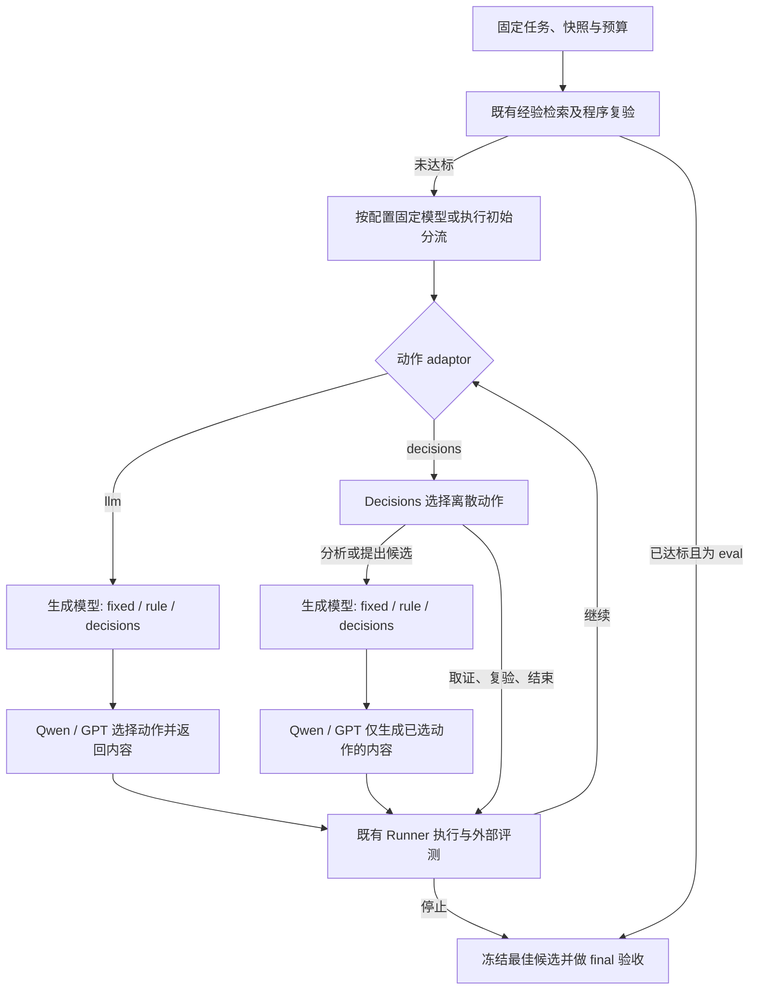

# 路由 adaptor 与四组消融

路由适配器最初基于 `f8fbb3e`，将两个决策点分开：**下一步做什么**和**由哪个生成模型处理**。
当前集成保留默认 `action=llm, model=rule`，并与初始经验分流、在线任务流及 native 研究协议共存。
legacy 运行，以及显式启用 adaptive 的 native feedback 研究，可以将两个开关独立替换为 OpenAI Decisions（`gpt-6-luna`），
其输出为离散选择和概率；代码与分析仍由 Qwen/GPT 生成。下方联调数据保留原执行版本与结果。

## 执行流程



- `ActionRouter`：`LLMActionRouter` 使用原有 JSON action 协议；`DecisionsActionRouter` 在
  `analyze`、`propose_candidate`、`profile_candidate:<cid>`、`run_validation:<cid>`、`finish` 中选择。
  只向它提供已有且通过静态检查的候选；预算不足时移除生成选项。取证、复验、结束可直接执行。
- `ModelRouter`：`RuleModelRouter` 仍以连续 2 个未达标候选或 3 次小模型请求触发升级；
  `DecisionsModelRouter` 在每个待生成请求前选择 small/large，升级后保持 large。
  两者只替换选择依据，沿用基线的单向升级约束。
- 决策输入为当时的 agent 可见状态、预算和模型配置。隐藏 final 数据及事后评测结果不进入路由请求。
  两个 Decisions adaptor 共用 `llm/openai_decisions.py` 的严格响应校验；凭证仅从环境读取。
- Runner 保有候选静态检查、沙箱、实测判定、停止与资源记账。生成模型返回与已选动作不同的 action
  会记为 `invalid_action/route_mismatch`；外部调用错误沿用既有错误记录与停止规则。

实现入口：`backend/src/routeevo/agent/routing.py`；接入点：`agent/runner.py` 的 `_iterate`、
`_select_model` 和 `_invoke`。没有更改任务、经验或 evaluator 接口。

## 四组配置

| 组 | `--action-router` | `--model-router` | 变化 |
| --- | --- | --- | --- |
| baseline | llm | rule | 原有 LLM 动作选择与固定升级规则 |
| action_decisions | decisions | rule | 仅替换动作选择 |
| model_decisions | llm | decisions | 仅替换模型升级决策 |
| both_decisions | decisions | decisions | 同时替换两层 |

在 `backend/` 运行单组：

```sh
uv run routeevo run B-01 --snapshot v0 --action-router decisions --model-router rule
```

运行四组、每组重复 3 次：

```sh
uv run routeevo ablate-routing B-01 B-02 --snapshot v0 --repeats 3 \
  --max-requests 6 --max-candidates 4 --wall-clock 300 --request-timeout 120
```

任务需先通过 `routeevo tasks build` 注册。四组统一关闭初始经验分流，从 small 开始；比较固定任务、经验快照、生成模型、总预算、沙箱及评测器，
仅改变 routing；按任务和重复轮次轮换组别顺序，串行执行。运行均为 eval，不发布经验；拒绝使用包含
这些任务经验的快照。`v0` 为空快照，适合观察路由本身；非空快照可能在复用阶段直接完成，报告保留这类零调用运行。

新汇总写入 `var/comparisons/research-routing-<id>.json`，每次运行仍有完整 `var/runs/<id>/report.json`。
汇总的 `fair` 按同一任务检查实际配置仅有两个 routing 开关不同、完整环境与 manifest 不漂移、快照一致，
并核对冻结计划和四组矩阵。未全部记录时为 null；final 完整性由独立字段报告。
这是配置可比性检查；样本量及计时波动仍需根据实际结果判断。环境、内部或模型 API 错误会停止批次并记录失败。

`run`、`learn` 命令均接受两个开关；HTTP 单次运行也可选择：

```json
{
  "task_id": "B-01",
  "mode": "eval",
  "snapshot_id": "v0",
  "action_router": "decisions",
  "model_router": "decisions"
}
```

请求发往既有 `POST /api/runs`，省略两个字段即为 baseline。界面的现有启动方式仍使用默认值。

## 预算与报告含义

每次 Decisions 或生成请求都计入同一个 `max_model_requests`、已报告 token 和 wall-clock 预算。
一次“Decisions 选动作 → Decisions 选模型 → Qwen/GPT 生成”最多消耗 3 次请求。
模型选择前至少预留路由和生成的 2 次配额；生成前重新检查停止标记、token 和时间预算。
因此固定总请求预算下，Decisions 组可能有更少生成机会，这是本消融测量的实际开销。

报告新增 `iterations.routing_requests`、`generation_requests` 和 `usage.by_purpose.routing/generation`。
路由步骤保留选择、完整概率分布和 call id；原始请求/响应仍保存在 `calls/`。
配置指纹含两个开关、路由实现版本、问题文本 hash；复现命令同时保留初始分流、两层路由、研究模式、
固定模型、dev-only、CPU affinity、预热次数和预算配置。

OpenAI Decisions 使用既有实验中的官方端点与计价表，估算费用与生成费用分开。
AIPing Qwen 暂无本仓库计价表，费用标记为 unknown；与已知 OpenAI 费用汇总时标记 partial。
因此 `cost_usd_total` 在 partial 状态下仅是已知部分，不能解读为总成本。

## 当前集成约定

初始经验分流 `_route()` 与运行中的 `ActionRouter`、`ModelRouter` 是独立配置。
默认 legacy 运行先按经验覆盖度选择起始模型，后续再由动作路由与模型升级规则推进。
`--no-router` 关闭初始分流；选择 `--model-router decisions` 时也关闭初始分流，避免预先切到 large
导致 Decisions 被单向升级规则短路。四组消融均关闭初始分流，使该配置在四组之间一致。

`--fixed-model small|large` 优先固定生成角色，同时关闭初始经验分流，跳过模型路由请求与升级。
研究默认 `research_model_policy=fixed`，只接受默认 `llm + rule`。
`research_mode=feedback` 显式配合 `research_model_policy=adaptive` 时允许 native 四组路由，固定 eval/v0、
`fixed_model=None` 和初始分流关闭；native 菜单按真实能力去掉 cProfile，并传入 score/speedup 目标。
independent/no_feedback 不接受 adaptive。independent 模式只见 c0，
没有前次分析、候选或评测反馈，只允许提出独立候选或结束。

初始分流的 `route_model` 步骤由 `program` 记录，Decisions 的模型选择由 `model` 记录。
报告的 `route` 只取初始程序分流，逐步 `model_role` 与用途账本保留实际调用角色。
benchmark adapter 沿用各自任务、评测器、raw-score 或 speedup 目标；研究截止时间与候选资格判定保持有效。
协调入口：[RouteEvo issue #1](https://github.com/bohack-2026-hw/RouteEvo/issues/1)。

历史回放的负面结果见 [decision-model/README.md](../decision-model/README.md)。
本 adaptor 提供受控对照入口；是否提高成功率、节省成本，要由四组实测判定。
新增 24 轮研究的冻结模板、实际规则计数语义和交接约定见
[native routing study](../research/native-routing/README.md)。下方是旧 legacy 联调，不能用作 native routing 的 baseline。

## 2026-11-14 联调结果

执行代码为 `813db15`，任务为 [routing-smoke-spec.json](../decision-model/routing-smoke-spec.json) 中固定的
30 万行、5000 keys、skew=0.8 的 groupagg；dev/final 种子分别为 1114/1115。
四组各运行一次，统一使用 v0、6 次请求、4 个候选、300 秒循环、120 秒请求超时、5 轮交替计时。
生成模型配置为 AIPing `Qwen3.8-27B`（thinking=false）与 `gpt-6.1-sol`（xhigh）；
实际生成调用全部由 Qwen 完成，未触发 GPT 升级。模型选择的两次成功判断均选择 small。

| 组 | Qwen 请求 | Decisions 请求 | 总耗时 | final 中位加速比 | final 达标 |
| --- | ---: | ---: | ---: | ---: | --- |
| baseline | 1 | 0 | 20.494 s | 1.3044× | 是 |
| action_decisions | 2 | 3 | 34.937 s | 1.2631× | 否 |
| model_decisions | 1 | 2 | 20.881 s | 1.1443× | 是 |
| both_decisions | 1 | 2 | 23.618 s | 1.2969× | 是 |

四组最终产物均正确，`fair=true`，除 routing 外共享配置 hash 为 `ac9717d00b1da0f8`。
action_decisions 首个候选开发检查为 wrong_output，第二个候选开发验证达标；final 中候选最慢
178.315 ms 略慢于基线最快 178.102 ms，未满足原有的全样本分离门槛，保留未达标结果。

7 次 Decisions 请求中，5 次成功、2 次 ConnectError；失败已计入预算，后续请求在预算内恢复。
成功调用已知费用估算合计 **$0.0013514**。两次网络错误和五次 Qwen 调用的费用未知，
本轮没有查询 AIPing 余额，不能把这个金额当作总费用。
单任务、单次运行及两次网络错误不足以区分策略优劣；本轮确认两个替换点及四组实验入口都能运行，
保留 baseline 为默认策略。

逐调用 usage、路由概率、候选哈希、开发结果和 final 原始计时见
[routing-smoke-results.json](../decision-model/routing-smoke-results.json)。本地完整报告与模型请求响应保存在
`backend/var/runs/<run_id>/`；批次汇总为
`backend/var/routing-ablations/routing-20261114T032721-aad0.json`。

复现本轮配置：

```sh
cd backend
uv run routeevo tasks build --spec ../docs/decision-model/routing-smoke-spec.json
uv run routeevo ablate-routing routing-smoke-01 --snapshot v0 --repeats 1 \
  --max-requests 6 --max-candidates 4 --wall-clock 300 --request-timeout 120
```

验证记录：

- `python -m pytest -q`：60 passed，包含原有 Docker 回归；有一条 FastAPI TestClient 的依赖弃用提示。
- Python 编译、Git diff 检查、前端 TypeScript/Vite 构建及 oxlint 通过。
- 前端构建使用原工作区已安装依赖，其 `pnpm-lock.yaml` 与本分支字节一致；新安装受到本机
  minimumReleaseAge 策略阻止，未改动依赖锁或该策略。
- 已通过 issue #1 与本地 EffiBench agent 交接独占 Docker/Qwen 调用窗口，本轮完成后已释放。
