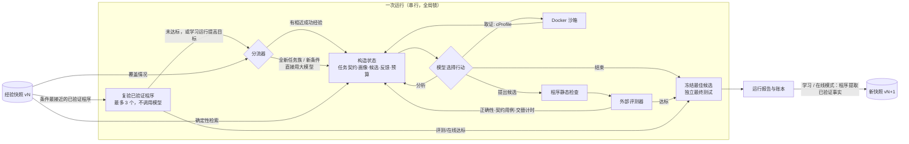

# RouteEvo 项目说明

RouteEvo 是一个自动改进程序的 **Research Agent 系统**，参加倍漾量化 Research Agent 赛道。给它初始程序、数据、目标和预算，它会分析问题、写出改进方案、运行测试，再根据结果继续修改。最后提供最佳程序、测试结果和运行记录。

评估看两件事：程序是否正确、性能提高多少，以及为此花了多少时间、Token 和费用。系统还会保存验证过的程序和适用条件，供之后的任务重用。

**主要结果**：在 12 个任务、3 次重放的 S 任务流中，使用经验后，大模型请求从 27 次降到 6 次，费用从 $0.402 降到 $0.086；两侧均有 36/36 次达标，最终加速比中位数均为 1.86×。各版实验和失败情况见第 5 节。

| 研究环节 | 在 RouteEvo 中 |
| --- | --- |
| 规划 | 研究问题、基线、允许修改范围、工具、预算在运行开始前固定；模型可用“分析”写下计划 |
| 收集证据 | 数据概况；“取证”在沙箱中对候选做 cProfile；每次评测返回状态、加速比、失败类别和公开反例 |
| 提出假设 | 每个候选提交前写下目的、假设、预期结果和验证方法 |
| 实验与验证 | 候选在隔离容器中由固定评测器检查正确性、规则检查用例，并与基线交替计时 |
| 修正 | 判定（支持 / 部分支持 / 反驳 / 未能检验）由程序给出并进入下一步状态；连续未达标按规则升级到云端大模型 |
| 分流 | 复用不达标时，由程序按经验覆盖情况决定从哪个模型开始：有相近成功经验 → 本地小模型；全新任务族或新条件 → 直接交给大模型 |
| 交付 | 冻结最佳候选，在隐藏数据上做一次独立最终测试；导出研究记录、最佳程序、全部候选、模型调用与复核脚本 |

## 1. 研究任务：带正确性约束的程序优化

| 项目 | 内容 |
| --- | --- |
| 任务族 | 3 个：**分组聚合**（按字符串 key 分组 CSV，输出每组数量与整数和）、**访问日志统计**（按小时 × 接口统计请求数、5xx 数、延迟和与最大值）、**区间合并**（合并重叠或相接的闭区间，取值跨 ±10¹²） |
| 初始程序 | 标准库实现：`csv` + dict + `sorted`；正则 + `datetime.strptime`；`csv` + 元组排序 |
| 主指标 | 加速比 = 初始程序耗时中位数 / 候选耗时中位数 |
| 达标 | 输出全对且通过该族全部公开规则用例；全部 5 次候选样本快于全部 5 次基线样本；加速比 ≥ 1.10 |
| 数据 | 43 个冻结任务包：分组聚合 smoke + A（学习）6 + B（开发对照）6 + C（第一版留出）6 + D（第二版封存留出）6；新任务族 smoke 2 + T（调优）4；S（第三版封存任务流）12，混合 3 个任务族。哈希锁定在 `backend/tasks/lock.json` |

分组聚合数据包含随机、有序、成簇、几乎有序、分组数多或少、小输入等情况；日志数据改变时间顺序、接口数和错误率，区间数据改变数值范围（含 ±10¹²）和重叠程度。相同改动在不同输入上的效果可能相反：例如将 key 保留为字节串，在分组数中等时有 1.4× 收益，分组数多时反而变慢。

## 2. 研究过程与系统结构



- **研究循环**：模型只能选 5 种行动——分析、取证、提出候选、运行验证、结束。程序先检查动作参数和允许范围再执行；候选提交后立即验证，结果作为下一步的输入。
- **先复验已知成果**（第二版）：首次模型请求之前，程序从经验快照里取出条件最接近的最多 3 个已验证程序，用同一评测器在本任务上复验。每个复验都是一个实验：程序依据经验记录写明来源、原实测结果和条件差异作为执行前的假设，判定同样由评测给出。评测运行中复验已达标就直接交付，不调用模型；没有达标时，复验结果作为证据交给模型。学习运行中复验已达标时，本次目标提高到超过已知最佳 5%，模型的请求只用于超越它。
- **假设与判定**：提出候选时必须填写目的、预期结果、验证方法，并给出假设（标为未验证）。评测后由程序判定：改善且达标 = 支持，改善未达标 = 部分支持，正确但没有改善 = 反驳，候选出错 = 未能检验；模型不能自评。
- **分流器**（第三版，`router-v1`）：复验没有达标时，程序依据经验快照对本任务的覆盖情况决定从哪个模型开始。快照里有同族成功记录与本任务至少 3/5 项条件相同 → 先用本地小模型；没有这个任务族的任何记录（全新任务族），或有记录但没有相近的成功（新条件）→ 直接交给大模型，把全部请求预算给它。分流原因作为一个程序步骤写进账本。全新问题第一次付费用大模型做对，在线或学习模式把验证过的结果写入经验，下一个相似任务先复用。每种情况的处理见[边界条件](../archive/boundaries.md)。
- **三种模式**：评测（只读冻结快照）、在线（像评测一样交付，交付后发布新快照）、学习（在已知最佳之上继续超越，发布新快照）。留出批次只能评测。
- **两条模型路径**：本地 Qwen（`qwen3.8:27b-mlx`，Ollama，关闭思考以保证延迟可预测）先执行；连续两个候选没有“正确且达标”，或 Qwen 已请求 3 次仍没有达标候选时，按固定规则升级到 GPT-6.1 Sol（Responses API，`reasoning.effort = xhigh`），之后本次运行一直使用 GPT。后一个条件是第一版 B 对照后加入的（升级规则 v2，见[实验结果](../archive/results.md)第 3 节）。
- **预算**：每次运行最多 6 次模型请求、4 个候选、300 秒循环时间、单次请求 120 秒、单次测量 10 秒。预算由程序执行，预算耗尽后不再为总结额外调用模型。
- **评测器**（容器外，模型不可见、不可改）：每个样本一个全新容器——禁网、只读根文件系统、非 root、1 CPU / 1 GB、64 进程；只挂载候选文件，输入走 stdin，参考输出留在宿主机。先在开发数据上检查正确性，再跑该任务族的 7 个公开规则用例，然后基线与候选各预热一次、交替测量 5 轮。计时从容器内启动器就绪后开始，到宿主机收齐输出为止，容器启动单独统计。
- **最佳产物规则**：只有通过且“全部样本快于基线”的候选能替换最佳产物；失败或退化的候选保留记录但不覆盖。循环结束后最佳候选冻结，在隐藏的最终数据上测试一次，结果不回流。
- **调用记录**：每次模型调用记录提供方、实际模型、角色、推理强度、输入/缓存/输出/推理 token、延迟、请求 ID、价表版本和估算费用；服务方没返回用量就记“未知”，绝不写 0；被拒绝的请求记“未计费”。本地 Qwen 记“无 API 费用”，机器成本单列为未核算。

## 3. 经验与版本

- **谁写经验**：程序从开发评测记录中提取，保存输入条件、5 项分类特征、完整代码、改动、测试结果、用量和来源。成功、无改善和失败记录都保存；模型给出的原因解释标为“未验证假设”。旧程序在新输入上重测后也生成记录。
- **哪些程序会被复验**：只有成功记录（正确且全部样本快于基线）里的程序。按该程序成功记录与当前输入条件的最高匹配特征数、再按实测加速比排序，取前 3 个；去掉空行和行尾空格后相同的程序只算一个；若某程序有一条无收益或失败记录比它任何一条成功记录都更接近当前输入条件，就跳过它。规则写入配置（`reuse-v1`），参与配置指纹。
- **版本**：有合格记录时，一次性发布新快照 `vN+1`，并设为之后运行默认使用的版本。每个快照保存后保持不变；回退只改变后续运行的默认版本。学习运行期间禁止切换。
- **检索**：确定性规则，只看同一任务族的记录；每个任务族有 5 项分类特征（分组聚合：行数、key 数、每 key 行数、顺序、偏斜；访问日志：行数、分组数、每组行数、时间顺序、错误率；区间合并：行数、起点顺序、每段合并数、数值大小、符号），至少匹配 3 个；最多注入 3 条成功、2 条失败、1 条无收益，并附上与当前输入条件不同的特征和各类样本数。每次运行记录自己实际读到了哪些经验。

## 4. 对照评测方法

- A 批串行学习得到最终快照；B 批用于开发期对照；留出批在配置冻结后做一次最终验收。B 与留出批都只读冻结快照，不写经验库；系统拒绝把为快照贡献过经验的任务当作留出任务。
- 每个任务、每个快照各运行完整 Agent 3 次；同一任务的旧/新配置按任务和轮次交替先后，串行执行，不并发争抢测量资源。
- 所有运行必须共享同一配置指纹（模型、提示词、动作模式、预算、评测器、沙箱镜像、检索、复用与分流规则），否则对照标记为不公平。
- 报告全部运行，包括失败和无收益；学习阶段成本沿快照链单独列出。3 次重复观察固定快照下的运行波动。
- **三版配置**：第一版（只有文字经验）按 A 学习 → B 开发对照 → C 最终留出完成。C 的结果被用来诊断问题，因此不能再作为第二版的留出集：第二版动手实现之前，先新建并封存了 D 批 6 个任务（提交 `d542906`，哈希写入 `tasks/lock.json`），第二版从 v0 重新学习、在 B 上对照定型后，在 D 上只运行一次。第三版（分流器 + 在线记忆 + 新任务族）在任何运行之前封存 S 任务流和 T 调优任务（提交 `7f9cace`），在 T 上检查后冻结配置，S 只运行一次。
- **任务流对照（第三版）**：同一串 S 任务按固定顺序运行两侧——带记忆（在线模式，每个任务读上一个任务发布的快照）与不带记忆（每个任务都读起点快照）；两侧按任务交替先后、串行执行。每次重放都从起点快照重新学起，所以 3 次重放重复的是学习过程本身。每个任务都先评测、再写入经验。

## 5. 结果

完整数据见[实验结果](../archive/results.md)。

### 5.1 第三版：分流器 + 在线记忆 + 3 个任务族（当前配置）

S 任务流从 v19 出发（只有分组聚合的经验）：12 个任务按固定顺序出现，混合 3 个任务族，两个新任务族（访问日志统计、区间合并）在流中第一次出现时，经验里没有任何同族记录。带记忆一侧用在线模式，每个任务读取上一个任务发布的快照；不带记忆一侧每个任务都只读 v19。3 次重放每次都从 v19 重新学起，配置指纹一致。

| S 任务流（12 任务 × 3 次重放） | 不带记忆 | 带记忆 |
| --- | --- | --- |
| 达标 / 运行 | 36/36 | 36/36 |
| 最终加速比中位数 | 1.86× | 1.86× |
| 大模型（GPT）请求 | 27 | 6 |
| 没有调用任何模型的运行 | 9 | 30 |
| 模型费用（估算） | $0.402 | $0.086 |
| 单次研究循环时长中位数 / 总耗时 | 31 s / 1486 s | 14 s / 1064 s |
| 输出 Token | 27,693 | 6,172 |

新任务族首次出现时两侧条件相同：都没有该族经验，分流器都直接交给大模型（带记忆 6 次大模型请求，不带记忆 6 次）。其余任务才体现记忆：带记忆 30/30 次没有调用模型，不带记忆 9/30；大模型请求 21 → 0，费用 $0.320 → $0.000，循环时长中位数 31 s → 12 s。经验条数每次重放 59 → 77 / 59 → 77 / 59 → 77。

分流器对照（4 个新任务族的 T 任务，从 v19 出发，评测模式）：先用本地 Qwen 达标 12/12、最终加速比中位数 2.11×、循环时长中位数 49 s、费用 $0.047；直接用 GPT 达标 12/12、2.18×、33 s、$0.188，先用 Qwen 时还有 2 个候选失败、2 次升级。直接用 GPT 更快、第一个答案更好，代价是每个新任务多花约一美分；这个答案会成为之后同类任务复用的起点。

### 5.2 第二版：复用已验证程序（分组聚合）

学习：A 批两轮串行，从 v0 到 **v19**（59 条经验：成功 42、无收益 13、失败 4；可复验的不同程序 21 个）。每次学习运行先复验已有程序；已达标时把目标提高 5%，模型只做超越。

| A 批学习 | 达标 | 模型请求 | GPT 费用 | 耗时 | 各任务最终加速比 |
| --- | --- | --- | --- | --- | --- |
| 第 1 轮（从 v0） | 5/6 | 21 | $0.174 | 996 s | A-01 1.19× / A-02 1.41× / A-03 1.09× / A-04 1.40× / A-05 1.24× / A-06 1.77× |
| 第 2 轮（在第 1 轮成果上） | 6/6 | 23 | $0.281 | 1369 s | A-01 1.45× / A-02 2.03× / A-03 1.24× / A-04 1.58× / A-05 1.69× / A-06 1.96× |

| 留出对照（6 任务 × 3 次，v0 vs v19） | D 封存留出（最终验收） | B 开发对照 |
| --- | --- | --- |
| 达标 / 运行 | 15/18 → 18/18 | 16/18 → 18/18 |
| 最终加速比中位数 | 1.20× → 1.73× | 1.28× → 1.56× |
| 模型请求中位数 / 合计 | 2.5 → 0 / 52 → 0 | 2.5 → 0 / 47 → 14 |
| 没有调用任何模型的运行 | 0 → 18 | 0 → 15 |
| 升级到 GPT | 7 → 0 次 | 7 → 3 次 |
| GPT 费用（估算） | $0.376 → $0.000 | $0.249 → $0.262 |
| 单次研究循环时长中位数 / 总耗时 | 53 → 27 s / 1782 → 669 s | 63 → 25 s / 1419 → 1324 s |
| 输出 Token | 41,101 → 0 | 34,654 → 13,893 |
| 配置指纹 | 一致 | 一致 |

学习阶段（两轮 12 次学习运行）另计 $0.455 / 2365 s，不摊进任何一侧。

### 5.3 第一版：只有文字经验（历史配置）

学习：A 批 6 个任务串行，v0 → v6，13 条经验（成功 4、无收益 8、失败 1），学习成本 $0.149 / 875 s。

| 留出对照（6 任务 × 3 次，v0 vs v6） | B 开发对照（升级规则 v1） | C 最终留出（升级规则 v2） |
| --- | --- | --- |
| 达标 / 运行 | 16/18 → 16/18 | 16/18 → 16/18 |
| 模型请求中位数 | 3 → 1 | 3 → 1 |
| 升级到 GPT | 8 → 1 次 | 11 → 5 次 |
| GPT 费用（估算） | $0.327 → $0.108 | $0.372 → $0.292 |
| 单次研究循环时长中位数 | 77 → 47 s | 84 → 50 s |
| 最终加速比中位数 | 1.30× → 1.29× | 1.41× → 1.29× |

### 5.4 结论

1. **第三版：复用经验减少了模型调用**。S 任务流上，大模型请求 27 → 6，费用 $0.402 → $0.086，总耗时 1486 s → 1064 s；达标均为 36/36，最终加速比中位数均为 1.86×。
2. **第一版：经验让系统更省，但停在更低的加速比**。读到文字经验后，Qwen 第一次提交就更常达标，请求、升级、费用和时长都下降，达标率不变；但智能体达到 1.10× 就停，用过 GPT 的达标运行加速比中位数约 1.5×、只用 Qwen 的约 1.27×，C 的中位数因此从 1.41× 降到 1.29×。
3. **诊断**：经验里已有完整的好程序，Qwen 却要花一次请求重新写出（第一版 A-04 的 Qwen 候选与 A-01 的 GPT 程序去掉空白后逐字相同）；达标即停，GPT 找到的更快方案不会被再用。
4. **第二版在封存的 D 上同时变好**：达标 15/18 → 18/18，最终加速比中位数 1.20× → 1.73×，模型请求中位数 2.5 → 0，研究循环时长中位数 53 s → 27 s，GPT 费用 $0.376 → $0.000。18/18 次运行没有调用任何模型：程序复验经验中的已验证程序，达标后直接交付。B 开发对照方向一致。
5. **学习本身在变强**：学习运行不再满足于达标，而是以已知最佳为起点继续超越；A 批第 2 轮各任务的最终加速比都高于第 1 轮，第一版始终没有改进的分组数多的任务 A-05 也找到了有效方案，并在 D-05 上直接迁移。
6. **代价与反例**：第二版学习更贵（两轮 $0.455，第一版 $0.149），因为学习运行要用 GPT 去超越已知最佳。经验覆盖不到的输入规模和特点复验不达标，照常交给模型研究：B-05 上新经验一侧的 GPT 费用（$0.262）高于 v0（$0.141），因为复验过的程序都留在提示词里，GPT 单次请求的平均输入从 3.4k 增加到 11.4k token——这使 B 的总费用基本持平（$0.249 → $0.262）。
7. **严格判定照样否决“看起来达标”的结果**：开发数据上已达标、最终测试有样本不快于基线的运行记为未达标（第二版 B 2 次、D 1 次，第一版 B 1 次、C 2 次）。
8. **研究过程如实记录**：全部正式运行 262 次、536 个实验（复用 215、模型 321）：支持 371、部分支持 36、反驳 100、未能检验 29（结果第 4 节）。

## 6. 研究成果与复现

```sh
cd backend && uv sync && cp .env.example .env     # 填 OPENAI_API_KEY；Ollama 中运行 qwen3.8:27b-mlx
scripts/experiment.sh                             # 重建任务包 → A 学习两轮 → B、D 对照 → S 任务流 → 分流器对照
uv run routeevo serve                             # 界面：http://127.0.0.1:8000
```

单次研究运行：`uv run routeevo run B-01 --snapshot v0`；全新问题在线运行：`uv run routeevo run T-L1 --mode online --snapshot v19`；任务流：`uv run routeevo stream S-01 … --start v19`；导出完整研究成果：`uv run routeevo export-run <run_id> --bundle <目录>`（研究记录、最佳程序、全部候选、原始模型调用、`report.json`、`reproduce.sh`）；经验带来的变化：`uv run routeevo explain <comparison_id>`。

[研究成果样例](../research/)按规则从正式运行中选出：反馈驱动的修正链、站在已知最佳上继续研究、没有验证出改进、复验已验证程序直接达标、开发达标但最终测试未达标。A-01 样例的 `reproduce.sh` 在最终数据上复核得到 1.44×（记录值 1.4367×），第二版 D-01 样例复核得到 1.4473×（记录值 1.4481×），第三版 S-01 样例（全新任务族直接交给大模型）复核：正确，6.69×（记录值 6.35×）。RA-01—08 与 RA-AC-01—08 的逐条对照见 [Research Agent 验收对照](../requirements/research-agent-acceptance.md)。

## 7. 已知限制

- 3 个任务族，都是单文件、只用 Python 标准库、输入走 stdin 的程序；经验只在同族内复用，跨任务族不迁移。无法用程序验证的任务（开放式问答等）刻意不做：经验只存经过评测器验证的事实。完整的边界条件见[边界条件](../archive/boundaries.md)。
- 复用达标即交付，不再为单个任务追求最优；想在已知最佳之上继续提高，要用学习模式。条件分桶是人工定义的每族 5 个特征，阈值固定；分流阈值（至少 3/5 项条件相同）沿用检索阈值，没有单独调优。
- 复用的上限就是方案库：经验覆盖不到的输入规模和特点（第二版 B-05）复验不达标，照常交给模型研究。第二版时复验过的程序都留在提示词里，使 GPT 请求更长；第三版只保留复验结果最好的一个程序的代码，但没有在 B-05 上重新测量。
- 第二版学习比第一版贵（$0.455 对 $0.149），因为学习运行用 GPT 去超越已知最佳；按 D 上每次运行少花的费用约 22 次运行收回。
- 计时在一台 Mac（OrbStack 虚拟化）上进行，同机还有一个常驻的本地模型服务（约占 2 核）和 iCloud 文件同步；交替测量和“全部样本快于基线”规则降低了噪声影响，但小输入任务的固定开销仍占约一半。第三版任务流的第一次运行因 OpenAI 接口网络中断而中止重跑，记录保留（见实验结果 2.2 节）。
- Qwen 的自部署机器成本未核算；GPT 费用按 2026-11-13 官方价表估算，以服务方账单为准。
- 模型不支持固定随机种子，同一请求可能得到不同回复；这正是每个配置重复 3 次的原因。
