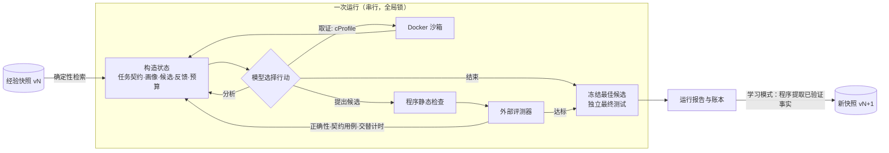

# RouteEvo 项目说明

RouteEvo 是一个**从已验证的执行结果中积累经验、并用经验改变后续决策**的任务执行系统。给它一个任务、可用工具、验收标准和资源预算，它自主选择行动、执行、由固定评测器验证、修正，最后交付最佳的已验证产物；学习模式下，程序把经过评测的执行事实整理成不可变的经验快照，后续任务读取这些经验。

学习发生在系统层：模型权重、系统提示词、评测规则全部固定，变化的只有经验快照。因此“用了新经验以后是否更好”可以用同一批未参与学习的任务直接对照。

## 1. 首个任务：带正确性约束的程序优化

| 项目 | 内容 |
| --- | --- |
| 任务族 | 按字符串 key 分组 CSV 记录，输出每组数量与整数和，按 key 升序 |
| 初始程序 | 直观的标准库实现（`csv` + 两个 dict + `sorted`），正确，没有人为削弱 |
| 主指标 | 加速比 = 初始程序耗时中位数 / 候选耗时中位数 |
| 达标 | 输出全对；全部 5 次候选样本快于全部 5 次基线样本；加速比 ≥ 1.10 |
| 数据 | 19 个冻结任务包：smoke + A（学习）6 + B（开发对照）6 + C（最终留出）6，哈希锁定在 `backend/tasks/lock.json` |

任务包覆盖随机、有序、成簇、几乎有序（陷阱）、低基数、高基数和小输入等工作负载。A 中观察到的优化不必在 B/C 处处成立：例如对有序输入流式分组很自然，但对“几乎有序”的输入就会出错；把 key 留成字节串在中等基数上有 1.4× 收益，在高基数上反而变慢。

## 2. 系统结构



- **执行循环**：模型只能选 5 种行动——分析、取证、提出候选、运行验证、结束。程序先检查动作参数和允许范围再执行；候选提交后立即验证，结果作为下一步的输入。
- **两条模型路径**：本地 Qwen（`qwen3.8:27b-mlx`，Ollama，关闭思考以保证延迟可预测）先执行；连续两个候选没有“正确且达标”，或 Qwen 已请求 3 次仍没有达标候选时，按固定规则升级到 GPT-6.1 Sol（Responses API，`reasoning.effort = xhigh`），之后本次运行一直使用 GPT。后一个条件是 B 对照后加入的（升级规则 v2，见第 5 节）。
- **预算**：每次运行最多 6 次模型请求、4 个候选、300 秒循环时间、单次请求 120 秒、单次测量 10 秒。预算由程序执行，预算耗尽后不再为总结额外调用模型。
- **评测器**（容器外，模型不可见、不可改）：每个样本一个全新容器——禁网、只读根文件系统、非 root、1 CPU / 1 GB、64 进程；只挂载候选文件，输入走 stdin，参考输出留在宿主机。先在开发数据上检查正确性，再跑 7 个公开契约用例，然后基线与候选各预热一次、交替测量 5 轮。计时从容器内启动器就绪后开始，到宿主机收齐输出为止，容器启动单独统计。
- **最佳产物规则**：只有通过且“全部样本快于基线”的候选能替换最佳产物；失败或退化的候选保留记录但不覆盖。循环结束后最佳候选冻结，在隐藏的最终数据上测试一次，结果不回流。
- **账本**：每次模型调用记录提供方、实际模型、角色、推理强度、输入/缓存/输出/推理 token、延迟、请求 ID、价表版本和估算费用；服务方没返回用量就记“未知”，绝不写 0；被拒绝的请求记“未计费”。本地 Qwen 记“无 API 费用”，机器成本单列为未核算。

## 3. 经验与版本

- **谁写经验**：程序，不额外调用模型。学习模式结束时，每个有有效开发评测的模型候选生成一条记录：工作负载条件（画像 + 5 个分桶特征）、改动（代码特征 + 相对初始程序的 diff）、实测结果（状态、加速比、是否改善、失败类别与反例）、资源、来源（运行、步骤、候选、评测 ID、配置指纹）。成功、无收益、失败三类都保留；模型的解释另存为“未验证假设”。
- **版本**：合格记录原子发布为新快照 `vN+1`（父版本 = 本次运行读取的快照），生效指针随之移动；没有合格记录就不制造空版本。快照不可变，回退只切换指针，学习运行进行中拒绝切换，历史全部保留。
- **检索**：确定性规则，5 个分桶特征（行数、key 数、每 key 行数、顺序、偏斜）至少匹配 3 个；最多注入 3 条成功、2 条失败、1 条无收益，并附上与当前工作负载不同的特征和各类样本数。每次运行记录自己实际读到了哪些经验。

## 4. 对照评测方法

- A 批串行学习得到最终快照；B 批用于开发期对照；C 批在配置冻结后做一次预登记的最终留出验收。B/C 都只读冻结快照，不写经验库；系统拒绝把为快照贡献过经验的任务当作留出任务。
- 每个任务、每个快照各运行完整 Agent 3 次；同一任务的旧/新配置按任务和轮次交替先后，串行执行，不并发争抢测量资源。
- 所有运行必须共享同一配置指纹（模型、提示词、动作模式、预算、评测器、沙箱镜像、检索规则），否则对照标记为不公平。
- 报告全部运行，包括失败和无收益；学习阶段成本沿快照链单独列出。3 次重复衡量的是固定快照下的运行波动，不代表学习过程本身被重复验证。

## 5. 结果

完整表格见 [实验结果](results.md)（由运行记录生成，不含手填数字）。学习阶段：A 批 6 个任务串行，v0 → v6，13 条经验（成功 4、无收益 8、失败 1），学习成本 $0.149 / 875 s。两个高基数任务（A-03、A-05）升级到 GPT 后仍没有改进，作为失败和无收益经验保留。

| 留出对照（6 任务 × 3 次，v0 vs v6） | B 开发对照（升级规则 v1） | C 最终留出（升级规则 v2，配置冻结后一次） |
| --- | --- | --- |
| 达标 / 运行 | 16/18 → 16/18 | 16/18 → 16/18 |
| 模型请求中位数 | 3 → 1 | 3 → 1 |
| 升级到 GPT | 8 → 1 次 | 11 → 5 次 |
| 失败候选 | 7 → 1 个 | 6 → 1 个 |
| 输出 Token | 45,385 → 28,947 | 45,728 → 30,532 |
| GPT 费用（估算） | $0.327 → $0.108 | $0.372 → $0.292 |
| 循环时长中位数 / 总耗时 | 77 → 47 s / 1802 → 1669 s | 84 → 50 s / 2000 → 1886 s |
| 最终加速比中位数 | 1.30× → 1.29× | 1.41× → 1.29× |
| 配置指纹 | 一致 | 一致 |

结论（同时适用于 B 和 C）：

1. **经验改变了行动，没有改变能否完成**。读到相关经验后，Qwen 第一次提交的候选更常直接达标：请求数、升级次数、失败候选、输出 Token、费用和时长都下降；达标率不变，原本做不到的任务（高基数、长 key）用了经验仍然做不到。
2. **少升级也意味着加速比更低**。智能体达到 1.10× 目标即停止。两批对照中，用过 GPT 的达标运行加速比中位数 1.49—1.53×，只用 Qwen 的 1.27—1.28×。v0 更常升级到 GPT，常常停在更快的程序上（C-01、C-02）；v6 用学到的做法一次达标就停。C 的加速比中位数因此从 1.41× 降到 1.29×。如果目标是加速比越大越好，需要修改终止条件，这是任务目标的选择，不是经验的作用。
3. **学习成本要算进去**。两批对照合计比 v0 少花 $0.299（B $0.219、C $0.080），学习花了 $0.149；单看 C，每次运行少花约 $0.004，大约 34 次运行才收回学习成本。提示词里加入经验后，输入 Token 反而增加（B 183K → 215K，C 152K → 232K）。
4. **反例与修正**。B-05（成簇、高基数）上 v6 只达标 1/3（v0 是 2/3）：两次未达标的运行里，Qwen 把 6 次请求大多花在分析、取证和无效回复上，只提交了 2 个候选，凑不满“连续两个未达标”，按 v1 规则始终没有升级。依据这个开发对照结论加入了“Qwen 请求 3 次仍没有达标候选就升级”（v2），C 在 v2 下预登记运行。C 中同类的高基数任务 C-05 两边都是 2/3。
5. **严格判定也会否决“看起来达标”的结果**。开发数据上已达标的运行，在隐藏最终测试中只要有一个样本不快于基线就记为未达标（B 1 次、C 2 次，两边都有）。

## 6. 复现

```sh
cd backend && uv sync && cp .env.example .env     # 填 OPENAI_API_KEY；Ollama 中运行 qwen3.8:27b-mlx
scripts/experiment.sh                             # 重建任务包 → A 学习 → B 对照 → C 对照
uv run routeevo serve                             # 界面：http://127.0.0.1:8000
```

单次运行：`uv run routeevo run B-01 --snapshot v0`；导出研究记录：`uv run routeevo export-run <run_id>`；三行进化说明：`uv run routeevo explain <comparison_id>`。

## 7. 已知限制

- 单一任务族，效果结论只适用于同族任务之间的迁移。
- 计时在一台 Mac（OrbStack 虚拟化）上进行；交替测量和“全部样本快于基线”规则降低了噪声影响，但小输入任务的固定开销仍占约一半。
- Qwen 的自部署机器成本未核算；GPT 费用按 2026-11-13 官方价表估算，以服务方账单为准。
- 模型不支持固定随机种子，同一请求可能得到不同回复；这正是每个配置重复 3 次的原因。
