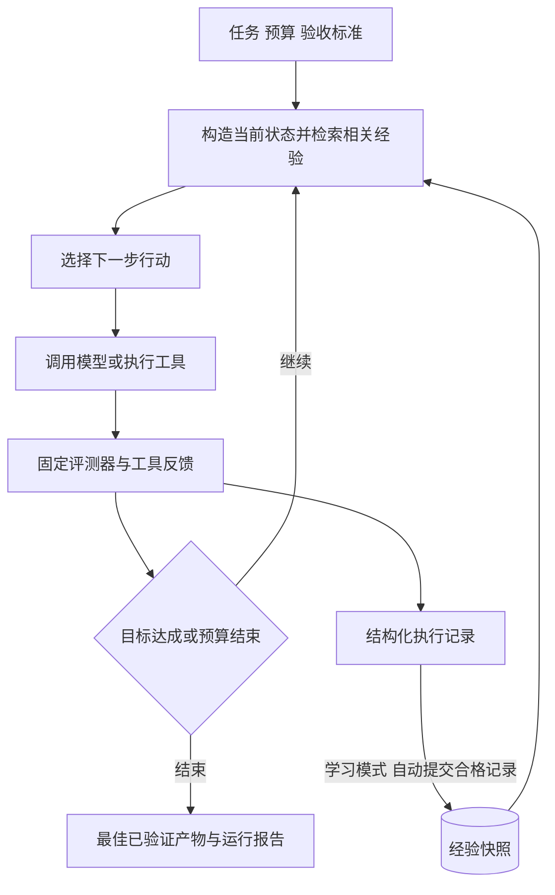

# 核心运行与经验管理需求

版本：v0.4；日期：2026-11-14；状态：Research Agent 主线的核心需求。

目标：为已选定的 Research Agent 赛道提供执行、验证、资源用量记录、经验积累和版本对照能力。

本文定义任务、运行、验证、用量、经验和版本的共用规则。研究动作与 RA 验收目标见[产品需求](product-requirements.md)，代码实现见[实现设计](../design/README.md)。

首版任务、模型、测量次数、A/B/C 划分、技术栈与开发分工按[开工决策](../archive/initial-implementation-decisions.md)执行。

## 1. 产品定位

给系统一个任务、可用工具、验收标准和资源预算，系统自主选择行动、执行任务、验证结果，将执行经验用于后续决策。

首版要回答两个问题：

1. 系统能否在预算内完成“决策—执行—验证—修正”，留下可追溯、可复现的结果？
2. 在相同条件下，加入经过验证的执行经验，能否改善后续任务的完成质量、成本或耗时？

学习发生在系统层：经验记录、相关经验的使用，以及由此改变的行动选择。首版固定模型、系统指令和评测规则，通过程序自动积累并注入经验。

## 2. 已确定的产品取舍

| 项目 | 首版决定 |
| --- | --- |
| 参赛方向 | 已选择倍漾量化 Research Agent 赛道，以研究过程和可复现成果为主线 |
| 具体任务 | 正确的 Python 分组聚合程序优化；必须保证结果正确，处理耗时为主指标 |
| 模型配置 | 自部署 Qwen 常规执行，GPT-6.1 Sol（xhigh）升级诊断与候选生成；一个循环管理两条路径 |
| 决策 API | 后续对照实验项，不作为首版依赖 |
| 本地模型与 GPU | 接入团队已有 Qwen 服务；候选工具与评测使用固定机器的 Docker 环境 |
| 多 Agent | 不作为首版要求，先完成单个执行循环 |
| 反馈来源 | 固定评测器的结果、工具执行结果、实际费用与耗时 |
| 学习内容 | 任务条件、执行动作、已验证结果、资源消耗、适用条件 |
| 文档与实现 | 本阶段交付 PRD；功能实现按本文验收条件推进 |

首版固定模型、提示词和选择模型的规则。

## 3. 核心能力与 Research Agent 的衔接

| 能力 | 核心提供 | Research Agent 主线要求 |
| --- | --- | --- |
| 任务执行 | 任务目标、运行额度、工具和验收标准 | 对分组聚合程序建立基线并开展性能研究 |
| 决策与修正 | 根据当前状态和反馈选择下一步 | 关联证据、执行前的假设、实验及反馈驱动的修正 |
| 经验积累 | 自动记录可检查的执行结果，形成版本 | 复用有效研究策略，保留失败方向与适用条件 |
| 评估 | 质量、费用、Token、耗时、失败记录 | 分别比较研究产物性能和 Agent 系统效率 |
| 可追溯性 | 计划、动作、反馈、产物、经验来源 | 交付可复现的实验记录、独立评价和可运行成果 |
| 回退 | 切换生效经验快照，保留历史记录 | 复现旧策略，比较经验版本的实际效果 |

运行额度按[开工决策](../archive/initial-implementation-decisions.md)设置，展示节奏根据实际研究耗时安排。

## 4. 使用流程

首版供团队开发、实验和现场展示使用。

1. 选择一个已登记的任务样例，查看目标、预算、工具和评测方式。
2. 指定运行模式与经验版本，开始任务。
3. 系统形成简短计划，逐步执行；每次行动显示目的、预期结果和实际反馈。
4. 候选结果由固定评测器验证。失败时系统选择修正、补充证据、更换方案或结束。
5. 任务结束后交付最佳已验证产物、运行报告和完整资源统计。
6. 学习模式下，合格的执行记录自动进入新经验版本；新任务可使用这些经验。
7. 对照模式下，用同一批留出任务分别运行旧经验版与新经验版，比较实际结果。
8. 需要回退时，切换生效经验版本；既有记录和产物继续保留。

## 5. 首版功能需求

### 5.1 任务与预算

每个任务具有稳定标识，并在开始前确定以下内容：

| 内容 | 要求 |
| --- | --- |
| 输入与初始产物 | 数据、说明、待处理程序或初始候选的固定版本 |
| 目标 | 主指标、优化方向、成功条件和允许的质量容差 |
| 工具 | 本任务允许调用的工具及其参数范围 |
| 评测器 | 固定版本的验证程序、参考结果和指标计算方式 |
| 预算 | 最大迭代次数、总运行时长、单次工具时限、Token 预算 |
| 执行配置 | 模型标识、提示词版本、工具版本、运行环境和随机种子（适用时） |
| 数据用途 | 学习任务或留出评测任务 |

运行开始后不修改验收标准。程序负责预算计算和执行约束，模型根据剩余预算选择允许的行动。

发起模型请求前检查剩余预算并限制输出长度；同时记录预估与服务方返回的实际用量。已经发出的请求可能在结束时产生额外消耗，超出预算必须如实显示，并停止新增请求。预算耗尽时使用已有记录生成报告，不再为了总结继续调用模型。

### 5.2 决策与执行循环

首版采用一个执行循环。模型可以选择的行动限定为：分析现有信息、获取工具证据、提出或修改候选方案、运行验证、结束并交付。

每一步记录：

- 当前问题、行动目的、预期结果及验证方式。
- 实际调用的工具或模型、关键参数、输入与输出的引用。
- 验证反馈、资源消耗，以及据此决定的下一步。

任务结束条件包括目标达成、预算耗尽、可用行动已经用尽、用户停止和不可恢复的执行错误。不同原因分别显示，不统一记为成功。

模型产生的动作先经过参数和允许范围检查，再由程序执行。工具和 API 出错时记录原因。

### 5.3 固定验证与产物管理

评测器输出至少包含：执行状态、正确性或约束检查、任务指标、失败详情和可复现记录。模型不能修改参考结果、评测程序或成功标准。

分别记录程序是否运行完成、验证是否通过、指标是否改善、是否达到目标；这些结果由评测程序判定。

每个候选产物独立保存。通过质量检查且符合预先确定的比较规则时，才替换当前最佳产物；失败或退化候选保留记录，但不覆盖最佳产物。

若样例涉及生成代码，代码须在受限执行环境中运行，任务输入和评测文件只读，限制运行时间和资源；模型服务凭据不进入候选代码的运行环境。

### 5.4 执行经验

原始执行日志与可复用经验分开保存。日志记录事实，经验是其中经过核验、适合用于后续任务的部分。

每条经验至少包含：

| 字段 | 内容 |
| --- | --- |
| 任务条件 | 任务类型、输入特点、目标、约束和可用工具 |
| 执行动作 | 采取了什么方案，由哪个模型或工具完成，使用什么配置 |
| 验证结果 | 哪些检查通过或失败，指标是否改善，证据记录在哪里 |
| 资源消耗 | Token、模型费用、耗时、重试与升级次数 |
| 使用条件 | 该记录可以支持什么判断，哪些条件与当前任务必须相符 |
| 来源 | 运行标识、步骤标识、模型与工具版本、评测器版本和时间 |

首版按任务类型、工具、约束和输入特征筛选少量相关经验。

注入决策上下文时，同时保留相关成功案例、失败案例和样本数量。未经验证的原因解释单独标记为假设，不能作为已证实结论使用。

未执行的模型或方案记为未知；比较模型时使用相同起点的任务。

首版固定 Qwen 与 GPT 两条路径，使用简单升级规则。经验主要改善实验选择、工具使用、失败修正和停止时机；升级次数由实际调用记录统计。首版不学习路由权重。

### 5.5 经验版本与回退

每次运行固定读取一个经验快照，并单独维护本次任务的实时观察记录。运行结束后，学习模式自动将有验证依据、字段完整的记录提交为新版本，用于后续任务。

每个版本保存来源运行、所含经验、创建时间及与上一版本的差异。运行记录保存实际读到的经验标识，便于查看某次决策参考了哪些证据。

回退只切换后续运行使用的经验快照，不删除历史记录，不修改正在执行的任务。重跑从相同初始任务产物开始，避免旧候选代码或输出被当成经验之外的隐藏收益。

首版的版本对象是经验快照。模型参数、系统提示词、检索方式和工具版本保持固定并写入运行配置；如需修改，作为独立配置版本记录，不能把收益全部归因于经验。

### 5.6 学习与对照评测

系统提供两种运行模式：

- **学习模式**：使用当前经验，允许在任务结束后自动提交新经验版本。
- **评测模式**：读取指定冻结快照；允许根据本次任务的工具反馈迭代，但不向持久经验库写入评测数据。

使用 A 批任务积累经验，B 批进行开发期冻结对照，C 批封存至最终验收。各批首版准备 6 个任务包，B/C 均包含同类任务的新实例和不应直接套用旧经验的情况。

对照运行使用同一批 B、相同初始产物、模型、系统指令、工具、预算、评测方式和并发设置。主要比较无经验或旧经验版与新经验版。禁用跨版本的应用输出缓存，外部模型缓存与实际费用单独记录。

若根据 B 的结果调整提示词、检索方法或策略，最终收益以 C 的冻结对照为准，C 沿用上述条件一致与禁止经验写入的规则。每个任务包内部另分开发数据与最终测试数据；最终测试不参与候选选择。

## 6. 数据与页面

### 6.1 最小数据对象

| 对象 | 保存内容 |
| --- | --- |
| Task | 输入、目标、预算、允许工具、评测器、初始产物与版本 |
| Run | 运行模式、配置、经验快照、状态、资源用量记录和最终产物 |
| Step | 行动目的、工具或模型调用、候选产物和反馈 |
| Evaluation | 正确性检查、指标、失败信息、环境和复现记录 |
| Experience | 可复用的执行事实及其证据来源 |
| MemorySnapshot | 不可变的经验集合、来源运行和版本差异 |
| Comparison | 对照任务、两个冻结配置、逐项结果和汇总指标 |

首版使用 Python 3.12、FastAPI 和 SQLite，工作目录保存产物；后端与前端在同一仓库。这些对象由同一个后端管理。

### 6.2 最小界面

| 页面 | 必须展示或支持 |
| --- | --- |
| 任务运行 | 任务目标、预算、经验版本、开始与停止、执行步骤、当前最佳结果 |
| 经验查看 | 新增经验、来源证据、适用条件、某次运行实际读取的经验 |
| 对照结果 | 同一任务两种配置的质量、Token、费用、耗时及失败详情 |
| 版本管理 | 版本差异、切换生效快照、回退结果 |

四类内容可在同一页面展示；主要流程也提供命令或脚本入口。

## 7. 指标与成本计算方法

| 指标 | 计算方式 |
| --- | --- |
| 任务成功率 | 达到预先定义目标的任务数 / 本次纳入评估的任务总数 |
| 任务质量 | 固定评测器输出的原始指标，保留方向与容差 |
| Token | 全部模型调用的实际输入、输出及服务方报告的相关用量 |
| 模型费用 | 所有执行、规划、修复、经验整理及决策调用的实际计费或按价格版本估算值 |
| 完成时间 | 从任务开始到终止的总时长，包含工具、验证和失败尝试 |
| 迭代情况 | 有效改进、无收益实验、失败实验、重复尝试与停止原因 |

API 未返回用量或价格未知时标记“未知”或“估算”，不能写成零。若后续引入决策模型，其费用与耗时计入总账。

分别展示积累经验、使用经验的成本，以及两者之和。

运行报告展示所有纳入评测的任务，包括失败与无收益任务。性能测量使用固定环境和一致方法；对时间敏感的样例采用重复测量的约定统计值，不依赖单次偶然结果。

## 8. 共用核心的验收样例

首个样例采用 Python 分组聚合程序：按字符串 key 分组，计算数量与整数求和，并按 key 升序输出。初始程序正确，Agent 在保持正确的前提下优化处理耗时；修复仅针对优化过程中产生的候选错误。

该任务族用于评价研究执行、反馈修正、经验与版本能力。首版围绕这一任务族实现工具、评测与研究报告。

样例要求：

- 有可运行的初始版本，以及独立于 Agent 的正确性验证。
- A/B/C 任务包独立，B/C 包含经验不适用的情况，每个包内部另有独立最终测试。
- 输入规模和运行预算足以支持多次实际执行。
- 初始版本使用正常实现，不通过人为削弱提示词或关闭常规能力制造改进。
- 存在可控的工具失败或验证失败场景，用于验证修正和保留最佳产物的机制。

任务目标、程序计时与完整 Agent 运行的重复次数，以及模型可见边界按[开工决策](../archive/initial-implementation-decisions.md)执行；固定错误候选只用于功能检查，不作为模型真实效果记录。

## 9. 验收条件

### 9.1 功能验收

| 编号 | 条件 |
| --- | --- |
| AC-01 | 从任务入口开始，无需人工修改代码、参数或提示词即可完成一次执行循环 |
| AC-02 | 验证失败后，系统能依据反馈修正、换方案或明确结束，保留真实失败原因 |
| AC-03 | 候选产物无法修改评测器和参考结果，运行完成与任务成功分别显示 |
| AC-04 | 每次模型和工具调用都有记录，资源统计覆盖失败、重试及总结等额外调用 |
| AC-05 | 学习模式自动生成有来源证据的新经验版本，后续任务实际读取该版本 |
| AC-06 | 评测模式冻结经验，能够对同一批留出任务生成旧版与新版的完整比较 |
| AC-07 | 回退切换经验快照且保留历史；重跑从指定初始产物开始 |
| AC-08 | 预算耗尽、工具超时、API 失败或用户停止时，保存已完成记录并准确显示状态 |
| AC-09 | 运行报告能定位实际产物、配置和复现入口；没有有效产物时明确标记 |

### 9.2 效果验收

功能完成后，再验证经验是否有效。目标是在预先约定的质量约束下，成本或耗时有所改善；或在相同资源预算下，任务结果更好。

用预先保留的测试任务比较成功率、加速比、费用和耗时，同时报告样本数量。

未见收益时保留结果，检查经验质量、检索和行动选择；任务清单与成功标准在对照前确定。

## 10. 实现顺序

| 阶段 | 交付物 | 进入下一阶段的条件 |
| --- | --- | --- |
| M1 执行与验证 | 一个任务族、Qwen/GPT 两条路径、工具调用、固定评测、运行账本 | 成功、验证失败、升级、预算停止流程可运行 |
| M2 经验与版本 | 结构化执行经验、自动快照、相关经验注入、回退 | 经验来源可查，前后两次运行实际使用不同快照 |
| M3 对照与展示 | 冻结评测、旧新版本对比、最小界面、复现入口 | 功能验收完成，并获得真实效果数据 |

核心按 M1—M3 推进，并按 [Research Agent PRD](product-requirements.md)的顺序接入研究功能：M1 同步记录证据与假设，优先完成反馈驱动实验、独立评价和成果复现，再完善 M2 经验与 M3 对照展示。按现有赛事说明，项目材料于 11 月 15 日 08:00 前提交，时区为 Asia/Shanghai。

## 11. 当前主线的效果验证重点

| 方面 | 应重点观察的证据 | 对应工作 |
| --- | --- | --- |
| 研究能力 | 实验反馈改变了下一步研究行动，产物可独立验证和复现 | 完成证据、假设、实验、修正与成果交付 |
| 经验效果 | 冻结经验在新任务上改变行为，并改善研究成果或效率 | 完成 A/B/C 对照、来源追溯和版本回退 |
| 资源效率 | 取得结果的全部请求、Token、模型费用与耗时可查 | 完整记录两条模型路径、升级原因和失败尝试 |

专用决策模型保持为后置对照项。若在相同任务与经验下减少总成本或耗时且满足质量要求，再纳入主流程。

## 12. 待验证事项与依据

赛道、模型、首个任务族、技术栈与固定 Docker 环境均已确定。金额暂不设硬上限，运行仍受次数与超时约束并完整记账。开发 agent 需按[开工决策](../archive/initial-implementation-decisions.md)接通 Qwen 的实际部署与两端凭据，验证真实延迟、样例优化空间与研究过程；是否引入决策 API 由后续独立对照决定。

依据：

- [BoHack 2026 赛道与赛题设置](https://tcnf5s7xd39g.feishu.cn/wiki/EpxXwbYkkieZrfk0QbRc7wWQnRc)：Research Agent 的研究过程和资源效率。
- [企业补充说明 comment1—comment4 原文](competition-brief.md)：本地轻量模型可忽略，可以仅使用一个 LLM，任务自由选择，需评估 Agent 系统自身的成本、效率与迭代能力。企业赛道的实现范围按这份补充理解。
- [TypeSafe 记忆示例](https://docs.typesafe.ai/cookbooks/basic_memory)：由外部程序保存经验并注入后续模型请求，作为实现参考。
