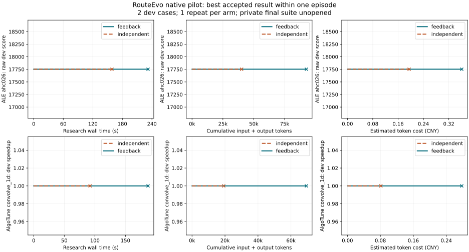

# ALE-Bench / AlgoTune 首轮真实开发预实验

日期：2026-11-14。实验代码：`f94a76c9c47d3569c4dd58b6d92294f843cc7733`；提示版本 `agent-prompt-v4`。
比较 ID：`research-20261114T043630-afdb`，4 轮研究 完成，同题配置/环境一致性检查通过。

本轮已跑通两个原生 benchmark 的真实模型研究循环，但没有观察到稳定优化收益。四次均保留初始方案 `c0`。不把中位数的短暂上升写成稳定加速，也不把这次单样本结果外推成反馈迭代普遍无效。

## 冻结配置

- 模型：AIPing 的 **Qwen3.8-27B**，固定 small 角色，无升级、无决策模型；跨任务经验为空快照 `v0`。
- 任务：ALE-Bench `ahc026`；AlgoTune `convolve_1d`，生成参数 `size=1000`。每题 2 个开发用例、3 个封存最终用例，全部模型实验使用 `dev-only`。
- 每轮研究 上限：900 秒、20 次请求、10 个候选，单请求超时 120 秒。实际四次均由模型主动结束，未跑满 15 分钟。
- 顺序：ALE feedback → independent；AlgoTune independent → feedback。两题各组各 1 次，不做跨题经验积累。
- 本机 Intel Core Ultra X7 358H；候选 1 CPU 配额、1 GiB 内存，科学计算库单线程。镜像 ID、依赖、来源版本、任务文件哈希见 [manifest.json](manifest.json)，硬件观察见 [hardware.json](hardware.json)。
- AlgoTune：独立容器中预热 1 次、函数计时 5 次，每个输出另行校验。两用例每轮累加，用中位数比值报告原始 speedup；只有 `max(candidate samples) < min(baseline samples)` 才允许替换初始方案。

## 实际结果

“通过候选”按提出的程序计数；“交付通过”是最后保留方案在 2 个开发用例上的通过数。最终私有集没有打开。

| 任务 | 组别 | 模型请求 | 通过候选 / 提出候选 | 交付通过 | 交付指标 | 研究耗时 | API 标价估算 |
| --- | --- | ---: | ---: | ---: | --- | ---: | ---: |
| ALE ahc026 | feedback | 17 | 2 / 2 | 2 / 2 | 原始分数 17,753；相对初始 +0 | 232.1 s | ¥0.3610 |
| ALE ahc026 | independent | 10 | 6 / 7 | 2 / 2 | 原始分数 17,753；相对初始 +0 | 158.9 s | ¥0.1948 |
| AlgoTune convolve_1d | independent | 11 | 9 / 9 | 2 / 2 | 初始程序，1.00× | 92.2 s | ¥0.0812 |
| AlgoTune convolve_1d | feedback | 19 | 3 / 3 | 2 / 2 | 初始程序，1.00× | 187.0 s | ¥0.2775 |

总计 **57 次请求、21 个候选、20 个通过、670.163 秒、约 ¥0.9145**。候选通过率 20/21；四个交付方案的开发通过率均为 100%。12 次回复缺少必填动作字段，已消耗请求且未形成候选；本批没有 API 调用错误。

AlgoTune 独立组最高原始中位加速比 **1.1673×**，反馈组最高 **1.1147×**（包含复验）。这些评测的计时区间均有重叠，未通过上述事前固定的噪声门槛，因此没有替换 `c0`。`1.00×` 是初始程序相对自身的定义值。

费用按实验前获取的 [AIPing 模型价目表](https://aiping.cn/api/v1/models)估算：输入 ¥3 / 百万 Token、输出 ¥12 / 百万 Token；价目表快照存于 manifest。估算不含折扣、账户赠金和本机成本，不能当作逐请求账单。准备阶段的下载、构建、参考方案预检以及仓库回归测试单列，不含在 670 秒研究耗时中。

## 过程与发现



曲线使用裁判接受的最佳方案，故本轮保持基线。所有候选的原始测量仍在各报告中，未因未被选中而删去。

1. **反馈组的实际提交的候选少。** ALE 的 17 次请求只形成 2 个候选；AlgoTune 的 19 次请求形成 3 个候选。另有分析步骤及字段缺失回复。四次都由模型提前结束。
2. **反馈确实进入后续决策，但没有转化为超越基线。** AlgoTune feedback 的 c1 使用 `fftconvolve`，c2 换成 `np.convolve` 后降到约 0.0343×，c3 再使用 NumPy FFT，约 0.7970×；后续分析明确引用这些结果并复验 c1。
3. **原生提示遗漏了严格筛选规则。** 模型多次询问为何中位 speedup > 1.10 却 `improved=false`。提示中缺少这条规则。实验结束后已补齐全样本区间判定，并加入包含所有必填字段的 JSON 示例，提示版本升为 v5。本目录保留 v4 的完整失败结果，未把修补后的配置混入本批，也未重跑完整对照。
4. **性能尺度偏小。** 这里两用例的基线函数耗时合计约 1.8–2 ms，较小的改善容易被噪声覆盖。后续正式批次应在封存配置前校准尺寸和测量稳定性；本批不据此改用宽松门槛重算成绩。

每项选一个问题、每组运行一次，使用两个开发用例。导入、裁判、输入隔离、候选选择和用量记录均已跑通；最终测试与 KernelBench GPU 实验待做。

## 证据与复现

- [汇总数据](summary.json)、[成对比较及过程记录](comparison.json)、[SVG 曲线](progress.svg)、[PNG 曲线](progress.png)。
- [ALE feedback](run-20261114T043630-000c/research.md)、[ALE independent](run-20261114T044022-922b/research.md)。
- [AlgoTune independent](run-20261114T044301-e2a7/research.md)、[AlgoTune feedback](run-20261114T044433-9802/research.md)。各目录包含完整 report、所有候选程序与适用许可证；原始 API 请求/响应保留在本机忽略的 `backend/var/runs/`。
- [实验脚本](run_pilot.py)在首次调用前写入冻结 manifest；[作图脚本](plot_progress.py)只读取结果，不调用模型或裁判。

复现本批需使用 `f94a76c` 和记录的镜像/模型配置。按[接入文档](../../design/research-benchmarks.md)重建两个任务包后，在 `backend/` 执行：

```bash
uv run python ../docs/research/native-20261114/run_pilot.py ALE_TASK_ID ALGOTUNE_TASK_ID \
  --pricing /path/to/qwen-price.json --out var/new-native-pilot
```

任务 ID 取导入输出；重建镜像得到不同 ID 时会产生新任务包，不能声称是同一冻结环境。新代码默认使用 v5 提示，需作为新的实验批次报告。

接入验证：后端完整 51 项测试通过；提示补充后运行相关 14 项检查通过；前端 TypeScript、Vite build、oxlint 通过。`ahc024`、`ahc026`、`pagerank`、`convolve_1d` 的参考方案均通过真实 CPU 容器校验，ALE 非法输出也被拒绝。未执行 KernelBench GPU 容器或模型实验。
