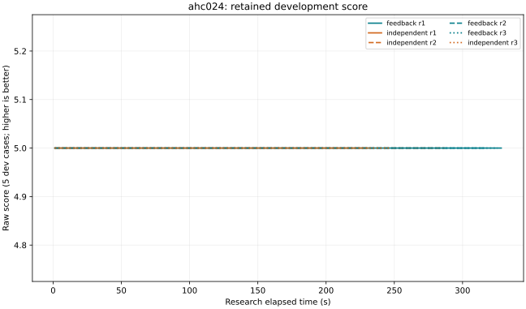
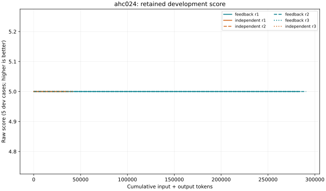
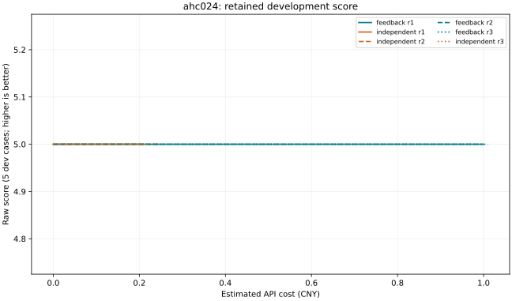
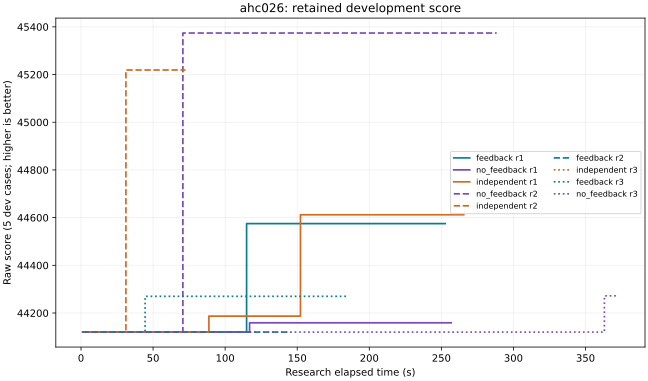
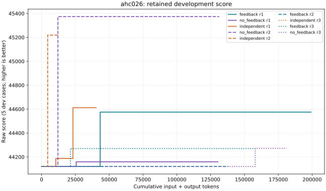
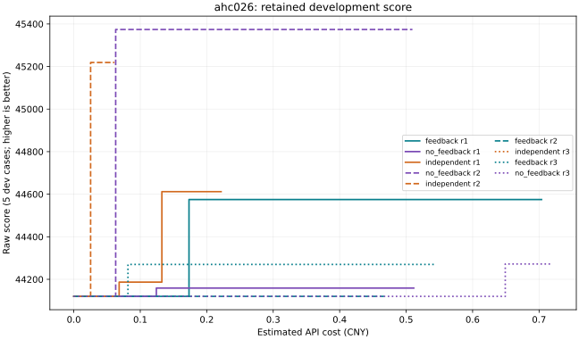

# ALE 正式评测结果

源码 `990f598b87f7c93bd27b6ceef5751bbc2d39dd79`；计划 `research-ale-formal-20261114-v2`；固定 Qwen3.8-27B、eval/v0。
每轮上限 900 秒 / 20 请求 / 10 候选；每题 5 dev / 15 final。final 在开发选优冻结后执行，不回流模型。

15 个计划位置全部保留；已启动 15，final 通过 15，未运行 0。审计 通过。
研究运行状态：{"completed": 14, "failed": 1}；研究终止状态与 final 验收分别记录。
批次墙钟 2621.263 秒；累计 episode 墙钟 3665.581 秒；请求 180 次；输入 Token —，输出 Token —；冻结标价估算：总额未知，已报告用量部分 CNY 7.445133。

累计模型等待 3441.755 秒，开发评测 148.662 秒，最终评测 71.862 秒。API 错误计数：{"http_4xx": 1}。

| 题目 | 模式 | final 通过/计划 | final 原始分数（各重复） | c0 基线差值（各重复） | c0交付 | 候选通过/提出 | CNY |
|---|---|---:|---|---|---:|---:|---:|
| ahc024 | feedback | 3/3 | 15, 15, 15 | 0, 0, 0 | 3 | 5/25 | 3.00102 |
| ahc024 | independent | 3/3 | 15, 15, 15 | 0, 0, 0 | 3 | 15/23 | 0.674463 |
| ahc026 | feedback | 3/3 | 133352, 131864, 132273 | 1488, 0, 409 | 1 | 14/20 | 1.715334 |
| ahc026 | independent | 3/3 | 133031, 135088, 131864 | 1167, 3224, 0 | 1 | 10/12 | — |
| ahc026 | no_feedback | 3/3 | 132015, 135718, 132428 | 151, 3854, 564 | 0 | 16/16 | 1.740987 |

| 序号 | 题目 / 重复 / 模式 | 状态 / final | best | final / c0 | 差值 | 请求 | episode秒 |
|---:|---|---|---|---|---:|---:|---:|
| 1 | ahc024 / r1 / feedback | completed / completed | [c0](run-20261114T073335-32c6/report.json) | 15 / 15 | 0 | 19 | 331.846 |
| 2 | ahc026 / r1 / feedback | completed / completed | [c3](run-20261114T073335-1a5c/report.json) | 133352 / 131864 | 1488 | 15 | 259.027 |
| 3 | ahc024 / r1 / independent | completed / completed | [c0](run-20261114T073907-af56/report.json) | 15 / 15 | 0 | 7 | 234.403 |
| 4 | ahc026 / r1 / no_feedback | completed / completed | [c2](run-20261114T073907-620a/report.json) | 132015 / 131864 | 151 | 12 | 263.346 |
| 5 | ahc024 / r2 / independent | completed / completed | [c0](run-20261114T074330-3c9d/report.json) | 15 / 15 | 0 | 9 | 290.18 |
| 6 | ahc026 / r1 / independent | completed / completed | [c5](run-20261114T074330-f525/report.json) | 133031 / 131864 | 1167 | 9 | 271.83 |
| 7 | ahc024 / r2 / feedback | completed / completed | [c0](run-20261114T074821-020e/report.json) | 15 / 15 | 0 | 20 | 320.537 |
| 8 | ahc026 / r2 / no_feedback | completed / completed | [c1](run-20261114T074821-6b87/report.json) | 135718 / 131864 | 3854 | 12 | 295.015 |
| 9 | ahc024 / r3 / feedback | completed / completed | [c0](run-20261114T075341-6da8/report.json) | 15 / 15 | 0 | 17 | 329.382 |
| 10 | ahc026 / r2 / independent | failed / completed | [c1](run-20261114T075341-62cf/report.json) | 135088 / 131864 | 3224 | 4 | 78.87 |
| 11 | ahc024 / r3 / independent | completed / completed | [c0](run-20261114T080312-9c97/report.json) | 15 / 15 | 0 | 10 | 249.808 |
| 12 | ahc026 / r2 / feedback | completed / completed | [c0](run-20261114T080312-370b/report.json) | 131864 / 131864 | 0 | 15 | 148.441 |
| 13 | ahc026 / r3 / independent | completed / completed | [c0](run-20261114T080722-9c52/report.json) | 131864 / 131864 | 0 | 2 | 22.947 |
| 14 | ahc026 / r3 / feedback | completed / completed | [c2](run-20261114T080746-c98c/report.json) | 132273 / 131864 | 409 | 15 | 191.018 |
| 15 | ahc026 / r3 / no_feedback | completed / completed | [c7](run-20261114T081057-be69/report.json) | 132428 / 131864 | 564 | 14 | 378.931 |

得分是各题原生裁判分数之和。final 失败或缺失时分数为 null，保留在计划分母；研究因接口错误终止但冻结候选通过 final 的，保留真实得分和 failed 运行状态。c0 为零时百分比为 null。三次重复报告差值及波动，不据此宣称统计显著。费用沿用冻结输入/输出费率，缓存按普通输入价估算；未知用量保持 null。

过程曲线使用开发集已保留候选的真实 progress；初始点来自 c0 开发评测，末点仅将最后保留值延续至研究结束。曲线不含 final 得分，不将批次并行节省的墙钟解释为算法加速。

第 10 个位置因 AIPing HTTP 400 终止，原始失败记录保留。续批仅执行此前未启动的 11–15，沿用原源码、参数和顺序。comparison.json 是两段原始比较文件的派生合并，原文件另存 source-comparison-*.json。
两段执行墙钟合计 2379.668 秒；中断间隔 241.594 秒，计入上述整体批次墙钟。













候选、原始请求/响应 JSON 逐字节复制，SHA256 见 SHA256SUMS 和各 run 的 audit.json。无反馈核验只比对生成的候选元数据、预算及模型历史来源；模型自身分析中的得分讨论不作为泄漏证据。总墙钟预算是协议允许的时间信号。

复现导出：

```sh
PYTHONPATH=backend/src python docs/research/native-formal-20261114/export_ale.py --root /path/to/snapshot --output /path/to/new-results
```

各轮原始执行命令保存在对应 report.json 的 reproduce 中；复现真实研究会产生新请求和新费用。
