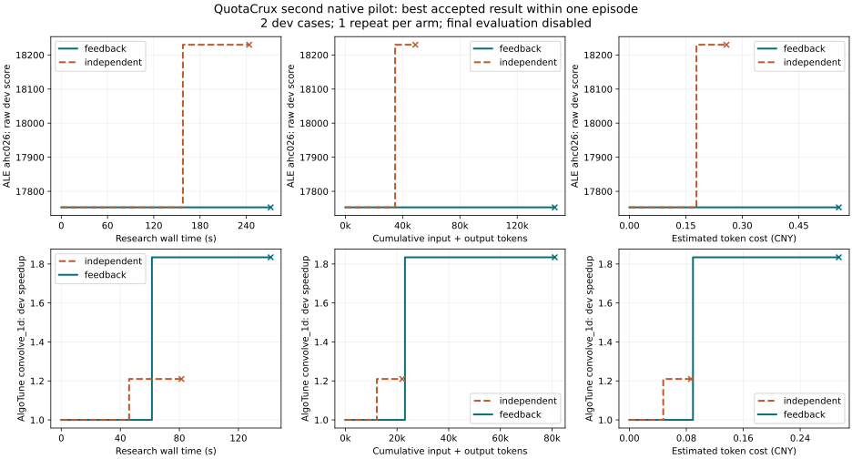

# ALE-Bench / AlgoTune 第二轮真实开发预实验

日期：2026-11-14。固定代码：`7408358977a5c83e890f4bb8f7af5f54041db6fa`；提示：`agent-prompt-v5`；比较 ID：`research-20261114T053410-bfde`。四轮研究 均完成，同题配置与环境一致性检查通过。

本轮测到了开发集上的稳定收益：AlgoTune feedback 保留 **1.8343×**，independent 保留 **1.2101×**；ALE independent 提高至 **18,230 分**，feedback 保持初始 **17,753 分**。反馈组在两个 benchmark 上没有一致胜出。每题每组仅一次，最终集未评测。

## 实际结果

| 任务 | 模式 | 请求 | 通过候选 / 提出候选 | 按代码结构去重 | 保留结果 | 开发用例通过 | 总耗时 | API 标价估算 |
| --- | --- | ---: | ---: | ---: | --- | ---: | ---: | ---: |
| ALE ahc026 | feedback | 13 | 4 / 4 | 4 | c0：17,753 分，+0 | 2 / 2 | 271.610 s | ¥0.556437 |
| ALE ahc026 | independent | 11 | 8 / 9 | 9 | c7：18,230 分，+477（2.69%） | 2 / 2 | 243.770 s | ¥0.257919 |
| AlgoTune convolve_1d | independent | 9 | 8 / 8 | 5 | c5：1.2101× | 2 / 2 | 81.400 s | ¥0.086445 |
| AlgoTune convolve_1d | feedback | 14 | 4 / 5 | 5 | c3：1.8343× | 2 / 2 | 141.833 s | ¥0.294297 |

总计 **47 次请求、26 个候选、24 个通过、738.613 秒、约 ¥1.1951**；候选开发通过率为 **92.3%**，四个保留方案全部通过两个开发用例。23 是各轮去除结构重复代码后的数量之和。AST 指代码的语法结构。AlgoTune independent 的 c1/c4/c5/c8 结构相同。

总耗时中模型等待约 **672.156 秒**，开发评测约 **65.960 秒**。容器启动约 **13.900 秒**已计入评测时间。输入 **264,714 Token**（其中缓存输入 114,688）、输出 **33,413 Token**。按调用前获取的 [AIPing 价目表](https://aiping.cn/api/v1/models)估算输入 ¥3 / 百万、输出 ¥12 / 百万，缓存输入也按普通输入单价计；此处是标价估算。实际账单及本机电力成本不在记录中。

## 单次研究过程中的变化

AlgoTune feedback 的真实轨迹是：c1 原始中位数 **1.1551×**，未通过区间门槛；c2 **0.8172×**；c3 使用按输出长度选择 FFT 长度的 NumPy 实数 FFT，达到并通过 **1.8343×**；之后继续试验，c4 未通过正确性，c5 为 **1.4329×**，最终保留 c3。达到 1.10× 目标后确实继续了任务内探索。

每个候选的 5 次计时是测量重复；学习过程由分析、提交不同程序和观察裁判反馈组成。所有用于选择的加速仍要求 `max(candidate samples) < min(baseline samples)`。本轮没有修改门槛，也没有把未达门槛的原始速度写成保留收益。

## 修复是否生效

[协议审计](protocol-audit.json)逐条核对了两轮原始请求与回复；原始 API 文件继续保留在本机忽略的 `backend/var/runs/` 中。

- **分析状态传递已修复。** 本轮 14 次有效分析的正文与假设，全部在实际下一请求中出现；第一轮为 0/19。原程序只保留目的摘要，导致中间推理无法累积。
- **候选产出改善。** feedback 从首轮 36 次请求 / 5 个候选，变为 27 次 / 9 个候选，候选/请求由 0.139 升至 0.333，约为原来的 2.4 倍；independent 从 16/21 升至 17/20。
- **格式错误减少，仍未归零。** 无效动作由 12/57 变为 3/47：两次 analyze 遗漏 `expected_result/verification`，一次 independent 请求 analyze 被协议拒绝。本轮没有显式 null 误用；仅计格式错误为 2/47。冻结后未临时改提示或补字段。
- **对照隔离保持有效。** independent 的 20 次原始请求全部只看到 c0；各 run 除 Budget 外的正文保持一致，没有其他候选、历史、分析或验证结果泄漏。四份报告的 final evaluation 均为 null。

与首轮相比，本轮同时改变了任务概况、提示、分析历史、CPU 绑定和预热次数。这些改动共同影响了结果。AlgoTune 本轮 feedback 的保留加速更高，同时耗时和费用也更高；下一阶段需多次重复与最终集验证才能比较效果的稳定性。

## 配置与证据

调用前已签名、推送的 [冻结协议](protocol.md)记录完整预算与校准依据。模型固定 **Qwen3.8-27B**，两题各 feedback/independent 一次，空快照 v0，dev-only；每轮上限 900 秒 / 20 请求 / 10 候选。CPU 2、3 次预热、5 次计时，全部串行。第一批 8 组与第二批 5 组无模型校准原始数据也已保留。

- [汇总数据](summary.json)、[比较账本](comparison.json)、[冻结 manifest](manifest.json)、[PNG 曲线](progress.png)。
- [ALE feedback](run-20261114T053410-981e/research.md)、[ALE independent](run-20261114T053842-37ca/research.md)。
- [AlgoTune independent](run-20261114T054245-d146/research.md)、[AlgoTune feedback](run-20261114T054407-1e3b/research.md)。
- 每个 run 保留完整 report 与所有候选，共 30 份候选文件，逐字节匹配原文件及报告中的 SHA256；两个 AlgoTune 目录附上游 MIT 许可证。
- [执行脚本](run_pilot.py)、[导出脚本](export_results.py)、[审计脚本](audit_results.py)、[作图脚本](plot_progress.py)。导出不包含原始请求、ALE 原题面或私有最终输入。

执行代码的后端完整 61 项回归通过；补充复现参数后相关 24 项检查通过。其后主分支集成的路由与多家族改动有独立的回归记录；本目录实测始终对应 `7408358`，没有混入合并后代码的新调用。
