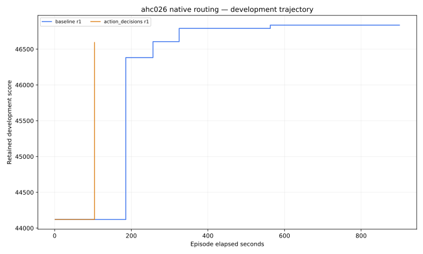
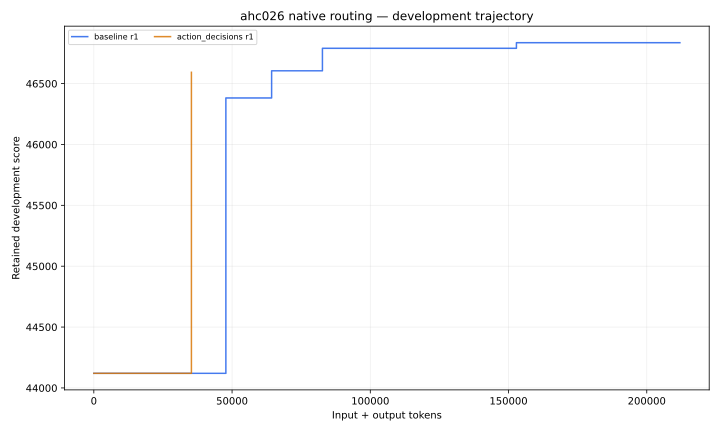
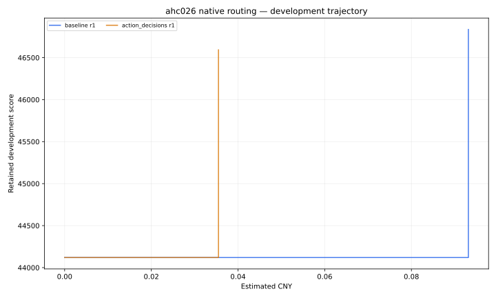
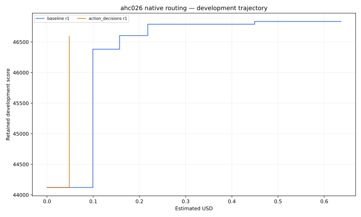

# Desktop ahc026 Decisions 路由结果

本长预算批次已按用户缩减范围指令停止；原始记录单独保留，不混入360秒短批比较。
执行源码 `912b20a4cfeb51af9c36d0679b23f0990abe862f`；计划 `routing-native-20261114-ale-v1`。
计划四组各3次，feedback/adaptive、eval/v0；每轮900秒、20个全部HTTP请求、10候选。5 dev / 15 final，dev选优冻结后执行final。探索性小样本，报告实际效应与成本。

运行状态 `{'completed': 1, 'stopped': 1, 'not_run': 10}`；审计 `passed=True`，fair=`None`。
导出 15 份候选、20 份调用JSON；失败和未跑项保留。

| 组 | final分数 | small / large请求 | 路由请求 | 升级轮数 | 候选通过/提出 |
|---|---|---:|---:|---:|---:|
| baseline | [139950, None, None] | 3 / 11 | 0 | 1 / 3 | 10 / 10 |
| action_decisions | [None, None, None] | 2 / 1 | 3 | 1 / 3 | 3 / 3 |
| model_decisions | [None, None, None] | 0 / 0 | 0 | 0 / 3 | 0 / 0 |
| both_decisions | [None, None, None] | 0 / 0 | 0 | 0 / 3 | 0 / 0 |

费用按币种分别记录；unknown/partial不补零。

```json
{
  "CNY": {
    "amount": 0.128631,
    "known_amount": 0.128631,
    "status": "estimated"
  },
  "USD": {
    "amount": null,
    "known_amount": 0.7716757,
    "status": "partial"
  }
}
```

逐轮状态、final、配对差异、交互项、动作频率与routing/generation用量见 [comparison.json](comparison.json)。
过程图使用dev保留分数，不含final；CNY与USD分别为各币种累计成本，不进行换汇相加。预算中路由请求会占用生成机会，未观察到升级的轮次原样保留。








