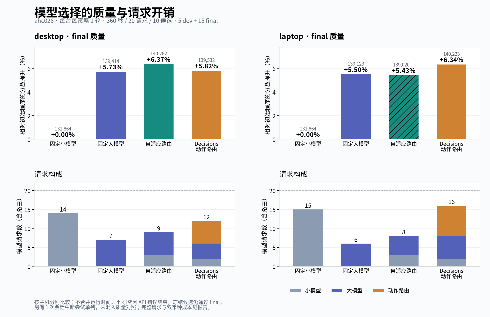
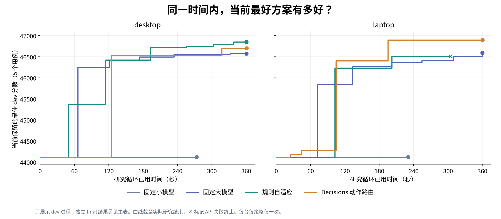

# 一小时双机模型策略补充实验（2026-11-14）

**本批补齐了固定小模型、固定大模型和混合策略的同机对照。** 两台固定小模型均交付 c0、提升 0%；有大模型参与的六格提升为 5.43%–6.37%。规则自适应与固定大模型的胜负并不一致，Decisions 动作路由对规则自适应也是一胜一负。当前证据支持保留这些质量与资源取舍，不支持将某个路由策略宣称为稳定全面领先。

首轮启动于北京时间 **23:10:33**，最后一格结束于 **23:46:13**，双机实验墙钟约 **35 分 40 秒**，包含 laptop 会话中断及续跑间隔。desktop 完整批次 24 分 15 秒；laptop 34 分 46 秒。准备与结果审计另计。

## 最终结果

共同 c0 final 得分为 **131864**。每台每策略一次，四格在各自机器内比较；括号为相对 c0 的原始得分提升，不是程序运行加速比。

| 策略 | desktop final | laptop final |
| --- | ---: | ---: |
| 固定小模型 | 131,864（+0.00%） | 131,864（+0.00%） |
| 固定大模型 | 139,414（+5.73%） | 139,123（+5.50%） |
| 规则自适应 | 140,262（+6.37%） | 139,020（+5.43%） † |
| Decisions 动作路由 | 139,532（+5.82%） | 140,223（+6.34%） |

† laptop 规则自适应因两次模型 API 超时结束，研究状态为 `failed/model_api_error`；冻结候选仍通过全部 15 个 final 用例。其余七格研究正常完成。**八份交付候选均通过 final**，其中两份就是初始程序。共提出 48 个模型候选，42 个通过 dev（87.5%）；不能将交付候选通过率写成模型候选全部正确。



## 可以据此讲什么

1. **强模型参与对本任务有效。** 在相同的 360 秒研究预算上限下，固定 Qwen 两格均无提升，固定 Sol 和两种混合策略六格均有提升。结论限定于本任务、模型配置和这两台机器的观察。
2. **混合策略保住了接近固定大模型的质量，但优势有波动。** desktop 规则自适应比固定大模型高 848 分（0.608%）；laptop 低 103 分（0.074%），且该格有 API 失败。两台大模型请求分别从固定大模型的 7、6 次变成规则自适应的 6、5 次，额外加入各 3 次小模型请求。
3. **支持动作层局部采用，全面切换默认策略的证据仍不足。** Decisions 相对规则自适应在 desktop 低 730 分、laptop 高 1203 分；两台都略高于固定大模型，但每格只有一次，laptop 的规则对照又受到 API 失败影响。它的低延迟与低路由开销已有直接证据，适合将有限动作选择交给 Decisions，保留现有大小模型切换规则与独立评测。这个工程价值应与最终得分是否稳定领先分别评价。
4. **费用节省尚不能给出完整数值。** 多个大模型请求超时缺失用量；本批保留双币种已知用量估算和请求构成，不用不完整小计证明实际费用下降。

本批全部采用 feedback，因此不回答 F/I/N 的因果问题；原固定 Qwen 反馈消融没有观察到 F 优于 I/N 的结论仍适用。本批重用了既有 5 dev / 15 final 包，也不作为全新任务或新留出集上的泛化确认。

## Decisions 局部接入的价值

本批的 `action_router=decisions, model_router=rule` 已是局部接入：Decisions 在当前允许的动作中选择下一步；选择分析或生成候选后，仍由 Qwen/Sol 生成内容；大小模型升级、预算硬约束和裁判验收保持原有实现。

| 主机 | 动作决策请求 | 平均耗时 | 累计耗时 | 占研究循环 | 路由 USD 估算 |
| --- | ---: | ---: | ---: | ---: | ---: |
| desktop | 6，全部成功 | 3.084 秒 | 18.504 秒 | 5.13% | 0.0051981 |
| laptop | 8，全部成功 | 1.259 秒 | 10.073 秒 | 2.80% | 0.0098287 |

合计 14 次，单次中位耗时 **1.341 秒**，均值 2.041 秒，范围 0.666–8.900 秒；路由累计费用按冻结价格估算 **USD 0.0150268**，这一部分用量完整。逐次数据见 [routing-latency.json](routing-latency.json)。

这些数据支撑“用较小时间与费用开销加入一个动作决策层”。当前两个动作路由运行也都取得了超过 5.8% 的 final 提升。不过本批 14 次选择全部是 `propose_candidate`，后续均需再调用生成模型，尚未覆盖补证据、复验、收尾之间的有效分流。生成候选路径会增加一次路由请求；两种动作路由的完整运行仍大体耗满研究预算。因此，本批尚不能把低决策延迟等同于整轮加速，也没有区分语义选择相对于固定“继续生成候选”策略的额外收益。

展示可表述为：**将有限动作选择交给低延迟 Decisions，将分析与代码生成交给 Qwen/Sol；程序执行预算约束和独立验证，各层的效果与开销分别记录。**

## 与此前时间—质量图的关系

此前四路由组合的[过程图](../native-routing/20261114/short-results/ahc026-elapsed_s.png)展示的是 dev 分数随研究时间变化。旧短批的双 Decisions 总耗时 112.9 秒、final 提升 0.513%；其他三组约 390 秒、提升约 6%。这是一次快结束但较低质量的观察，不等同于已标定出稳定可控的速度/质量档位。

本次没有重跑双 Decisions，因此没有重新验证那个快速结束点。新增的是固定大小模型参照，以及动作层 Decisions 的两台机器观察；仅动作接入仍大体耗满研究预算。1.34 秒的单次路由中位耗时是组件开销数据，不能将它当成整轮搜索的加速比。

将本批已有轨迹按旧图口径重画如下，不新增模型请求。若讨论速度，应比较同一 dev 质量达到的时间；若讨论搜索效果，应比较同一时间下的保留质量。desktop 的曲线有交叉，laptop 动作路由在中后段较好，但每台每策略一次且存在 API 失败，尚未证明一种接法能稳定改善整条时间—质量曲线。图中的 dev 进度也不能替代独立 final 的结果。



轨迹数据：[development-trajectories.json](development-trajectories.json)；生成脚本：[plot_trajectories.py](plot_trajectories.py)。新证据细化了策略取舍及基线，没有将原结论升级为“局部接入后稳定更快且更好”。

## 请求、候选和费用

请求列顺序为 **小模型 / 大模型 / 动作路由**，包含失败请求；时长顺序为 **研究循环 / 整轮**，单位秒。两台硬件不同，不合并运行时间比较。允许主动 finish，因此相同预算上限不表示实际花满 360 秒。

费用按当天短批冻结单价统一估算；“部分”只表示有用量记录的已知小计。缓存折扣、机器成本和缺失用量未补估，不能将该数值当供应商账单。CNY/USD 分列，不换汇相加。

| 主机与策略 | 请求 | dev 合法候选 | 循环 / 整轮秒 | CNY 估算 | USD 估算 |
| --- | ---: | ---: | ---: | ---: | ---: |
| desktop · 固定小模型 | 14 / 0 / 0 | 3/5 | 273.2 / 276.2 | 0.787047 | 0.000000 |
| desktop · 固定大模型 | 0 / 7 / 0 | 6/6 | 360.2 / 392.9 | 0.000000 | 0.251606（部分） |
| desktop · 规则自适应 | 3 / 6 / 0 | 6/6 | 360.3 / 393.0 | 0.091422 | 0.265076（部分） |
| desktop · Decisions 动作路由 | 2 / 4 / 6 | 4/4 | 360.8 / 393.1 | 0.057465 | 0.098922（部分） |
| laptop · 固定小模型 | 15 / 0 / 0 | 9/9 | 230.3 / 233.4 | 0.691455 | 0.000000 |
| laptop · 固定大模型 | 0 / 6 / 0 | 6/6 | 359.9 / 392.2 | 0.000000 | 0.251572 |
| laptop · 规则自适应 | 3 / 5 / 0 | 2/5 | 304.6 / 336.7 | 0.074976 | 0.155424（部分） |
| laptop · Decisions 动作路由 | 2 / 6 / 8 | 6/7 | 360.4 / 393.3 | 0.054234 | 0.302499（部分） |

八格共有 **87 次有账模型请求**。另一次会话中断尝试记录了 1 次 Qwen 调用（CNY 0.016581），还有 1 个 `model_started` 未形成完成/用量记录。

全批含中断开销：**88 次有账调用 + 1 次未闭合开始记录**；其中 7 次有账的大模型超时缺失用量。按冻结单价计算的已知小计为 **CNY 1.773180 + USD 1.3250988**，两个币种的完整总额均保持未知。

## 可展示的实际研究链与重复性

建议使用 desktop 规则自适应运行 `run-20261114T152142-4468` 说明候选如何逐步变化：

- c0 的 5-case dev 得分为 44120。
- Qwen 提出的 c1 得分 45374；三次小模型请求后按规则升级 Sol。
- c2→c6 沿父候选继续修改，dev 得分依次为 46426、46729、46749、46799、46855，六个生成候选全部通过 dev。
- 按 dev 冻结 c6，再执行 15-case final：140262，相对 c0 提升 6.37%。dev 与 final 用例数量不同，两个分数不直接相除。
- 账本记录每步候选来源、验证反馈、模型升级、一次超时和用量缺口；模型的假设仍是模型解释，裁判结果是独立证据。

c6 使用固定随机种子和按 `perf_counter()` 截止的 1.77 秒局部搜索，固定种子并不意味着得分恒定。保持代码、原任务、CPU4 和配置不变，额外重评一次 final 得到 **140212，15/15 合法**，比原结果低 50 分（0.03565%）。原主对照仍保留 140262，不选较高值；这次 36.70 秒的固定候选复验没有调用模型。原始结果见 [replay-check.json](replay-check.json)。

## 协议、失败与审计

执行源码固定为 `912b20a4cfeb51af9c36d0679b23f0990abe862f`，该版本包名仍是 `routeevo`。small 为托管 Qwen3.8-27B（thinking=false），large 为 gpt-6.1-sol（xhigh），Decisions 为 gpt-6-luna。各格空 v0、新 run、20 次全部模型请求/10 候选/360 秒；final 独立执行。详细冻结条件和两次执行修订见 [protocol.md](protocol.md)。

laptop 的原自适应尝试 `run-20261114T151800-c23e` 在无生成候选、无 final 的阶段随会话 SIGTERM 结束；原记录保留，替代尝试在开始前另行冻结。后续替代尝试的 API 失败没有重跑，只继续了未启动的两个固定模型基线。实际共有 **9 次研究尝试，对应 8 个计划格子和 1 次单列中断**。

核对结果见 [audit.json](audit.json)：八格 final 逐用例分数求和一致、15 个用例全部合法；报告请求数与 SQLite 行数相符；所有候选文件哈希与账本一致；请求数与候选数均未越界。研究循环记录的最大调度收尾超时为 0.801 秒。两个归档共 187 个文件的大小与 SHA256 校验通过，导出前对实际 API 密钥进行了内容排除检查，未包含凭据文件。没有遗留运行中的研究记录。

两台 judge 的 RootFS 与 Config 相同。candidate 镜像最后三层摘要不同，但 Python 3.12.16 和执行 harness 字节一致，已按主机分别登记，见 [images.json](images.json)。

## 文件与运行索引

- [summary.json](summary.json)：完整角色用量、成本状态、主机分层结果及中断记录。
- [summary.csv](summary.csv)、[interrupted_attempts.csv](interrupted_attempts.csv)：对照格子与中断尝试分表。
- [PNG 展示图](quality-requests.png)、[SVG 展示图](quality-requests.svg)。
- [desktop 完整证据包](evidence/desktop.tar.gz)、[laptop 完整证据包](evidence/laptop.tar.gz)：冻结配置、SQLite 快照、任务包、候选、原始调用和逐轮报告；归档摘要见 `audit.json`，包内 `checksums.json` 提供逐文件摘要。
- [run_batch.py](run_batch.py)、[continue_laptop.py](continue_laptop.py)、[finish_laptop.py](finish_laptop.py)：原始编排及两次有记录的续跑入口。
- [summarize.py](summarize.py)、[plot.py](plot.py)：从导出记录生成汇总和图，无模型调用。

| 主机 | 策略 | Run ID | 研究状态 |
| --- | --- | --- | --- |
| desktop | 固定小模型 | `run-20261114T151033-f2c4` | completed |
| desktop | 固定大模型 | `run-20261114T151509-a28c` | completed |
| desktop | 规则自适应 | `run-20261114T152142-4468` | completed |
| desktop | Decisions 动作路由 | `run-20261114T152815-44b8` | completed |
| laptop | 固定小模型 | `run-20261114T154219-2648` | completed |
| laptop | 固定大模型 | `run-20261114T153547-7844` | completed |
| laptop | 规则自适应 | `run-20261114T152545-a811` | failed |
| laptop | Decisions 动作路由 | `run-20261114T151127-bd8c` | completed |

从本目录重新汇总并绘图，无需调用模型（`summarize.py` 使用标准库；绘图需要 matplotlib 和 Noto Sans CJK 字体）：

```sh
work_dir=$(mktemp -d)
tar -xzf evidence/desktop.tar.gz -C "$work_dir"
tar -xzf evidence/laptop.tar.gz -C "$work_dir"
python summarize.py --batch "desktop=$work_dir/desktop-evidence/batch.json" --batch "laptop=$work_dir/laptop-evidence/batch.json" --out "$work_dir/output"
python plot.py "$work_dir/output/summary.json" --out "$work_dir/output"
python plot_trajectories.py "$work_dir/output/summary.json" --out "$work_dir/output"
```

归档和原汇总保留执行时路径；重新汇总优先读取解包目录中的报告，并生成当前路径供轨迹脚本使用。`run_batch.py` 及两个续跑脚本是当次执行记录，依赖冻结版本 `912b20a` 和原运行环境；离线复核使用上述汇总与绘图命令。
