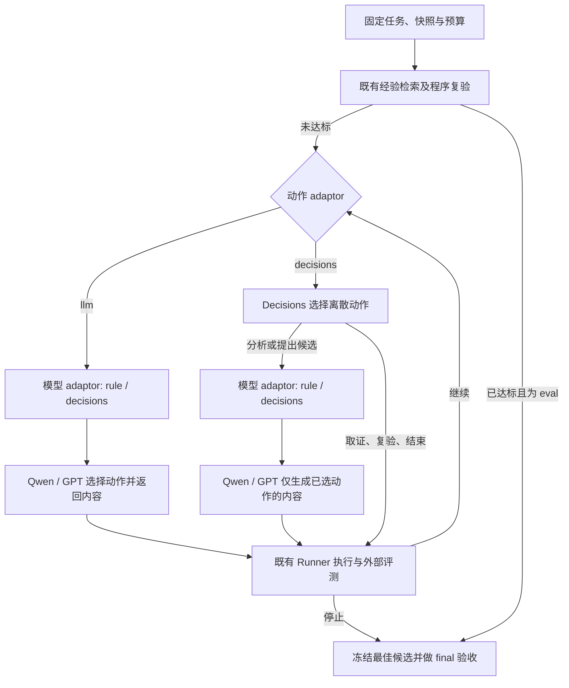

# 路由 adaptor 与四组消融

本实现基于 `f8fbb3e`，将两个现有决策点分开：**下一步做什么**和**由哪个生成模型处理**。
默认 `action=llm, model=rule` 保留该基线的行为。两个开关可以独立替换为 OpenAI Decisions
（`gpt-6-luna`），其输出为离散选择和概率；代码与分析仍由 Qwen/GPT 生成。

## 执行流程



- `ActionRouter`：`LLMActionRouter` 使用原有 JSON action 协议；`DecisionsActionRouter` 在
  `analyze`、`propose_candidate`、`profile_candidate:<cid>`、`run_validation:<cid>`、`finish` 中选择。
  只向它提供已有且通过静态检查的候选；预算不足时移除生成选项。取证、复验、结束可直接执行。
- `ModelRouter`：`RuleModelRouter` 仍以连续 2 个未达标候选或 3 次小模型请求触发升级；
  `DecisionsModelRouter` 在每个待生成请求前选择 small/large，升级后保持 large。
  两者只替换选择依据，沿用基线的单向升级约束。
- 决策输入为当时的 agent 可见状态、预算和模型配置。隐藏 final 数据及事后评测结果不进入路由请求。
  两个 Decisions adaptor 共用 `llm/openai_decisions.py` 的严格响应校验；凭证仅从环境读取。
- Runner 保有候选静态检查、沙箱、实测判定、停止与资源记账。生成模型返回与已选动作不同的 action
  会记为 `invalid_action/route_mismatch`；外部调用错误沿用既有错误记录与停止规则。

实现入口：`backend/src/routeevo/agent/routing.py`；接入点：`agent/runner.py` 的 `_iterate`、
`_select_model` 和 `_invoke`。没有更改任务、经验或 evaluator 接口。

## 四组配置

| 组 | `--action-router` | `--model-router` | 变化 |
| --- | --- | --- | --- |
| baseline | llm | rule | 原有 LLM 动作选择与固定升级规则 |
| action_decisions | decisions | rule | 仅替换动作选择 |
| model_decisions | llm | decisions | 仅替换模型升级决策 |
| both_decisions | decisions | decisions | 同时替换两层 |

在 `backend/` 运行单组：

```sh
uv run routeevo run B-01 --snapshot v0 --action-router decisions --model-router rule
```

运行四组、每组重复 3 次：

```sh
uv run routeevo ablate-routing B-01 B-02 --snapshot v0 --repeats 3 \
  --max-requests 6 --max-candidates 4 --wall-clock 300 --request-timeout 120
```

任务需先通过 `routeevo tasks build` 注册。比较固定任务、经验快照、生成模型、总预算、沙箱及评测器，
仅改变 routing；按任务和重复轮次轮换组别顺序，串行执行。运行均为 eval，不发布经验；拒绝使用包含
这些任务经验的快照。`v0` 为空快照，适合观察路由本身；非空快照可能在复用阶段直接完成，报告保留这类零调用运行。

汇总写入 `var/routing-ablations/<id>.json`，每次运行仍有完整 `var/runs/<id>/report.json`。
汇总的 `fair` 检查实际配置中只有 routing 不同、任务 manifest 不漂移、快照一致且所有计划运行已结束。
这是配置可比性检查；样本量及计时波动仍需根据实际结果判断。环境、内部或模型 API 错误会停止批次并记录失败。

`run`、`learn` 命令均接受两个开关；HTTP 单次运行也可选择：

```json
{
  "task_id": "B-01",
  "mode": "eval",
  "snapshot_id": "v0",
  "action_router": "decisions",
  "model_router": "decisions"
}
```

请求发往既有 `POST /api/runs`，省略两个字段即为 baseline。界面的现有启动方式仍使用默认值。

## 预算与报告含义

每次 Decisions 或生成请求都计入同一个 `max_model_requests`、已报告 token 和 wall-clock 预算。
一次“Decisions 选动作 → Decisions 选模型 → Qwen/GPT 生成”最多消耗 3 次请求。
模型选择前至少预留路由和生成的 2 次配额；生成前重新检查停止标记、token 和时间预算。
因此固定总请求预算下，Decisions 组可能有更少生成机会，这是本消融测量的实际开销。

报告新增 `iterations.routing_requests`、`generation_requests` 和 `usage.by_purpose.routing/generation`。
路由步骤保留选择、完整概率分布和 call id；原始请求/响应仍保存在 `calls/`。
配置指纹含两个开关、路由实现版本、问题文本 hash；复现命令含两个开关。

OpenAI Decisions 使用既有实验中的官方端点与计价表，估算费用与生成费用分开。
AIPing Qwen 暂无本仓库计价表，费用标记为 unknown；与已知 OpenAI 费用汇总时标记 partial。
因此 `cost_usd_total` 在 partial 状态下仅是已知部分，不能解读为总成本。

## 并行分支接入约定

远端 `feat/shared-core` 的 `1bf9d49` 新增了经验覆盖度决定首个模型的 `_route()`，
以及 online stream；这些改动不在本次固定基线内。集成时应将其首选模型逻辑纳入 `RuleModelRouter`，
避免在 Decisions 选择之前先把 `role` 固定成 large，否则单向升级会绕过 Decisions 模型路由。
同名 `route_model` 步骤在这里表示带概率的在线选择，集成报告应区分首选路由和后续升级。

EffiBench 分支的 benchmark adapter 可继续通过既有 task/evaluator 接口提供证据。
它对 runner 的任务验证文案及 `checker_error` 处理应在合并时保留。
协调入口：[RouteEvo issue #1](https://github.com/bohack-2026-hw/RouteEvo/issues/1)。

历史回放的负面结果见 [decision-model/README.md](decision-model/README.md)。
本 adaptor 提供受控对照入口；是否提高成功率、节省成本，要由四组实测判定。
